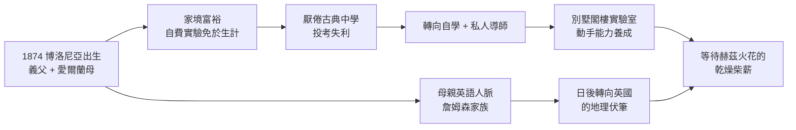

# 1.1 博洛尼亞的混血少年 (1874-1888)

1874 年 4 月 25 日，古列爾莫·馬可尼（Guglielmo Marconi）出生於義大利博洛尼亞附近的薩索別墅（Villa Griffone, Pontecchio）。他的父親朱塞佩·馬可尼（Giuseppe Marconi）是博洛尼亞富裕的地主與銀行家，第二任妻子正是古列爾莫的母親——愛爾蘭人安妮·詹姆森（Annie Jameson）。

安妮出身於都柏林著名的詹姆森威士忌（Jameson Whiskey）家族，外祖父蘇格蘭移民愛爾蘭，以釀酒致富。這個家世給了馬可尼兩樣決定命運的東西：其一是**錢**，讓他終生不必為生計打工，可以自費做實驗、打官司、建電台；其二是**英語世界的人脈與語言**，母親的娘家在倫敦、都柏林都有親戚，這為他日後轉向英國發展鋪好了路。

## 地主之子，不愛學校

馬可尼排行第二，同父異母有一位兄長路易吉，同母有一位兄長阿方索。父親年近五十得此幼子，溺愛而疏於管教。馬可尼自幼體弱、害羞、不愛正規學校，在博洛尼亞、佛羅倫斯輾轉就學，成績平平，數理並未顯出天才。他真正喜歡的是動手：拆鐘錶、接電池、玩電鈴，閣樓裡堆滿線圈與瓶瓶罐罐。

當時的義大利教育正處於統一後的大改革，古典中學重拉丁文輕實驗。馬可尼兩度報考義大利海軍學院與博洛尼亞大學均未成功，這在傳統傳記裡常被輕描淡寫，實則至關重要——**正規體制的拒斥，把他推向了自學與私人導師之路**，也讓他終生保持一種「體制外發明家」的姿態：不發論文、只申請專利；不爭學理優先權、只爭商業實用。

幸而家境優渥，父親為他聘請了博洛尼亞大學的私人教師，教授物理與化學。其中最重要的一位是文森佐·羅莎（Vincenzo Rosa），帶他認識了電學的基礎。

## 愛爾蘭母親的關鍵角色

母親安妮是一位虔誠、果斷的新教徒，在天主教義大利社會中顯得特立獨行。她看準小兒子不是讀書考試的料，卻有實作的熱情，便全力支持他的「玩電」嗜好，出錢買儀器、騰出別墅閣樓做實驗室。更重要的是，她終生扮演馬可尼的經紀人、外交家與英文秘書：1896 年正是她帶著 22 歲的馬可尼前往倫敦，投靠娘家親戚，為他敲開英國郵政總局的大門。

可以說，沒有安妮，就沒有英國的馬可尼。義大利的官僚體系對一個沒有文憑的二十歲青年毫無興趣，而維多利亞晚期的英國卻崇拜發明家、資本活躍。母親的血緣與眼光，決定了馬可尼事業的地理座標。

當時的電學背景可用一個簡單關係理解：電池、電報、有線電纜已經普及，缺的只是「無線」這一環。馬克士威（Maxwell）已在 1865 年預言電磁波以光速 $c$ 傳播：

$$c = \frac{1}{\sqrt{\mu_0 \varepsilon_0}} \approx 3 \times 10^8 \text{ m/s}$$

少年馬可尼尚不懂這條公式，但他已經站在一個電氣時代的門口：有線電報網密佈歐洲，海底電纜連接歐美，唯獨船隻出海即失聯。誰能剪斷電報線，誰就掌握下一個財富密碼。

## 因果鏈

**前因驅動**：本節之果——一個無文憑卻有實驗室、有資金、有英語能力的少年——是由三重前因共同驅動的：(1) 義大利統一後重文輕理的教育，使體制容不下動手型少年；(2) 父親的土地資本提供了物質豁免權；(3) 母親的愛爾蘭血緣提供了日後逃離義大利體制的出口。若缺其一，馬可尼可能成為平庸的中學生或鄉紳。

**引發後果**：少年時代的「野路子」直接引發下一節的兩件事：他能讀懂赫茲實驗的通俗報導並立即動手複製（學院派尚在爭論理論細節時），且他毫不猶豫地把別墅當作實驗場。母親的人脈更預告了 1896 年的英國轉向——當義大利郵政部拒絕他時，他有地方可去。
