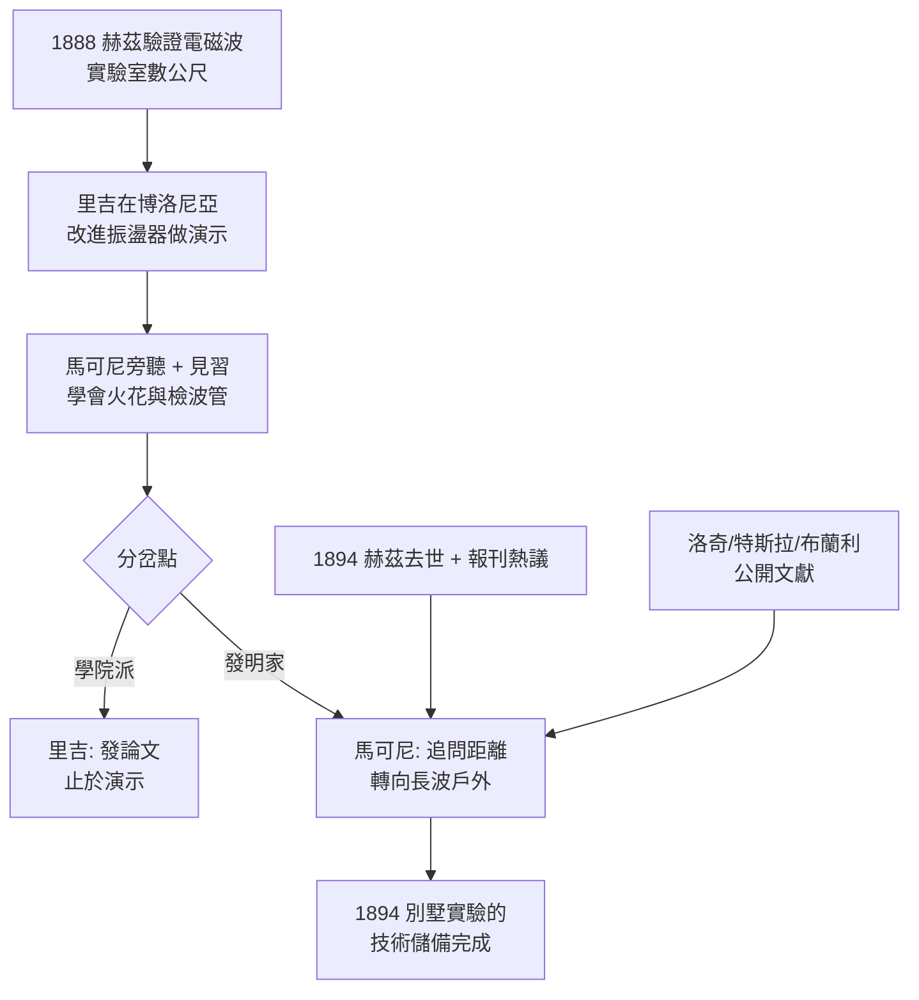

# 1.2 赫茲之火與里吉的啟蒙 (1888-1894)

1888 年，德國人海因里希·赫茲（Heinrich Hertz）在卡爾斯魯厄實驗室裡，用一個感應線圈火花隙發射、用一個銅環缺口接收，證明了馬克士威預言的電磁波真實存在。當火花在接收環缺口處同步跳動時，籠罩物理學二十年的疑雲散去：光 indeed 是一種電磁波，波長 $\lambda$ 、頻率 $f$ 與光速 $c$ 滿足：

$$c = \lambda f$$

赫茲測得的是分米級的超高頻波（UHF），只能在實驗室幾公尺內表演。赫茲本人對應用毫無興趣，甚至宣稱「毫無用處」。但報紙把這件事傳遍歐洲，1894 年赫茲 36 歲英年早逝，更添傳奇色彩。

## 里吉教授的實驗桌

正在博洛尼亞大學任教的奧古斯托·里吉（Augusto Righi）是義大利第一流的赫茲追隨者。他改進了赫茲振盪器，用三個火花隙與拋物面反射鏡產生更短波長的微波，並做吸收、反射、偏振實驗，寫成《電振盪的光學》（L'Ottica delle oscillazioni elettriche, 1897）。

二十歲的馬可尼經人介紹得以旁聽里吉的課程、出入他的實驗室，當過短期的非正式助手。里吉給了他三樣無價之物：

1. **親眼看到赫茲波**：火花、檢波器、諧振的概念從紙上變成手上功夫；
2. **一套儀器傳統**：里吉型振盪器、布蘭利（Branly）金屬屑檢波管（coherer）；
3. **一個反面教材**：里吉是典型的學院物理學家，滿足於發論文、做演示，從不追問「距離能推多遠」。馬可尼後來回憶：「我看到的是，別人止步的地方，正是起點。」

馬可尼與里吉的關係後來交惡——里吉抱怨馬可尼從未致謝，馬可尼則堅稱一切都是自己獨立發展。這場師徒心結預演了日後更大的優先權之爭：學院重發現，發明家重距離。

## 自學者的閱讀清單

1894 年夏天，馬可尼在阿爾卑斯山比亞西諾（Biassono）度假，讀到英國《電學評論》對赫茲實驗與洛奇（Oliver Lodge）講座的報導，據說徹夜未眠，在書頁空白處寫下：「電波可以做電報，無需電線。」

他回博洛尼亞後瘋狂補課：赫茲論文、洛奇的《電波與訊號》、特斯拉的高頻講座、布蘭利的檢波器報告。他的學習方式完全是工程式的——不推導馬克士威方程組，只問三件事：發射如何更強？接收如何更靈？天線如何更高？

他做了一個關鍵的概念跳躍：赫茲、里吉、洛奇都在玩「短波、室內、小功率」，因為物理學家要的是可操控的光學類比；但電報需要的是「長波、戶外、大功率」，距離就是一切。把頻率降低、把天線接大地、用接地與高空線構成不對稱振子——這不是物理學，是工程直覺。

## 因果鏈

**前因驅動**：本節是上一節「乾燥柴薪」遇上火星。沒有博洛尼亞別墅的動手訓練，馬可尼看不懂里吉的儀器；沒有里吉實驗桌的近距離觀摩，他無法站在赫茲的肩膀上；沒有 1894 年赫茲逝世引發的報刊紀念潮，他不會在度假山莊裡被那篇報導擊中。三因合流，才有頓悟。

**引發後果**：里吉給的是短波室內傳統，馬可尼反其道而行之，直接引發下一節別墅實驗的核心創新——升高天線、接地、大功率、長波化。同時，與里吉「只演示不實用」的分道揚鑣，塑造了他終生的行為模式：保密、專利先行、公開演示只為投資人。這為 1896 年赴英申請專利埋下伏筆，也為日後與洛奇、特斯拉的專利官司種下遠因。
