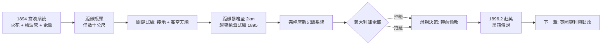

# 1.3 格里豐別墅的槍聲與鈴聲 (1894-1896)

1894 年秋到 1895 年夏，薩索的格里豐別墅閣樓與後山，成為無線電歷史上最著名的車庫實驗室。二十歲的馬可尼帶著兄長阿方索和老管家，開始了系統的距離競賽。

他的第一套系統拼湊自公開文獻：里吉式火花發射機 + 感應線圈 + 布蘭利金屬屑檢波管 + 電鈴。原理很直白：按下發射鍵，火花隙輻射阻尼波；接收端檢波管內金屬屑在電波作用下電阻驟降（$R_{\text{high}} \to R_{\text{low}}$），導通電池，電鈴響；再以小錘輕敲檢波管使其復原（decohere），等待下一個點或劃。这正是摩斯碼的無線版。

## 接地與天線：化腐朽為距離

真正的突破在 1895 年春。馬可尼發現，把發射機一端接地、另一端接高懸金屬板（後改為垂直銅線），把接收端同樣處理，距離從幾十公尺暴增到上千公尺。他無意中發明了**單極天線（monopole）對地工作模式**，大地成為巨大的鏡像導體，等效天線長度倍增。

今天我們可以用四分之一波長單極子解釋：當天線高度 $h \approx \lambda/4$ 時輻射效率最高。但馬可尼不懂理論，他是試出來的：越高越遠，越大越遠。他把銅線掛上風箏、綁上氣球，別墅後山丘成了發射場。

1895 年 9 月的傳奇一幕：阿方索帶著接收機翻過山丘，超出視線，約定以槍聲為號。馬可尼在別墅按下電鍵，山那頭先是電鈴響，繼而一聲獵槍響徹山谷——訊號翻越了障礙物！無線電第一次證明它不靠視線、不靠電線，可以越嶺。那聲槍響，就是無線時代的開槍令。

到 1895 年底，他已實現 2 公里以上傳輸，並能使電鈴吸引鐵片（接力器）自動在紙帶上打出摩斯碼。這已是一套完整的無線電報系統雛形：發射—傳播—檢波—記錄。

## 義大利的冷遇

馬可尼帶著成果求見義大利郵電部，得到的答覆是冷淡的公文：年輕人、無文憑、無教授背書，不予資助。義大利海軍雖略有興趣，但官僚拖延。父親朱塞佩起初也不願再掏錢，是母親安妮力排眾議，決定變賣部分年金、帶兒子去倫敦——娘家表親亨利·詹姆森·戴維斯（Henry Jameson-Davis）是倫敦的工程師兼掮客，答應引薦。

1896 年 2 月，母子登船赴英。行李中有一隻鎖死的黑箱，裝著拆散的儀器。傳說英國海關懷疑是炸彈，強行撬開損壞了儀器，馬可尼在倫敦只好重做——陰差陽錯，這反而讓他在英國人面前從零演示了全套技術，可信度倍增。

## 因果鏈

**前因驅動**：別墅的成功不是偶然，而是前兩節的兌現——閣樓動手能力讓他能快速迭代線圈與檢波管；里吉傳統讓他起點就是第一線；義大利學院體制把他擋在門外，反而逼他走「距離壓倒理論」的野路子。接地與天線的發現，恰恰是學院派不屑一試的「粗活」。

**引發後果**：2 公里與越嶺證明是一把鑰匙，直接打開三扇門：(1) 技術上證明長波+高天線路線正確，引出赴英後不斷加高天線、加大功率的軍備競賽；(2) 義大利的拒絕與母親的決斷，共同把事業重心從博洛尼亞搬到倫敦，下一章的英國郵政、普里斯、海軍演習皆由此起；(3) 保密與專利意識成形——在義大利吃過閉門羹後，馬可尼學會先申請專利再公開演示，這正是 1896 年英國 12039 號專利的直接前因。
