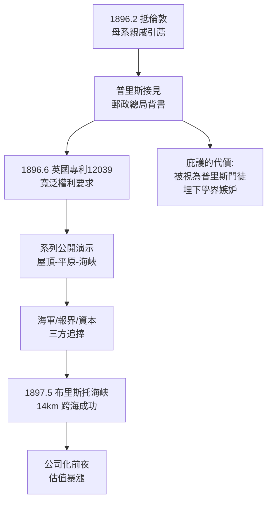

# 2.1 渡海赴英與郵政巨人的庇護 (1896-1897)

1896 年 2 月，22 歲的馬可尼與母親抵達倫敦。表親戴維斯迅速引薦了兩位貴人：英國郵政總局（GPO）總工程師威廉·普里斯（William Preece），以及專利律師卡普（Carpmael）。

普里斯其人至關重要。他是維多利亞電信帝國的掌門人，掌管全英電報電話，主持過感應式「無線」實驗（沿海底電纜的電磁感應），正苦於無法跨越更遠海峽。他一見馬可尼的演示即驚為天人——這個義大利青年的火花系統比郵政自己的感應系統遠一個數量級。普里斯當即決定：以郵政總局的經費、場地與官方信譽為馬可尼背書。

## 專利與演示的雙軌閃電戰

1896 年 6 月 2 日，馬可尼提交英國專利第 12039 號：「電脈衝與訊號傳輸方法的改進及其裝置」。這份專利寫得極其寬泛，把發射、檢波、高天線、接地幾乎一網打盡，成為日後專利戰的原子彈。7 月，他在郵政總局大樓屋頂做首次倫敦公開演示；9 月在索爾茲伯里平原（Salisbury Plain）實現 2.75 公里；12 月在倫敦講座現場把訊號傳過市區樓群。

1897 年 5 月，在布里斯托海峽（Bristol Channel）的拉弗諾克（Lavernock）到布林唐（Brean Down），他跨越 14 公里海水傳輸成功；6 月向皇家學會報告。普里斯親自站台，把馬可尼介紹給海軍、陸軍、 Lloyd's 船級社與新聞界。英國報紙以「切斷電線的義大利魔術師」為題大肆報導。

為什麼是英國而不是義大利？三重因果：一是英國普通法專利制度成熟，保護發明人；二是英國是海洋帝國，海軍與商船對「船岸通訊」有剛性需求，義大利則無此壓力；三是普里斯本人的部門利益——他需要一場勝利來壓過電話公司與財政部的質疑，馬可尼恰好是現成的明星。

1897 年 7 月，馬可尼在義大利拉斯佩齊亞（La Spezia）為義大利海軍做 18 公里演示，算是衣錦還鄉。但他已決定事業總部留在倫敦：資本、市場、海權都在這裡。距離的增長近似滿足 $d \propto h_1 h_2 / \lambda$ 的經驗律——天線越高、波長越長，跨海越穩，這正是郵政總局願意加碼的工程算術。

## 因果鏈

**前因驅動**：本節是別墅槍聲的變現。若無 2 公里越嶺的硬成績，普里斯不會接見；若無母親的英語與親戚，連門都敲不開；若無英國海權對船岸通訊的飢渴，演示只會是雜耍。專利先行則是義大利冷遇教會的謹慎——先鎖權利，再做秀。

**引發後果**：郵政的庇護是一柄雙刃劍：正面是它帶來了官方試驗場、媒體與第一批投資人，直接催生下一節無線電報公司的成立；負面是它把馬可尼推到英國電學建制派的對立面——以開爾文、洛奇為代表的學界開始質疑「那個義大利小子不過是把我們的東西組裝起來」。學界嫉妒 + 寬泛專利 = 日後十年專利戰的火藥。此外，跨海 14 公里的成功把目標直指英吉利海峽與大西洋，距離競賽從此停不下來。
