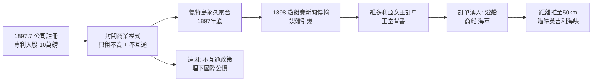

# 2.2 無線電報公司的誕生 (1897-1898)

1897 年 7 月 20 日，馬可尼無線電報公司（Marconi's Wireless Telegraph Company，後改稱 Marconi's Wireless Telegraph Co. Ltd.）在倫敦註冊，股本 10 萬英鎊。投資人多為倫敦金融城紳士與戴維斯引薦的親友，馬可尼本人以專利入股，成為最大股東兼技術總監。這是世界上第一家以無線電為唯一業務的公司，比「電子工業」這個詞早了半個世紀。

公司的商業模式與眾不同，深刻影響了無線電史：**馬可尼不出售設備，只出租服務，且操作員必須是馬可尼雇員，設備不准與非馬可尼系統互通**。用今天的話說，這是封閉生態 + 電信運營商模式。好處是品質可控、收入穩定（船東按年付租）；壞處是樹敵無數——各國海軍與競爭對手痛恨「不互通」政策，後來國際無線電公約的核心議題之一就是強制互通。

## 懷特島：第一座永久電台

1897 年底，公司在懷特島（Isle of Wight）的阿爾姆灣（Alum Bay）尼德爾斯（The Needles）建成第一座永久海岸電台，天線高達 36 公尺。1898 年 5 月，布里 studied？不，是洛伊德船級社與《每日快報》合作，用馬可尼設備報導懷特島皇家遊艇賽——新聞第一次經無線電即時傳回倫敦艦隊街，轟動一時。

同年，維多利亞女王在懷特島奧斯本莊園（Osborne House）避暑，因威爾斯親王（後來的愛德華七世）在遊艇上受傷，女王急需與遊艇聯絡。馬可尼受邀架設臨時鏈路，為王室傳遞 150 餘封電文。女王親賜嘉獎，這筆「王室訂單」是最好的廣告：連女王都用馬可尼，還有誰敢說無線電是玩具？

技術上，這兩年是快速迭代期：馬可尼引入感應線圈加大功率、改進檢波管真空封裝、試驗風箏與氣球天線。傳輸距離從 14 公里推到 30、50 公里，租金收入約滿足 $R = n \cdot r - C$（$n$ 為裝機船數，$r$ 為年租，$C$ 為岸站成本），船越多越賺，網路效應初現。競爭者也開始出現：德國的布勞恩（Ferdinand Braun）、斯拉比（Slaby）與 AEG 合組 Telefunken（1903），俄國的波波夫（Popov）亦聲稱優先權。但馬可尼憑藉先發專利 + 英國資本 + 海軍訂單，暫居鰲頭。

## 因果鏈

**前因驅動**：公司不是憑空而來，而是普里斯演示鏈的變現：布里斯托海峽 14 公里的硬數據說服了金融城；郵政與海軍的站台降低了投資風險；英國公司法的便利使專利可資本化。若留在義大利，既無風險資本，也無海洋市場，公司斷無可能誕生。

**引發後果**：公司的成立把馬可尼從發明家變成企業家，驅動了三個後果：(1) 必須不斷用距離紀錄餵養股東與報紙，英吉利海峽試驗成為剛性任務；(2) 封閉模式在短期內保證利潤，卻長期種下與各國政府、與 Telefunken、與美國海軍的衝突，直接通向第三、四章的專利戰與 1906 年柏林國際無線電公約的圍剿；(3) 懷特島電台的工程經驗（高塔、大功率、地線網）成為日後波爾德胡（Poldhu）巨型電台的預演。
