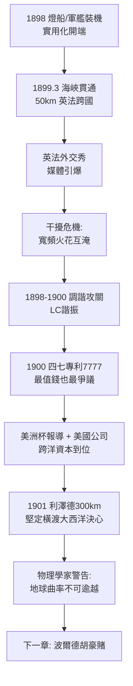

# 2.3 飛越英吉利海峽 (1898-1901)

1899 年 3 月 27 日，多佛（Dover）附近的南福蘭（South Foreland）燈塔與法國濱海維姆勒（Wimereux）之間，約 50 公里的海峽上空，摩斯碼第一次跨國飛越：「無線電向法國問好」。法國政府代表在對岸親耳聽到電鈴打出訊號，起立鼓掌。這是人類第一次用電磁波連接兩個國家，象徵意義不亞於技術意義——電報終於擺脫了海底電纜的銅價與鯊魚咬斷風險。

馬可尼深諳宣傳：在海峽兩岸同時邀請英法官員、記者與科學院代表，把一次工程試驗辦成外交事件。《泰晤士報》稱之為「以太的征服」。法國原本支持本土的布朗利（Branly）與迪克雷泰（Ducretet）系統，面對現場演示亦不得不承認馬可尼的領先。

## 調諧：從吼叫到耳語

海峽試驗暴露了一個致命問題：所有電台都在同一片「電磁吼叫」中工作，火花發射是寬頻阻尼波，接收機來者不拒，兩台同時發報即互相淹沒。馬可尼在 1898-1900 年間全力攻關「調諧」（tuning / syntony），即讓發射與接收迴路諧振在同一頻率 $f_0$：

$$f_0 = \frac{1}{2\pi\sqrt{LC}}$$

他 1900 年 4 月 26 日取得英國第 7777 號「四七」專利（famous Four Sevens patent），用變壓器耦合與可變電容電感實現多級調諧，使不同波長的電台可以共存。這份專利後來成為專利戰中最值錢、也最受爭議的一份——洛奇早在 1897 年就申請了調諧專利（英國 11575 號），特斯拉在美國的 1897 年專利亦涵蓋類似思想。馬可尼的律師以精巧的權利要求繞過前案，卻為 1943 年美國最高法院推翻其部分權利埋下伏筆（詳見 3.3 節）。

## 燈船、軍艦與股價

1898-1901 年間，馬可尼系統迅速實用化：都柏林快郵船、愛爾蘭燈船隊、英國海軍「歐羅巴號」「朱諾號」相繼裝機。1899 年美國杯帆船賽，馬可尼親赴紐約，用船載電台即時報導賽況，2,000 餘封新聞電文經無線發出，美國報界轟動，美國馬可尼公司（American Marconi）隨之籌組。

到 1901 年初，地中海亦有建樹：馬可尼在懷特島與康沃爾郡利澤德（Lizard）之間實現 300 公里傳輸，證明長波沿海面傳播衰減遠小於預期。這給了他一個大膽的推論：既然 300 公里可行，為何不試 3,000 公里？橫跨大西洋的念頭由此從狂想變為計畫，股東們既興奮又恐懼——興奮的是壟斷跨洋電報的暴利，恐懼的是物理學家異口同聲說「不可能，地球是圓的，電波走直線」。

## 因果鏈

**前因驅動**：海峽貫通是懷特島永久電台與公司資本的直接產物——沒有 36 公尺天塔的工程經驗，就沒有 50 公里跨海；沒有女王訂單帶來的信譽，法國政府不會派員見證；調諧突破則是被干擾逼出來的，實用化越深，干擾越痛，越倒逼選頻技術。

**引發後果**：本節是通往大西洋的跳板，兼具技術與心理雙重驅動：技術上，四七調諧專利使大功率長波發射成為可能（窄一點才傳得遠、收得清）；商業上，美洲杯的成功讓美國資本相信跨洋有利可圖；心理上，300 公里的實測讓馬可尼敢於蔑視「地球曲率不可能」的學院共識——他不知道電離層存在，卻賭它存在。下一章波爾德胡的巨塔，正是這場賭局的籌碼。
