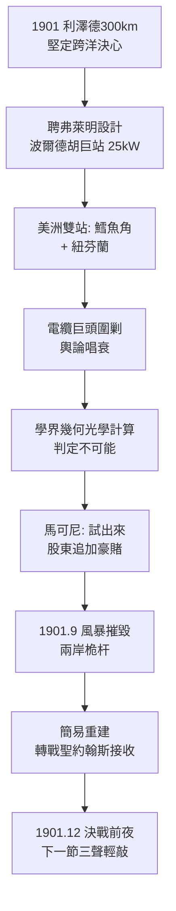

# 3.1 波爾德胡的豪賭 (1901)

1901 年，馬可尼在康沃爾郡西南角的波爾德胡（Poldhu）押上了公司的命運。他聘請約翰·安布羅斯·弗萊明（John Ambrose Fleming，倫敦大學學院教授、真空二極體發明人）設計一座前所未見的巨型火花電台：20 根 60 公尺高的木桅組成直徑 60 公尺的圓環，懸掛扇形天線網，饋以 25 千瓦（後加大到更高）交流發電機 + 感應線圈 + 巨型萊頓瓶電容組。發射波長約 300-400 公尺（頻率約 $f \approx 800\text{ kHz}$ ），火花響如雷鳴，夜間輝光數里可見。

在大西洋彼岸，他在麻薩諸塞州鱈魚角（Cape Cod）與紐芬蘭同步建站，計畫雙向貫通。海底電纜公司如臨大敵——跨洋電報每字收費高昂，是電纜巨頭的金礦，馬可尼若成功，資費將被打穿。電纜利益集團在報紙上放話：「電波走直線，地球是圓的，3,000 公里外只能收到大西洋的魚。」

物理學家的計算確實悲觀：按幾何光學，60 公尺天線的地平線不過 30 公里，繞射損耗隨距離指數增長。當時無人知曉高空有電離層（Heaviside 層 1902 年才被假說提出，1924 年才被證實）。馬可尼的回答是工程師式的：「算不出來，就試出來。」股東們為這場豪賭追加了數萬英鎊，失敗即破產。

1901 年 9 月，災難先至：一場風暴吹倒了波爾德胡的桅環，9 月 17 日鱈魚角站亦被風摧毀。馬可尼下令簡易重建，以兩根 48 公尺桅杆吊起倒三角天線，功率不減反增。12 月，他帶著助手肯普（Kemp）與兩隻風箏、一隻氣球，登船前往紐芬蘭聖約翰斯（St. John's），決定以輕裝接收站迎接波爾德胡的雷霆一擊。

## 因果鏈

**前因驅動**：波爾德胡不是瘋狂，而是前兩章的邏輯頂點：懷特島教會他「越高越大越遠」；四七調諧專利讓大功率窄一點成為可能；美洲杯讓美國資本願意下注；電纜高價則提供了巨額獎賞。若無海峽 50 公里的心理突破，無人敢想 3,000 公里。

**引發後果**：豪賭把公司推到懸崖邊，直接驅動下一節聖約翰斯的背水一戰——桅杆既倒，只能用風箏氣球做接收天線，陰差陽錯用上了 120 公尺超高天線，反而提高了靈敏度。同時，弗萊明的深度參與把真空管技術引入馬可尼體系，為日後檢波革命埋下種子。而與電纜巨頭的正面宣戰，則預告了未來十年商業與專利絞殺的慘烈。
