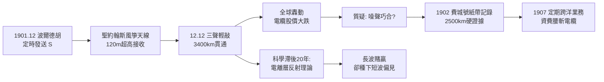

# 3.2 聖約翰斯的三聲輕敲 (1901-1902)

1901 年 12 月 12 日中午，紐芬蘭聖約翰斯訊號山（Signal Hill）上寒風刺骨。馬可尼與肯普躲在廢棄醫院小屋裡，把 120 公尺長的銅線繫上風箏放上天，連著檢波器與電話耳機。按約定，波爾德胡將在格林威治時間每日午後連續發送摩斯字母「S」（···，三點）——在噪聲中，「S」最易辨認。

中午 12 點 30 分左右，耳機裡傳來微弱而規律的三聲輕敲，斷斷續續，隨風箏搖擺時強時弱。肯普也聽到了。馬可尼把耳機遞給他，只問：「聽到了嗎？」肯普點頭。沒有歡呼，沒有記者，只有兩個凍僵的人在筆記本上記下時間與訊號強度。

消息傳回倫敦，全世界炸鍋。《紐約時報》頭版、海底電纜公司股價大跌、英王愛德華七世致電祝賀。3,400 公里！電波彎過了地球曲率，物理學家的幾何光學被一隻風箏擊碎。後人爭論當天是否真收到訊號（有人懷疑是大氣噪聲的巧合），但 1902 年 2 月馬可尼在「費城號」郵輪上用紙帶記錄儀收到波爾德胡訊號至 2,500 公里、12 月在加拿大格萊斯貝（Glace Bay）站實現穩定跨洋收發，以硬記錄平息了質疑。

科學解釋遲到了二十年：高空 100-300 公里的電離層（E 層、F 層）如同一面 plasma 鏡，把長波、中波反射回地面。頻率 $f$ 低於臨界頻率 $f_c$（約數 MHz，白天約 $10\text{ MHz}$）的電波會被折返：

$$f < f_c \sec\theta_0 \quad \Rightarrow \quad \text{天波反射}$$

馬可尼用的約 800 kHz 長波恰好落在可反射窗口——他賭贏了一層尚不存在於教科書的大氣。諷刺的是，他日後迷信長波、輕視短波，又被同一電離層狠狠教育（見 5.1 節）。

此役之後，跨洋無線電報商用化勢不可擋：1907 年格萊斯貝—克利夫登（Clifden, 愛爾蘭）定期跨洋業務開通，每字收費僅為電纜的一半。

## 因果鏈

**前因驅動**：三聲輕敲是四重因緣的交點：波爾德胡大功率是「吼得夠大」；120 公尺風箏天線是「耳朵夠靈」（風暴摧毀固定桅反而逼出更高更靈的臨時天線）；選「S」三點是「訊號夠聰明」；聖約翰斯的荒涼是「背景夠靜」。缺一即淹沒在噪聲裡。

**引發後果**：直接後果有三：(1) 商業上打穿電纜壟斷，跨洋業務成為公司現金牛，支撐後續全球海岸電台鏈；(2) 學術上逼出電離層假說（1902 年 Kennelly-Heaviside），無線電從江湖手藝變成大氣物理學；(3) 心理上把馬可尼推上神壇，也讓他陷入「長波巨功率即真理」的路徑依賴，強力打壓短波研究近二十年，直到 1920 年代才被迫回頭。盛名與偏見，同日而生。
