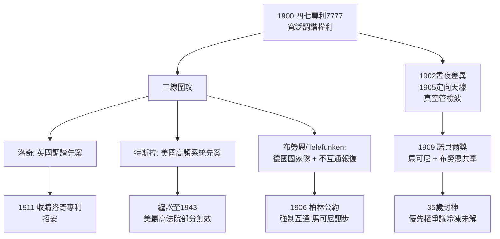

# 3.3 調諧、專利戰與諾貝爾桂冠 (1902-1909)

跨洋成功之後，馬可尼面對的不再是物理距離，而是法律與商業的叢林。核心戰場是 1900 年的四七專利（7777 號）：它主張以 $LC$ 諧振實現選頻，權利要求寫得鋪天蓋地。英國的洛奇（1897 年調諧專利）、美國的特斯拉（1897 年高頻傳輸系統專利，1900 年獲准）、德國的布勞恩（耦合電路專利）紛紛主張馬可尼是「組裝者而非發明者」。

- **對洛奇**：馬可尼公司 1911 年收購洛奇專利，庭外和解，實為招安；
- **對 Telefunken（布勞恩 + 斯拉比）**：德國以國家力量扶持 Telefunken，要求德國軍艦只與 Telefunken 系統互通，對等報復馬可尼的「不互通」政策。1906 年柏林國際無線電會議強行通過互通條款，馬可尼被迫讓步；
- **對特斯拉**：最慘烈。特斯拉早在科羅拉多斯普林斯做過大功率高頻實驗，主張調諧與接地天線皆其首創。兩人在美英纏訟十餘年。1943 年美國最高法院在 *Marconi v. United States* 案中判馬可尼部分調諧專利無效（特斯拉、洛奇、斯通先於馬可尼），但那已是馬可尼死後六年，且判決夾雜戰時徵用賠償的政治考量。公允的歷史評價是：特斯拉首創概念，馬可尼首成系統——概念不等於產品。

與此同時，技術仍在狂奔：1902 年馬可尼發現白天傳輸距離僅為夜間一半（後知為電離層 D 層白天吸收），1905 年實現定向天線，1906 年弗萊明二極體與德福雷斯特三極體先後問世，檢波從金屬屑走向真空管。

## 1909：與布勞恩共享諾貝爾獎

1909 年諾貝爾物理獎授予「馬可尼與布勞恩，以表彰其對無線電報發展的貢獻」。把獎一分為二，是諾獎委員會的政治智慧：既承認馬可尼的系統與商業功績，也安撫德國學界（布勞恩的耦合電路確實使發射效率與選擇性大增）。馬可尼時年 35 歲，是當時最年輕的物理獎得主之一。

領獎演說中，馬可尼罕見地謙遜，詳述從赫茲到跨洋的鏈條，感謝弗萊明與助手們。但他絕口不提特斯拉與波波夫——優先權的傷口，從此成為歷史公案。

## 因果鏈

**前因驅動**：專利戰是 1896 年寬泛專利 + 1897 年封閉商業模式的必然反噬：權利寫得越寬，挑戰者越多；越堅持不互通，各國政府越要聯手立法拆牆。若無跨洋成功帶來的暴利，也無人值得打這場官司——訴訟是成功的影子。

**引發後果**：1909 年的桂冠把馬可尼從企業家推上民族英雄與世界名人，直接驅動下一章的兩條線：(1) 各國海軍爭相採購船載電台，「海上守夜人」網路鋪開，為鐵達尼之夜的救難奇蹟準備了物質條件——沒有專利戰逼出的互通條款，鐵達尼的求救也無人能收；(2) 名聲帶來政治資本，義大利王國授勳、參議員席位接踵而至，把他一步步推向與墨索里尼政權的糾葛。榮耀即槓桿，既能救人，也能自縛。
