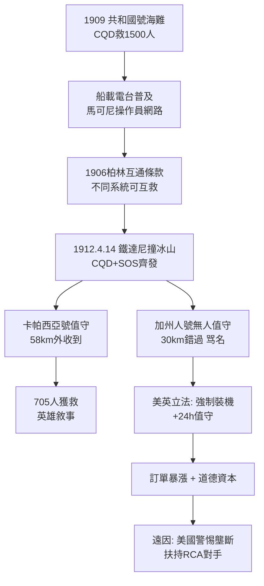

# 4.1 海上的守夜人與鐵達尼之夜 (1909-1912)

1909 年之前，無線電在船上是奢侈品；1909 年之後，它是生死線。轉折點是兩場海難的預演：1909 年 1 月「共和國號」（Republic）與「佛羅里達號」相撞，馬可尼操作員傑克·賓斯（Jack Binns）持續發報 14 小時，召來救援，1500 人獲救，被稱為「CQD 奇蹟」（CQD 是當時馬可尼系統的求救碼，後為 SOS 取代）。

到 1912 年，北大西洋已有數百艘船裝備馬可尼設備，操作員皆為馬可尼公司雇員，晝夜守聽 600 公尺波長（ $f \approx 500\text{ kHz}$ ）的呼叫。海岸電台鏈（Poldhu、Glace Bay、Clifden、Cape Cod）24 小時值班。這張網，正是諾貝爾光環 + 專利和解 + 柏林互通條款共同織成的——諷刺的是，逼馬可尼讓步的互通條款，此刻成了救命的關鍵。

## 1912 年 4 月 14-15 日：鐵達尼

23:40，鐵達尼號撞上冰山。首席報務員傑克·菲利普斯（Jack Phillips）與哈羅德·布萊德（Harold Bride）用 5 千瓦火花機不斷發出 CQD 與新興的 SOS。最近的卡帕西亞號（Carpathia）58 公里外，報務員哈羅德·科特姆（Harold Cottam）本已準備就寢，臨睡前最後一次戴上耳機，捕捉到了求救。他叫醒船長，卡帕西亞號全速破冰夜航，救起 705 人。

另一艘加州人號（Californian）僅 30 公里，卻因報務員已睡、無人值守而錯過求救，成為百年罵名。這場對比以血的代價證明：無線電的價值不在機器，而在「永遠有人聽」。事後美英聽證會一致結論：所有遠洋客輪必須配備無線電並 24 小時值守；馬可尼本人親赴紐約作證，受到英雄式歡迎——卡帕西亞號的報務員正是馬可尼公司的員工。

馬可尼因此獲得了至高無上的道德資本：「他的發明拯救了七百條生命。」公司訂單如雪片般飛來，各國立法強制裝機。但硬幣的另一面是：壟斷地位引來美國政府的警惕，美國海軍開始扶持本土競爭者（後來的 RCA），為 1920 年代馬可尼在美國的敗退埋下伏筆。

## 因果鏈

**前因驅動**：鐵達尼的奇蹟不是偶然，而是三章積累的兌現：跨洋巨站證明大功率可靠；專利和解與柏林公約保證不同船舶能互聽；諾貝爾名聲讓船東願意付租金。若無 1906 年被迫接受的互通，卡帕西亞號（馬可尼系統）或許仍能收到，但更多非馬可尼船舶將游離於救援網之外。

**引發後果**：救難神話把無線電從商業工具變成公共事業，直接驅動兩件事：(1) 各國以法律把無線電變成強制安全設備，市場規模暴增十倍，公司從此與軍事、海事深度綑綁，第一次世界大戰的電波軍備競賽已箭在弦上；(2) 美國目睹馬可尼壟斷救命通道，決心培植本國無線電工業，一戰後以海軍力量強行收購美國馬可尼，改組為 RCA——今日美國廣播帝國的起點，正是鐵達尼之夜種下的報復。
