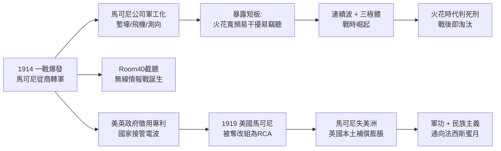

# 4.2 第一次世界大戰的電波武器 (1914-1918)

1914 年 8 月，一戰爆發，馬可尼 40 歲。他立即以中校（後晉升）身份加入義大利陸軍，負責軍事無線電，後任意大利駐英海軍武官與巴黎和會代表。英國馬可尼公司一夜轉為軍工廠：生產塹壕無線電、飛機電台、潛艇探測、定向測向站。法國凡爾登前線、英國索姆河戰場，步兵連第一次能呼叫後方砲火——儘管火花機笨重、易被竊聽、有效距離僅數十公里。

戰爭把無線電的三個短板暴露無遺：(1) 火花寬頻易干擾，敵我同頻即癱瘓，有效頻寬 $B$ 被噪聲 $N$ 淹沒時，誤碼率驟升；(2) 密碼與竊聽成為新戰場，英國 40 號房間（Room 40）靠截獲德國海軍無線電報破譯情報，日德蘭海戰即受益；(3) 真空三極體的連續波（CW）與外差接收證明遠優於火花，戰後火花機迅速被淘汰。馬可尼本人在戰時主持了義大利的定向與攔截網，並試驗短波（見下一章），但公司主力仍是長波大功率——路徑依賴在戰時訂單的麻醉下愈加深重。

大戰的最大遺產不是技術，而是產權重組：英國政府以戰時管制徵用馬可尼專利；美國海軍以「國家安全」為由，戰後拒絕把美國馬可尼歸還英方，強行促成通用電氣（GE）收購，於 1919 年改組為美國無線電公司（RCA）。馬可尼失去了親手創建的美國江山。作為補償，英國馬可尼獲得巨額軍方訂單與政府債券，一躍為大英帝國的電信支柱。

X 射線之外，無線電是第一個被國家全面徵用的電子技術。馬可尼從商人變成穿軍裝的國士，這重身份將他與義大利民族主義牢牢綑綁，為戰後與法西斯政權的接近鋪路。

## 因果鏈

**前因驅動**：大戰的電波化是鐵達尼立法的軍事翻版——既然法律已強制商船裝機，海軍更無理由拒絕；而1909 年以來的全球海岸電台鏈，戰時稍加改造即成軍用網。若無前十年鋪設的硬體與操作員隊伍，戰時動員斷無可能如此之快。

**引發後果**：戰爭以矛盾的方式塑造未來：技術上宣判了馬可尼賴以起家的火花系統死刑，逼他晚年轉向短波與微波（下一章）；產權上奪走了他的美國公司，直接催生 RCA 這個終生勁敵，1920 年代的廣播大戰即源於此；政治上賜予他軍功與民族英雄光環，使他在戰後義大利政壇炙手可熱——勳章越多，離墨索里尼越近。下一節的廣播前夜與下一章的政治抉擇，皆發端於戰壕裡的火花聲。
