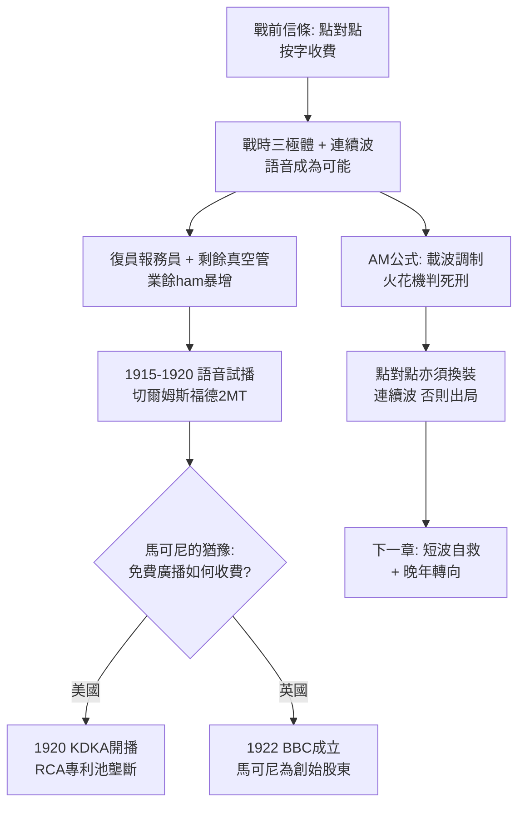

# 4.3 從點對點到廣播前夜 (1918-1920)

戰前，無線電信條是「點對點」：一發一收，收發皆付費，內容是私人電報。1915 年聖誕夜，美國人費森登（Reginald Fessenden）與德福雷斯特用連續波與三極體做了語音與音樂試播，業餘愛好者（ham）用自製礦石收音機偷聽，驚覺「一點對多點」別有天地。戰時，大量復員報務員與剩餘真空管流入民間，美國業餘電台從數百暴增至上萬。

馬可尼對廣播起初是鄙夷的。他是電報之王，靠字收費；廣播免費向空氣喊話，商業模式何在？1919-1920 年，英國馬可尼在切爾姆斯福德（Chelmsford）做語音試播（呼號 2MT），播放音樂與新聞，倫敦報紙譏為「科學怪人的留聲機」。美國馬可尼舊部（已屬 RCA）在匹茲堡 KDKA 於 1920 年 11 月 2 日大選之夜正式開播，被公認為廣播元年。

技術公式也在翻轉：傳送語音需要連續波載波 $c(t)$ 被音頻 $m(t)$ 調制，調幅（AM）可寫為：

$$s(t) = A_c[1 + k_a m(t)]\cos(2\pi f_c t)$$

火花阻尼波做不到，唯有三極體振盪器能產生純淨載波。馬可尼的火花帝國在物理層面已過時，他若不跟進，連點對點市場都將被連續波吞噬。

1919-1920 年的抉擇塑造了兩大分岔：美國路線——RCA + GE + 西屋 + AT&T 結盟，以專利池壟斷廣播，馬可尼被排除在外；英國路線——馬可尼公司遊說郵政總局，最終促成 1922 年英國廣播公司（BBC）成立，馬可尼是創始股東之一。電報之王不情願地為廣播時代接生，而接生的孩子很快就不認得父親。

## 因果鏈

**前因驅動**：廣播前夜是戰爭的意外分娩：沒有戰時量產的真空管與訓練的報務員，就沒有民間 ham 潮；沒有火花竊聽的慘痛教訓，就沒有連續波的決心；沒有失去美國公司之痛，馬可尼或許還沉浸在電報暴利中。若無鐵達尼立法鋪設的海岸網，語音試播亦無發射塔可用。

**引發後果**：本節是全書的樞紐，向後拋出三條索：(1) 技術上逼迫馬可尼放棄火花、擁抱真空管與短波，直接引出第五章遊艇「埃萊特拉號」上的短波重生；(2) 商業上宣告點對點電報的暴利時代結束，公司必須轉型為廣播設備商與帝國無線網承建商；(3) 地緣上確認美英分治——美國歸 RCA，英國歸馬可尼-BBC，跨洋電報的舊戰場讓位給廣播的新戰場。舊王未死，新王已立。
