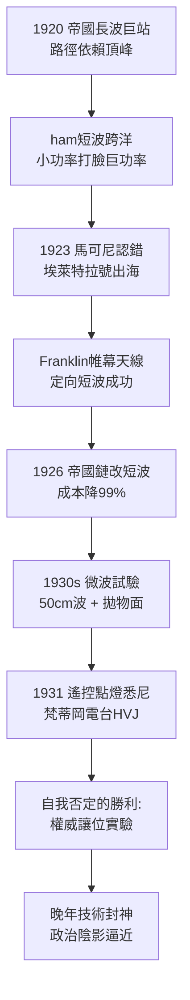

# 5.1 短波與微波的回歸：埃萊特拉號 (1920-1932)

1920 年代初，馬可尼犯過的最大錯誤被業餘愛好者糾正了。他迷信「波長越長、功率越大、傳得越遠」，斥巨資為大英帝國建造長波巨站鏈（帝國無線計劃）。然而美國與法國的 ham 們發現：白天用 100 公尺左右的短波、以區區幾十瓦竟能跨洋！電離層對短波的反射效率遠高於長波，且天線小巧、干擾較少。

1923 年，49 歲的馬可尼放下身段認錯，買下 220 噸遊艇「埃萊特拉號」（Elettra），改裝為海上短波實驗室，與助手弗蘭克林（C. S. Franklin）系統試驗定向短波。他發明了帷幕式定向天線（Franklin beam），在波爾德胡與加拿大、巴西、暹羅之間實現晝夜穩定的短波通訊，功率僅為長波站的百分之一。1926 年，帝國無線鏈被迫改為短波樑式系統，馬可尼親自向英國郵政證明：短波又便宜又好。

晚年他更走向微波：在義大利聖瑪格麗塔與羅馬之間試驗 50 公分波（ $f \approx 600\text{ MHz}$ ）通訊，演示定向微波束與拋物面反射器，被後人視為雷達的前聲。1931 年，他以無線電波點燃了悉尼展覽會的燈火（跨越半球遙控），並為教宗庇護十一世建成梵蒂岡電台（呼號 HVJ），第一次讓教宗的聲音傳遍世界。

從鄙視短波到擁抱短波，這場回歸是馬可尼一生最動人的自我否定：1901 年他靠蔑視教科書贏，1923 年他靠承認外行贏。科學從不效忠權威，只效忠天線另一端的訊號強度。

## 因果鏈

**前因驅動**：短波回歸是三重倒逼：廣播時代證明連續波優於火花（不換即死）；ham 的低成本跨洋讓長波巨站的股東血本無歸（不認即破產）；一戰定向與攔截經驗讓他手裡本就有短波數據。若無 1901 年跨洋時「賭贏電離層」的記憶，他不會如此快理解短波的同一面鏡子。

**引發後果**：技術重生帶來最後的榮光，直接引出下一節的政治悲劇：短波帝國鏈的成功使他成為墨索里尼最想招攬的國寶，國家科學院院長、法西斯大議會席位、侯爵爵位接踵而至——實驗室的勝利把他推上獨裁者的閱兵台。同時，微波定向試驗為二戰雷達埋下種子：英國鏈式雷達（Chain Home）與馬可尼公司的微波遺產血脈相連，徒弟們將用師父的餘暉打贏不列顛空戰。
