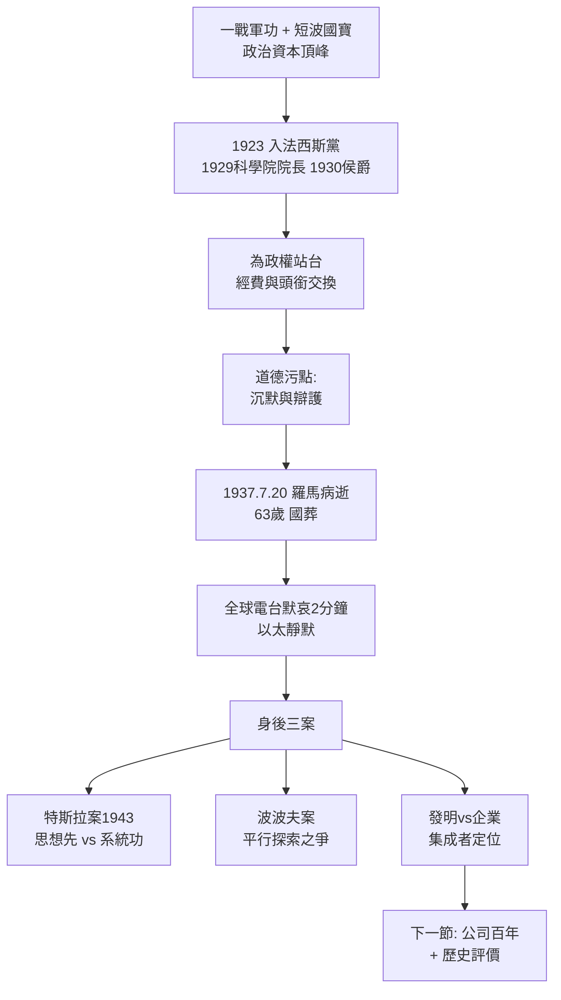

# 5.2 榮耀、政權與爭議 (1922-1937)

1922 年墨索里尼上台，馬可尼於 1923 年加入法西斯黨，1929 年被任命為義大利國家科學院（Accademia d'Italia）院長，1930 年封侯爵，長期擔任參議員與法西斯大議會成員。他為政權站台、出訪、演講，梵蒂岡電台亦被政權用作宣傳樣板。這段關係是他一生最大的道德污點，也是傳記最難的一頁。

公允地說，動機是複雜的：一是民族主義——一戰軍功使他真心相信強大義大利需要強大電訊；二是實用主義——短波帝國鏈、梵蒂岡電台、羅馬大學講席皆需政府資助；三是時代局限——1920 年代歐洲知識界普遍對法西斯缺乏警覺，馬可尼並非孤例。但他對種族法保持沉默、為入侵阿比西尼亞辯護，確使諾貝爾光環蒙塵。1937 年 7 月 20 日，他因心臟病在羅馬去世，享年 63 歲。墨索里尼為他舉行國葬，全球無線電台在葬禮當天同時默哀兩分鐘——以太為他靜默。

爭議並未隨死亡結束：

- **與特斯拉**：特斯拉 1943 年死於紐約旅館，窮困潦倒。同年美最高法院判馬可尼部分專利無效，特斯拉支持者歡呼「遲到的正義」，馬可尼支持者則指判決是戰時賴帳（美國政府不願付專利賠償）。真相介於兩者之間：特斯拉有思想之先，馬可尼有系統之功，諾獎只獎其一，本就不公；
- **與波波夫**：蘇聯長期主張波波夫 1895 年先於馬可尼發明無線電。事實是波波夫演示了雷電接收，未做發射距離系統，屬平行探索；
- **發明 vs 企業**：學院派批馬可尼「不懂馬克士威方程」，企業史家則反駁「洛奇懂方程，卻沒連上大西洋」。歷史最終把他定位為**系統集成者與產業奠基人**，而非基礎物理學家——這一定位並不減損其偉大，一如愛迪生之於電燈。

私生活方面，馬可尼 1905 年娶愛爾蘭女子約瑟芬·奧布萊恩（Josephine O'Brien），育有三女一子，1924 年離婚；1927 年再娶義大利貴族少女瑪麗亞·克里斯蒂娜（Maria Cristina Bezzi-Scali），育有一女。晚年篤信天主教，與梵蒂岡關係密切。他一生獲獎無數，頭銜之多恰如其天線之高——名望 $P$ 幾乎與距離 $d$ 成正比，而爭議亦如影隨形。

## 因果鏈

**前因驅動**：與政權的糾葛不是偶遇，而是四十年因果的收束：愛爾蘭母親把他推向英國，英國海權把他推向帝國，帝國大戰把他推向軍功，軍功把他推向民族主義，而民族主義在 1920 年代義大利只有一個買家——法西斯。若無短波帝國鏈的國寶價值，政權亦不會高價招攬。

**引發後果**：政治選擇直接污染了身後名：戰後義大利史學長期迴避此節，英美傳記亦輕描淡寫；特斯拉與波波夫的支持者則以此為道德槓桿，放大專利質疑。但國葬日全球靜默的兩分鐘證明，電波共同體最終選擇記住建設者而非政客——這為最後一節的歷史評價定下基調：功過分書，功在互聯，過在沉默。
