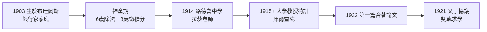

# 1.1 布達佩斯猶太銀行家神童（1903–1921）

1903 年 12 月 28 日，**約翰·馮·諾伊曼**（John von Neumann，匈牙利語 Neumann János Lajos，暱稱「揚奇」Jancsi）出生於布達佩斯一個富裕的猶太銀行家家庭。父親馬克斯·諾伊曼（Max Neumann）是成功的銀行家，母親瑪格麗特·卡恩出身同樣富有的銀行世家。1913 年父親因對帝國的金融貢獻獲封貴族頭銜，全家姓氏加上「margittai」（源自家鄉 Margitta），德語化即為「von Neumann」——這就是日後震動世界的名字的由來。

## 奧匈帝國黃金時代的布達佩斯

要理解馮紐曼，必須先理解他的出生地與時代：

- **布達佩斯的奇蹟**：1867 年奧匈折衷方案後，布達佩斯急速現代化，猶太人在金融、法律、醫學與學術界大放異彩。這座城市在一代人之間產出了馮紐曼、西拉德（Leo Szilard）、維格納（Eugene Wigner）、特勒（Edward Teller）、厄爾德什（Paul Erdős）——科學史上罕見的智力爆發；
- **同化主義的環境**：猶太家庭以德語文化自許、以匈牙利愛國者自居，馮紐曼終身是匈牙利國家足球隊的死忠球迷；
- **但天花板正在逼近**：1919 年貝拉·昆（Béla Kun）的共產政權與隨之而來的白色恐怖、霍爾蒂反猶法規，讓這一代匈牙利猶太知識分子的「可帶走的資產」只剩頭腦——他們後來幾乎全部流亡，並在美國匯流成改變世界的力量（見 3.1、4.3）。

## 神童的各種證據

馮紐曼的童年是「神童」一詞的教科書案例，幾乎每個細節都被親友反覆傳述：

- **六歲**能做八位數的除法，在腦中開根號；
- **八歲**已讀完大學微積分——家庭教師亞伯拉罕·富特勒（László Rátz，著名中學數學教師）發現無東西可教，將他轉介布達佩斯大學教授庫爾查克（Michael Fekete / Kürschák）指導；
- **驚人的照相式記憶**：多年後他能逐字背出整頁小說（例如《雙城記》開頭數頁）、整本橋牌手冊、交通時刻表與笑話集；
- 對**歷史**的痴迷不亞於數學：他能詳述拜占庭宮廷鬥爭、聖女貞德審判的每個細節，晚年自稱歷史知識讓他「對人類未來的預測比數學還準」；
- 他父親務實地希望孩子學「有用」的東西，曾拒絕他 11 歲時想進數學班的請求，改請家庭教師補化學——這場「理想 vs. 生計」的拉鋸，將在他 1921 年的大學選擇中重演（見 1.2）。

### 「揚奇」的社交面

與一般對孤僻天才的想像不同，小馮紐曼**極度外向、愛講笑話、喜歡派對**：

- 家中客廳常有音樂會與沙龍，他習慣在喧鬧中工作——日後在普林斯頓的開放式辦公室、嘈雜的火車車廂裡寫論文，都是這個習慣的延續；
- 童年摯友包括日後的物理學家維格納——維格納終身承認：「揚奇的腦子是我見過最快的，我們所有人在他面前都自覺遲鈍。」

## 中學與大學的搶跑

1914 年，馮紐曼進入路德會中學（Fasori Evangélikus Gimnázium），與維格納成為校友。這所學校是匈牙利教育奇蹟的縮影：

- 數學教師拉斯洛·拉茨（László Rátz）慧眼識才，主張「天賦不能被課程進度浪費」；
- 1915 年起，布達佩斯大學的教授約瑟夫·庫爾查克（József Kürschák）以「特許聽講生」身分指導他；至 18 歲，他已與庫爾查克**合夥發表第一篇數學論文**（關於某類方程根的定位，1922 年刊於德國數學期刊）；
- 1921 年高中畢業時，他已在匈牙利數學競賽（Eötvös 競賽）拿下全國第二。

## 父子協議：化學與數學的雙軌

1921 年，18 歲的馮紐曼面臨人生第一個重大談判：

- 他想學**數學**；父親馬克斯認為純數學不能養家，「數學家窮得叮噹響」；
- 談判結果是一個影響深遠的妥協：**馮紐曼在柏林大學註冊化學（父親指定），同時在柏林與布達佩斯兩地讀數學**；
- 這個「化學—數學雙軌」在日後結出奇果：化學訓練讓他對**分子、統計行為與工程實作**有親身直覺，數學則是他的母語——兩者交會處正是他一生的黃金地帶（量子力學的數學、蒙地卡羅、乃至電腦架構，無一不是「抽象數學 × 物理工程」的混血兒，見 2.1、3.3）。

## 時代的陰影

神童傳說的另一面，是帝國的崩塌：

- 1919 年匈牙利蘇維埃共和國期間，全家曾短暫避居維也納；
- 反猶氛圍讓「布達佩斯天才群」的成員心中都埋著一個共識：**歐洲不是久留之地**；
- 維格納、特勒、西拉德日後在曼哈頓計畫中重逢，並推動了愛因斯坦致羅斯福的著名信件——那封信的技術底稿正是西拉德寫的，而把它變成炸彈方案的數學，則是馮紐曼的（見 3.1）。因果鏈的第一環，就埋在 1919 年布達佩斯的街頭。

### 神童傳說的辨偽

後世傳記作家對神童軼事做過核實，結果是：**大部分屬實，少數是家人美化**——

- 屬實：六歲除法、八歲微積分、照相式記憶（維格納與家庭教師們的獨立證詞一致）；
- 屬實但需限定：希臘語的「流利」僅限於背誦與翻譯，非口語能力；
- 美化：「與父親辯論股票」被證實是飯後閒談的誇張版本；
- 但最重要的是**方向屬實**：布達佩斯的中產猶太家庭確實在一代人內湧現了五位諾獎級人物（馮紐曼、維格納、西拉德、特勒、赫勒），這種密度只能用制度（中學教育＋沙龍文化）解釋，不能用基因的偶然。

這個辨偽的教訓，恰好是馮紐曼自己的方法論：**軼事可以當樣本，不能當證明**——而「制度如何承接天才」，將是貫穿本書的隱線（中學拉茨、大學庫爾查克、哥廷根希爾伯特、普林斯頓 IAS：天才的每一站都有制度接住）。

## 事件關聯與前因後果

| 年份 | 事件 | 後續影響 |
|------|------|----------|
| 1903 | 生於布達佩斯銀行家家庭 | 經濟無虞＋貴族頭銜，可自由追逐智力極限 |
| 1913 | 父親受封貴族，姓氏變 von Neumann | 「馮紐曼」之名進入歷史 |
| 1914 | 進路德會中學，遇拉茨老師 | 天才被制度承接而非浪費 |
| 1915–1921 | 庫爾查克私人指導 | 18 歲前完成大學數學訓練 |
| 1919 | 匈牙利動亂，全家避居維也納 | 「必須流亡」的種子；日後美國化 |
| 1922 | 發表第一篇合著數學論文 | 進入歐洲數學共同體的門票 |
| 1921 | 父子協議：柏林學化學＋數學 | 化學×數學雙軌成型（見 1.2） |

**因果**：如果說希爾伯特的童年在哥尼斯堡被「數學之美」點燃（→ 詳見《希爾伯特傳記》第 1 章），馮紐曼的童年則是被**富裕、戰亂與神童速成**三者共同塑造。富裕給了他無所畏懼的智力自信；戰亂給了他「科學必須有用於生存」的現實感；速成給了他終身「比所有人快十倍」的工作方式——也種下他日後看不起緩慢而深刻的方法（如圖靈式的單線索深挖）的傾向（見 5.2）。

## 小結

- 布達佩斯黃金時代＋猶太銀行家家庭，提供了馮紐曼**智力、資源與緊迫感**的三重起點；
- 神童的三大武器：**超速心算、照相式記憶、跨域博學**（數學＋歷史＋化學）；
- 外向性格使他成為天生的「科學外交家」，這在日後的 IAS、曼哈頓計畫與華盛頓官場都是關鍵資產；
- 父子協議確立了化學與數學的雙軌——這條雙軌的下一站是柏林與蘇黎世（見 1.2）。
