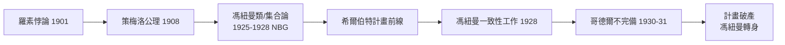

# 1.3 集合論公理化與希爾伯特計畫（1925–1928）

1926 年，22 歲的馮紐曼帶著雙學位來到**哥廷根**，擔任希爾伯特的助理（1926–1927）。這裡是當時世界數學的首都，而希爾伯特正在打一場關係數學存亡的大戰：**希爾伯特計畫**——為全部數學找到一個無矛盾的、機械可驗證的形式基礎。馮紐曼很快成為這場戰役中最鋒利的年輕劍客，卻也在 1931 年親手敲響了它的喪鐘。

## 集合論的危機與公理化競賽

故事要從更早說起：

- **羅素悖論**（1901/1902）：「包含所有不包含自身的集合的集合」動搖了弗雷格的邏輯主義大廈（→ 詳見《弗雷格傳記》；→ 詳見《羅素傳記》第 2 章）；
- **策梅洛**（1908）提出第一套集合論公理，弗蘭克爾後來修訂，是為 ZF/ZFC；
- **馮紐曼的突破**（1923–1928）：引入「**類**」（class）的概念——集合是能作為成員的類，而像「所有集合的全類」這種太大的是真類（proper class）。這一招一舉化解了羅素悖論在系統內的重現；
- 他把**序數**定義為「所有與之同構的良序集的類」，用一個乾淨的遞歸系統重建了超窮算術——這套公理經貝爾奈斯（Paul Bernays，希爾伯特的另一助手）與哥德爾修訂後，成為今日標準的 **NBG 集合論**。

## 希爾伯特計畫的陣地

希爾伯特的野心（→ 詳見《希爾伯特傳記》第 6–8 章）是：

- 將數學全部**形式化**為符號系統；
- 用**有窮方法**（finitary，直觀、機械可查）證明該系統**無矛盾**且完備；
- 一句口號：「沒有人能把我們從康托爾創造的天堂裡趕出去。」

馮紐曼 1925–1928 年間的系列論文《集合論的公理化》《公理集合論導論》正是這條戰線的核心工事。他年輕氣盛地宣布：集合論的矛盾問題已在他手上終結。

## 1928：證明論的高峰與維也納的敵意

1928 年馮紐曼發表了**二階算術一致性的部分證明**，被視為希爾伯特計畫的重大進展：

- 他在哥廷根主持**數學基礎研討班**，與貝爾奈斯並肩作戰；
- 但在維也納學派那裡，他遭到激烈批評：**卡爾納普**（→ 詳見《卡爾納普傳記》）質疑其哲學根基，**維根斯坦**陣營（→ 詳見《維根斯坦傳記》）則根本否認數學需要「基礎的救贖」；
- 馮紐曼與維根斯坦在人生中幾乎沒有正面交鋒，但兩人對「數學是什麼」的答案徹底相反：一個要公理化一切，一個要治療一切。

## 1928 年的另一場勝利：極小極大定理

同一年，馮紐曼做了另一件看似與基礎無關、實則改變世界的事：

- 1926 年他在哥廷根一場報告中聽到鮑萊爾對二人零和賽局的討論，當場思考；
- **1928 年論文《論 parlor games》**證明了**極小極大定理**（minimax theorem）：任何有限二人零和賽局都存在最優混合策略，解為鞍點
$$\max_s \min_t v(s,t) = \min_t \max_s v(s,t);$$
- 這是**賽局論**的建國文獻（見 2.3），證明用了不動點式論證——十七年後它演化成經濟學、核武威懾與電腦科學的基礎工具。

## 1930：哥德爾的炸彈

1930 年 9 月，柯尼斯堡「精確科學的認識論」會議的圓桌討論上，24 歲的**哥德爾**平靜地宣布：一階算術是**不完備的**（→ 詳見《哥德爾傳記》相關；→ 詳見《希爾伯特傳記》第 9 章）：

- 完全性定理（1929，哥德爾博士論文）與不完備性定理（1931）合起來宣判：希爾伯特計畫**以其原始目標而言，不可能成功**；
- 馮紐曼當時就坐在場邊。他是全場**最快理解後果**的人——幾週內他已獨立推出第二不完備定理，隨後聽說哥德爾早已寄出論文，便坦然放棄，並立刻寫信告知哥德爾；
- 這是馮紐曼生涯少見的「被別人搶先」時刻。他的反應不是嫉妒，而是全力以赴地推廣哥德爾——他日後在普林斯頓給哥德爾爭取 IAS 職位出力甚多，並公開說：「哥德爾是亞里斯多德以來最偉大的邏輯學家。」

## 轉身：從基礎的廢墟走向新大陸

希爾伯特計畫之死，對馮紐曼是一次「信仰的搬家」：

- 他自承：「我不會再去搞基礎了。哥德爾之後，那裡已經沒有值得做的事。」
- 但哥德爾的證明裡藏著一個對他**致命的誘惑**：原初遞歸函數、通用形式系統、「機械地枚舉一切可證明式」——這正是**可計算性**的伏筆。1936 年圖靈把這條線拉到底，造出圖靈機（→ 詳見《圖靈傳記》第 3 章）；馮紐曼是最早看出「圖靈機=計算的精確定義=可以造出來的機器」的人（見 2.2、5.2）；
- 同時，哥廷根的物理系正被量子力學炸翻——他旋即轉身投入，寫出《量子力學的數學基礎》（見 2.1）。

### 「最快的大腦」傳說的定型

哥廷根歲月給馮紐曼貼上了終身標籤——**速度**：

- 哈代（→ 詳見《哈代傳記》相關）訪哥廷根時聽他講解一個證明後說：「這個人可以在半小時內做完我半年的工作」；
- 集合論的證明以「跳步」聞名：同行要花一週補的細節，他當場略去——貝爾奈斯的日常之一就是替他補全證明並出版；
- 這種速度的哲學後果是雙面的：他**善於快速吸收他人的思想並極端化**（吸收策梅洛、超越之；吸收鮑萊爾、極小極大之；吸收圖靈、實作之），卻較少做那種「無中生有」的長跑原創（圖靈機、哥德爾定理那種）；
- 他的自我認知很誠實：「我不是原創者，我是**化學家式的數學家**——把別人的元素組合成新物質。」這句自評，是理解本書全部章節的鑰匙。

## 事件關聯與前因後果

| 年份 | 事件 | 後續影響 |
|------|------|----------|
| 1925 | 集合論公理化論文（博士論文） | NBG 體系源頭，化解羅素悖論 |
| 1926–27 | 哥廷根希爾伯特助理 | 進入形式主義陣營核心 |
| 1928 | 一致性證明＋極小極大定理 | 基礎研究頂點＋賽局論誕生 |
| 1929 | 完全性定理發表（哥德爾） | 邏輯氣候轉變的前兆 |
| 1930 | 柯尼斯堡圓桌，哥德爾宣布不完備 | 希爾伯特計畫實質死亡 |
| 1931 | 馮紐曼讀懂並放棄，轉推廣哥德爾 | 轉向量子力學與應用數學 |

**因果**：這五年是馮紐曼的「加冕與放逐」：他在 22–25 歲登上基礎數學的最高戰場並一度以為自己贏了，卻在 27 歲被一個更年輕的邏輯學家判了出局。這段經歷的雙重遺產：一是他對**形式系統的力量與極限**有著全歐洲最深的體感——這份體感在十五年後直接轉化為對「計算機作為形式系統的物理化身」的洞察（3.2、5.2）；二是他學會了在「正面戰場無解」時**轉身去開新戰場**——量子力學、賽局論、計算機，全是這一招。

## 小結

- 馮紐曼以「類」重建集合論，留下 NBG 體系，是希爾伯特計畫的主力戰將；
- 1928 年他同時站在兩座頂點：基礎的一致性工作與極小極大定理；
- 哥德爾 1930–31 年的不完備性定理終結了原始計畫；馮紐曼是第一個讀懂、第一個放下、也是最有力的傳道者；
- 「形式系統可機械枚舉」的教訓，成為日後圖靈機與電腦的思想橋樑；
- 戰場已換：物理學正在哥廷根燃燒，下一步他要把**希爾伯特的公理化武器**帶進量子力學（見 2.1）。
