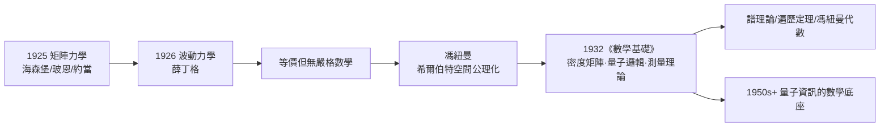

# 2.1 哥廷根與量子力學數學基礎（1926–1932）

1926–1929 年，馮紐曼在哥廷根的三年，恰逢物理學史上最瘋狂的歲月：海森堡、玻恩、約當在此提出矩陣力學，薛丁格的波動力學隨之登場，兩者被證明等價——但「等價」只是物理學家的直覺，**沒有人給出嚴格的數學**。馮紐曼用希爾伯特空間把這團烈火澆鑄成鋼，寫下他生前最被引證的巨著《量子力學的數學基礎》（Mathematische Grundlagen der Quantenmechanik，1932）。

## 背景：兩種力學的混戰

1926 年前後，量子力學有兩套等價但語言迥異的形式：

- **矩陣力學**（海森堡 1925，玻恩與約當數學化）：可觀測量是非對易矩陣，$pq - qp \neq 0$；
- **波動力學**（薛丁格 1926，馮紐曼在 ETH 的舊識）：態是波函數 $\psi$，滿足薛丁格方程；
- 物理學家普遍覺得兩者「其實一樣」，但證明僅限於特殊情形；更麻煩的是**譜理論**——希爾伯特 1900 年代為積分方程開創的算子理論，本來是抽象數學，此刻突然成了物理的生死線（→ 詳見《希爾伯特傳記》第 5 章）。

## 馮紐曼的公理化：希爾伯特空間作為宇宙

馮紐曼的核心洞見是：**量子系統的態空間就是（無限維可分）希爾伯特空間**。整座大廈從幾條公理推出：

1. **態**是希爾伯特空間中的單位向量（推廣為密度矩陣 $\rho$）；
2. **可觀測量**是自伴算子（self-adjoint operators）；
3. **測量**由投影算子描述，測量結果的期望值為 $\mathrm{tr}(\rho A)$；
4. **疊加**就是線性組合，**干涉**就是內積。

在這套語言裡：

- 矩陣力學與波動力學的等價，變成「兩種坐標下同一個希爾伯特空間」——嚴格成立；
- 他在過程中發展了**無界自伴算子的譜理論**，把希爾伯特的遺產推向完備，並順手證明了**均值遍歷定理**（1932）——統計力學的數學基石；
- **密度矩陣**與**糾纏態**（1932 年論文論及的 mixed states）的數學處理，使他在八十年後成為量子資訊理論被引用最多的人之一。

### 測量問題與「馮紐曼鏈」

《數學基礎》中最富哲學爭議的一章是**測量理論**：

- 他提出**量子邏輯**的雛形：命題格不滿足分配律（投影格結構）——後來由 Birkhoff 與他 1936 年合作成文；
- 他提出**「馮紐曼鏈」**：觀察者測量儀器、儀器測量系統、……可以無限上推，最後在「主觀截斷」處坍縮——這條鏈把意識帶進了討論，爭議至今未息；
- 與哥本哈根詮釋的交鋒中，他站在玻爾一邊反駁愛因斯坦的 EPR 質疑，但也留下了一個日後被貝爾定理重新審視的隱變量「不可能性」論證（1932；其漏洞由貝爾 1966 年指出——馮紐曼的證明假設過強）。

## 與希爾伯特—諾特傳統的合流

這本書是**希爾伯特學派方法論**的勝利：先公理，後定理，物理直覺只當路標。馮紐曼自己也承認：

> 「量子力學的數學，就是希爾伯特空間的譜理論。希爾伯特 1904–1910 年做的純數學，二十年被物理學等到了。」

同一時期他還完成了**算子環（later 馮紐曼代數）**的奠基工作（1929 年起，與 Murray 合作至 1940 年代）——這原是為量子力學打造的一般框架，後來成為純數學的重要分支，並在量子場論與量子計算中復活。

## 哥廷根的社會網

三年間的哥廷根也是他一生人脈的熔爐：

- **玻恩**：量子力學統計詮釋的提出者，馮紐曼的統計框架與之共振；
- **外爾**：從 ETH 的老師變成同事；
- **約當**：合作過統計力學，也讓他親歷了納粹崛起前的學術政治（約當後來是納粹黨員，馮紐曼與之決裂）；
- 1933 年希特勒上台，哥廷根數學系幾乎全軍覆沒——諾特、柯朗、外爾等流亡美國。這場大流亡的直接後果之一，就是美國數學的崛起與普林斯頓/IAS 的補強（見 2.2）。

### 書名裡的宣言

書名《量子力學的數學基礎》本身是一次宣戰：

- 「數學基礎」（Grundlagen）一詞刻意致敬希爾伯特的《幾何基礎》（1899）——**同一個詞，同一種姿態：給一門學科一個不可動搖的公理地基**；
- 希爾伯特把幾何安放在算術之上，馮紐曼把量子力學安放在希爾伯特空間之上——兩代哥廷根人做了同一件事，只是對象從空間換成了原子；
- 諷刺的是，同年哥德爾的不完備性定理已經宣告「基礎」有其極限（1.3）——馮紐曼比誰都清楚這一點，卻仍選擇建造：**公理化不再許諾絕對安全，而是許諾清晰**。這種「清醒的公理化」成為他日後每個領域的簽名；
- 玻恩的評語概括了物理界的感受：「我們在黑暗中摸索了兩年，這本書開燈之後，我們才看清自己一直在哪個房間裡。」

## 事件關聯與前因後果

| 年份 | 事件 | 後續影響 |
|------|------|----------|
| 1926 | 赴哥廷根，接觸矩陣力學 | 轉向數學物理 |
| 1927 | 發表希爾伯特空間公理化論文 | 量子力學獲得嚴格基礎 |
| 1929 | 開始算子環（馮紐曼代數）研究 | 純數學永久遺產 |
| 1932 | 《量子力學的數學基礎》出版 | 經典中的經典；密度矩陣/糾纏數學化 |
| 1932 | 均值遍歷定理 | 統計力學與蒙地卡羅的理論背景（3.3） |
| 1933 | 納粹上台，哥廷根解體 | 流亡潮；美國時代開啟（2.2） |

**因果**：這一章的直接前因是 1.3——希爾伯特計畫死後，馮紐曼把「公理化」這把寶劍從邏輯轉向物理。直接後果有二：一是**量子力學從此有了教科書式的數學**，至今物理系課程的框架仍是他 1932 年版；二是**糾纏與測量問題**的數學化，使 1990 年代後的量子計算/量子資訊學科有現成地基——香儂（Shannon）的資訊熵被他同年在書中推廣為**馮紐曼熵** $S(\rho) = -\mathrm{tr}(\rho \log \rho)$，兩人日後在貝爾實驗室時代的互助（3.3）在此已有數學伏筆。

## 小結

- 1926–1932，馮紐曼用希爾伯特空間完成量子力學的公理化，是**數學統一物理學**的典範戰役；
- 副產品驚人：譜理論、馮紐曼代數、遍歷定理、量子邏輯、密度矩陣；
- 測量問題的「馮紐曼鏈」開啟了至今未決的哲學戰場；
- 這三年也證明了他的終身模式：**每進入一個新領域，先做公理化，再留下一門新數學**；
- 而時局正在崩壞：1933 年，他必須為自己選一個新大陸（見 2.2）。
