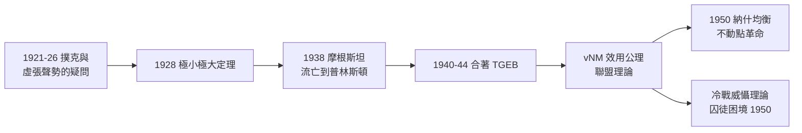

# 2.3 賽局論與《賽局與經濟行為》（1928–1944）

1928 年，25 歲的馮紐曼證明**極小極大定理**（1.3），點燃賽局論的火種；1944 年，他與奧地利經濟學家**摩根斯坦**（Oskar Morgenstern）合著《賽局與經濟行為》（Theory of Games and Economic Behavior, TGEB）出版，將火種燎原。這本六百餘頁的巨著，是數學家正式入侵社會科學的第一場總攻，也是馮紐曼「數學應當支配人的行為科學」信念的最大實踐。

## 前史：從撲克到定理

- 1921–1926 年的求學期（1.2），撲克牌桌是布達佩斯與柏林沙龍的日常——馮紐曼對「虛張聲勢」（bluffing）能否被數學化極感興趣；
- 鮑萊爾 1921 年已提出「策略」的初步概念但未證成；1926 年哥廷根的研討會上，馮紐曼聽到討論後「在腦中把問題關掉再打開」；
- **1928 年**《論 parlor games》證明：任何有限**二人零和賽局**，允許**混合策略**（隨機化）時，必存在鞍點：
$$\max_{p}\min_{q}\; p^T A q \;=\; \min_{q}\max_{p}\; p^T A q;$$
- 這個定理的哲學含義巨大：**理性對抗中，隨機化是必需的**——「不讓對手預測」本身就是策略。十五年後，這正是冷戰核威懾的數學原型（4.3）。

## 摩根斯坦與合著的誕生

1938 年，維也納學派圈的經濟學家摩根斯坦流亡到普林斯頓（2.2 的流亡潮之一）。1938–1940 年間：

- 摩根斯坦 1928 年的著作《經濟預測》曾抱怨經濟學「缺乏理性的對抗模型」，並在書中犯了個小錯——馮紐曼在聚會上善意地當眾指出，兩人就此結識；
- 1940 年起，摩根斯坦以「馮紐曼想要有人幫他把數學翻譯成經濟學」的身分開始合作。實情微妙：**數學是馮紐曼的，經濟學框架是摩根斯坦的**，兩人為署名順序與貢獻比例終身各有說法；
- 1944 年，普林斯頓大學出版社出版 **TGEB**。書的結構：期望效用公理（即**馮紐曼–摩根斯坦效用**，vNM utility）、二人零和理論、以及全新的**多人賽局與聯盟理論**。

## TGEB 的三大貢獻

### 1. 期望效用的公理化

- 馮紐曼用幾條公理從「偏好」推出效用函數 $u$ 的存在性，使「理性人在不確定下做選擇」變成可計算的數學；
- 這條公理化路線（公理→表示定理）正是希爾伯特學派方法論（1.3、2.1）向社會科學的輸出；日後與**拉姆齊、薩維奇**的路線匯流，成為現代決策理論與行為經濟學「理性基準」的源頭——行為經濟學的諾獎成果（如前景理論）全部以 vNM 效用為對照組。

### 2. 零和二人賽局的完備解

- 線性規劃的對偶性被首次以賽局語言揭示；**對偶定理**後來由丹齊格與馮紐曼在 1947 年的著名會談中再次獨立發現（丹齊格講完單純形法，馮紐曼一小時內給出對偶理論與其等價於賽局論的證明——見 3.3、5.2）。

### 3. 多人合作賽局的「解」概念

- 特徵函數型賽局、聯盟、核（core）的雛形、穩定集（stable set）——經濟學自此擁有「**談判力量如何分配剩餘**」的嚴格模型；
- 1950 年代納什（Nash，普林斯頓博士生）用不動點定理證明**納什均衡**，將馮紐曼的合作路線推廣到非合作賽局；馮紐曼對納什的評價冷淡（「只是另一個不動點定理」）——這是他生涯罕見的判斷失誤：納什均衡後來成為比穩定集重要得多的概念，1994 年首屆賽局論諾獎得主的獎名正是**納什、海薩尼、澤爾騰**。

## 軍事應用的先聲

TGEB 出版的同年，馮紐曼已是美國海軍的顧問：

- **攻擊–防禦分配**、**搜尋論**（反潛作戰，與 Blackett、Morse 等運籌學家同場）；
- 他把極小極大直接用在「轟炸機 vs. 防空」的配置問題上；
- 這條軍事線在曼哈頓計畫（3.1）中爆發為決定性貢獻。

## 與同時代的對照

| 人物 | 時間 | 貢獻 | 關係 |
|------|------|------|------|
| 馮紐曼 | 1928/1944 | 極小極大、TGEB | 建國者 |
| 摩根斯坦 | 1944 | 經濟學框架、合著者 | 共同作者 |
| 納什 | 1950 | 非合作均衡 | 後繼者（馮紐曼當年低估） |
| 塔克 | 1950 | 「囚徒困境」命名 | 普林斯頓同事；其學生即納什 |
| 舒比克、奧曼 | 1950s– | 賽局論進入社會科學各領域 | TGEB 的學術子孫 |

### 「在數學裡沒有股價」：對經濟學的方法論判決

TGEB 的第一章有一個常被忽略的宣言，它解釋了這本書為何影響深遠：

- 馮紐曼直指經濟學的失敗根源：**物理學的成功靠的是把「結果」分成可分離的單變量，而經濟學的每一個結果都是無數「行為者互相預期對方」的產物**——沒有單變量，只有互動；
- 因此經濟學需要的不是「更多的統計」，而是**互動的數學**——賽局論正是為此而生；
- 這個判決預言了此後七十年的路線之爭：**總體計量派**（用統計歸納）與**理性選擇派**（用賽局與公理）至今仍在爭奪經濟學的心臟——兩派都自認有理，而馮紐曼當年兩個都沒做（他沒算數據，也沒建宏觀模型），他只提供了武器；
- 薩繆爾森的評語是這場戰爭的最佳註腳：「馮紐曼的書像一柄給了經濟學的劍——問題是沒有人知道該朝哪個方向揮。」三十年後（1970s–90s），方向被找到了：拍賣、合約、政治與演算法（5.3）。

## 事件關聯與前因後果

| 年份 | 事件 | 後續影響 |
|------|------|----------|
| 1928 | 極小極大定理 | 賽局論誕生 |
| 1938 | 摩根斯坦抵普林斯頓 | 合作的種子 |
| 1941–43 | 合著起草；馮紐曼同時投入戰爭數學 | 軍事運籌與賽局互相餵養 |
| 1944 | TGEB 出版 | 數理經濟學紀元 |
| 1947 | 與丹齊格的對偶定理會談 | 線性規劃的數學確認（5.2） |
| 1950 | 納什均衡；囚徒困境 | 非合作賽局時代開啟 |
| 1994 | 賽局論首次獲諾獎 | TGEB 路線的制度化加冕 |

**因果**：這條線的前因是雙重的——哥廷根的數學訓練（1.3）給了方法，撲克桌與戰爭（1.1、2.2）給了問題意識。後果更是雙向的：**往經濟學**，TGEB 使「理性選擇」成為整個學科的通用語言（薩繆爾森、阿羅、德布魯的數理化革命都在其延長線上）；**往軍事與計算**，賽局論的矩陣計算直接逼出對高速計算機的需求——丹齊格的單純形法、RAND 的戰略模擬、乃至蘭德公司的核戰推演（4.3），全部是「需要算」的賽局。換言之：**賽局論是電腦的第一批殺手級應用之一**，而它的作者正是電腦的發明人——這不是巧合，是同一顆腦袋的兩個出口。

## 小結

- 1928 年極小極大定理＋1944 年 TGEB，構成賽局論的「創世記」上下卷；
- vNM 期望效用公理是二十世紀社會科學被引用最廣的數學結構之一；
- 與摩根斯坦的合作，示範了馮紐曼的「跨域合夥」模式：數學家供引擎、領域專家供地圖；
- 他低估了納什均衡，是他生涯少數的判斷失誤——天才的盲區往往在他自己沒深耕的角落；
- 1943 年，戰爭已把他拉向洛斯阿拉莫斯：賽局論的最極端應用——如何用數學贏得熱戰與冷戰（見 3.1、4.3）。
