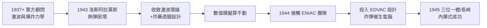

# 3.1 曼哈頓計畫與內爆式設計（1943–1945）

1943 年秋，馮紐曼以顧問身分加入**曼哈頓計畫**，頻繁往返於普林斯頓與洛斯阿拉莫斯。他沒有全程參與，卻在計畫最危急的關口——**鈽彈的內爆式設計**——提供了決定性的數學。廣島的鈾彈用的是「槍法」，而長崎的鈽彈「胖子」用的正是馮紐曼參與敲定的內爆方案。他是那個「把炸彈變成可行工程」的數學家。

## 加入的因果鏈

馮紐曼的戰爭參與是一條環環相扣的鏈：

- **1937 年起**：他已是美國陸海軍軍械部門的顧問——流亡者（1.1、2.2）把「打敗納粹」當成個人使命；他申請軍官職被拒（年齡因素），轉而以科學顧問參戰；
- **1939 年**：西拉德—愛因斯坦信件（其技術起草者是他的匈牙利老鄉西拉德，1.1）啟動了美國的鈾研究；
- **1941–43 年**：他在英國、美國的炸彈與反潛問題上做衝擊波研究——**爆炸波的數學**（流體力學、激波反射）成為他的主業之一；
- **1943 年秋**：奧本海默親自邀請他加入洛斯阿拉莫斯理論部——因為計畫有一個燙手問題無人能解：**如何讓鈽彈起爆**。

## 為什麼鈽彈必須「內爆」

1943–44 年的困境：

- **鈾-235**：臨界質量可以用「槍法」——把兩塊亞臨界鈾用炸藥射到一起；簡單可靠，廣島的「小男孩」即此；
- **鈽-239**：反應堆生產的鈽含有同位素鈽-240，自發裂變率極高——槍法太慢，彈芯在完全壓縮前就會**提前起爆**（pre-detonation），變成一聲啞炮；
- 唯一出路是**內爆式**（implosion）：用炸藥從四面八方同時擠壓亞臨界鈽核，把它壓到超臨界——擠壓速度快到先於自發裂變完成；
- 問題：這需要**幾十個起爆點在微秒級同時對稱地**壓縮一個球形金屬塊——流體動力學上幾乎無解。

## 馮紐曼的貢獻：激波透鏡與收斂激波

1943–44 年，馮紐曼做了三件互相咬合的工作：

1. **球面收斂激波的理論**：證明向球心收斂的激波在接近中心時會**自增強**（振幅趨於無窮），這給內爆提供了物理可行性論證；
2. **炸藥透鏡設計**（explosive lens）：利用快慢兩種炸藥的組合，把平面爆轟波「折射」成球面收斂波——數學上等價於光學透鏡的設計問題，他用激波反射的理論（此前為海軍做的）直接求解；
3. **數值模擬**：內爆的流體方程**解析法無解**，只能數值計算——而人力計算的精度與速度完全不夠。他與洛斯阿拉莫斯的年輕人用桌式計算器與 IBM 打卡機做數百萬次運算，苦不堪言。

### 第三點是真正的歷史樞紐

- 1944 年夏，馮紐曼在賓州摩爾學院（Moore School）遇到**ENIAC** 團隊——一台為彈道表建造中的電子計算器（見 3.2）；
- 他立刻意識到：**內爆模擬、天氣預報、氫彈，全都需要這種機器**；
- 他隨後全力投入 EDVAC 的邏輯設計——**炸彈的需要，直接催生了電腦的架構**。這是本傳記最重要的因果跳接：3.1 與 3.2 之間的橋，就是「內爆問題算不動」這六個字。

## 三位一體與戰後

- **1945 年 7 月 16 日**：三位一體試爆成功，內爆式設計被驗證；馮紐曼事先用他最喜歡的方式押注結果——他計算了爆炸的破壞半徑，並已著手計算對**日本城市的目標分析**（他參與了目標委員會，主張不預先警告以最大化心理衝擊）；
- **1945 年 8 月 6、9 日**：廣島（槍法鈾彈）與長崎（內爆式鈽彈）；戰爭結束；
- 馮紐曼的反應複雜而清醒：他從不悔恨「結束戰爭的炸彈」，但立刻開始思考**下一場戰爭**——氫彈與蘇聯。他的名言：「如果你說我們不應該造炸彈，那你就是在說我們應該讓希特勒、史達林造炸彈。」

## 同事眼中的馮紐曼

- 洛斯阿拉莫斯的年輕物理學家把他當成「半人半神」：任何人都可推門找他，他會**當場**把對方的方程在腦中展開、給出漸近解或指出錯誤；
- 費曼回憶：馮紐曼曾對他說：「你不用為造炸彈負道德責任——**瘋狂的社會責任在於社會**，你只是提供了一個誠實的答案。」這句話成為費曼的救贖之一；
- 泰勒（特勒，1.1 老鄉）拉他進**氫彈**的早期構想——1946 年著名的秘密會議上，馮紐曼的數值計算支持了泰勒的路線（日後 H-bomb 之爭的另一面，見 4.3）；
- 而在計算的世界裡，他同時在與**香農**（→ 詳見《香農傳記》第 3 章，貝爾實驗室的密碼與資訊論）、**圖靈**（→ 詳見《圖靈傳記》第 5 章，英國的 Colossus 與 ACE）平行作戰——三條戰線在 1945–46 年匯成「電腦誕生」的同一個事件。

## 內爆問題的三個數學化瞬間

把馮紐曼對內爆的貢獻拆成技術細節，可以看到「數學救活一枚炸彈」的完整過程：

- **瞬間一：可行性論證（1943 冬）**。他證明收斂激波在理想氣體中接近球心時壓力無限放大（自相似解的漸近行為），把「內爆」從直覺變成定理——物理學家因此敢押注這條路線；
- **瞬間二：幾何設計（1944）**。炸藥透鏡要求兩種爆速不同的炸藥介面曲線滿足特定的激波折射條件——這是一個變分問題，他給出了可直接交付車間的曲線計算；
- **瞬間三：不對稱性除錯（1944–45）**。實驗顯示起爆點的微小時差會造成射流（jets）破壞對稱壓縮；他推導出可容忍的起爆同步誤差上界，直接決定了同步起爆器的規格；
- 三個瞬間的共同點：**每一個都是把「物理學家說大概可以」翻譯成「工程師可以照著做」**——這正是他一生的核心技藝。

### 對照：廣島的槍法為何不需要他

值得注意的歷史細節：**廣島的鈾彈幾乎沒有用到馮紐曼**：

- 槍法在力學上平庸——兩塊亞臨界鈾以炮速相撞，誤差容忍度大，無需內爆數學；
- 換言之：如果 1945 年的美國有足夠的鈾-235，**歷史可能根本不需要「馮紐曼架構」被戰爭催生**——正是鈽的物理性質（鈽-240 的自發裂變）把計算的難度抬到了人力不可及的高度，才逼出了電子計算機的黎明；
- 史家因此說：**「胖子」的複雜性，是數位時代的第一因**。

## 事件關聯與前因後果

| 年份 | 事件 | 後續影響 |
|------|------|----------|
| 1937–42 | 軍方爆炸力學顧問 | 內爆問題的理論庫存 |
| 1943 | 加入曼哈頓計畫 | 主戰場確立 |
| 1943–44 | 收斂激波＋炸藥透鏡 | 鈽彈內爆可行 |
| 1944 夏 | 洛斯阿拉莫斯人力計算瓶頸 | 數值需求→對電子計算機的執念 |
| 1944.8 | 接觸 ENIAC/摩爾學院 | EDVAC 邏輯設計啟動（3.2） |
| 1945.7–8 | 三位一體、廣島長崎 | 冷戰原子秩序；馮紐曼轉向氫彈（4.3） |

**因果**：這一章的「前因」是三股線的交匯——流亡者的復仇意志（1.1）、賽局論式的戰爭觀（2.3）、化學工程的尺度感（1.2）；「後果」則是雙生的：一枚炸彈（改寫國際政治，見 4.3）與一台機器（改寫一切，見 3.2）。值得與香農對照：香農在戰爭中做密碼分析，收穫的是**資訊理論**（→ 詳見《香農傳記》第 3 章）；馮紐曼在戰爭中做爆炸模擬，收穫的是**電腦架構**。戰爭給兩人各自的禮物，恰好拼出數位時代的一半拼圖——另一半由圖靈的 ACE 與曼徹斯特機補上（→ 詳見《圖靈傳記》第 6 章）。

## 小結

- 馮紐曼在曼哈頓計畫的核心貢獻：**內爆式設計的數學**——收斂激波理論、炸藥透鏡、以及「必須用機器算」的判斷；
- 「內爆算不動」是 EDVAC 誕生的直接工程動機：炸彈是電腦的助產士；
- 他對使用原子彈的立場是冷靜的工具理性，戰後立刻轉向氫彈與威懾理論（4.3）；
- 洛斯阿拉莫斯也把他推進了與工程師、年輕物理學家共事的新模式——這種模式日後在 IAS 的計算機計畫中原樣復刻（3.3）；
- 戰爭結束了，但他與「計算」的婚姻才剛開始：下一節是 1945 年那本改變世界的報告（見 3.2）。
