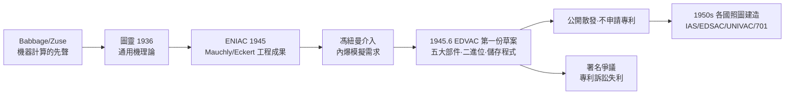

# 3.2 EDVAC 報告與馮紐曼架構（1945）

1945 年 6 月，一份百餘頁、只有一個作者署名的文件在賓州大學摩爾學院流傳：《EDVAC 報告書的第一份草案》（First Draft of a Report on the EDVAC），署名**僅馮紐曼一人**。這份未完成的草案，是人類第一次以**邏輯完備**的方式描述一台儲存程式式數位計算機——今日全世界幾乎所有電腦的組織方式，都被稱為**馮紐曼架構**。它同時也是一場著名爭議的起點：這個架構，究竟屬於誰？

## 背景：ENIAC 與摩爾學院

- **ENIAC**（1943–45，Mauchly 與 Eckert 主導建造）：美國陸軍彈道研究實驗室出資的電子計算器，一萬八千支真空管，**沒有儲存程式**——改一個程式要重接數天的線纜；
- **1944 年 8 月**，馮紐曼（為內爆模擬而來，3.1）首次參加 ENIAC 會議，幾週內就成為團隊的邏輯顧問；
- **1944–45 年**，摩爾學院開始設計後繼機 **EDVAC**：目標是把程式放進記憶體、像資料一樣被處理——即**儲存程式**（stored-program）概念；
- 1945 年春，馮紐曼在火車上起草、與 Goldstine 與 Arthur Burks 討論後，寫出《第一份草案》。

## 草案的內容：一台被「公理化」的機器

馮紐曼的寫法正是他一生的標誌——**先公理，後構造**（1.3、2.1 的方法論第三度出征）：

1. **將機器抽象為邏輯元素**（e-elements）：不必先管真空管還是繼電器，先定義神經元式的抽象開關；
2. **五大部件**：運算器（CA）、控制器（CC）、記憶體（M）、輸入（I）、輸出（O）——今日課本的「運算/控制/記憶/輸入/輸出」即源於此；
3. **程式與資料同儲於記憶體**，皆以**二進位**編碼，指令可被修改——這是「儲存程式」的嚴格表述；
4. **串列執行**：一條一條取指、執行——後來被稱為「馮紐曼瓶頸」，成為日後平行計算革命批判的靶子（5.3）；
5. 數值表示、進位、溢位、甚至指令格式（他設計的短指令至今猶見於 RISC 精神）——從抽象到接地，一氣呵成。

### 理論的影子：圖靈機

草案的哲學底牌是 2.2 那段「錯過的合夥」：

- 圖靈機證明了**單一固定機器可以執行任何可計算過程**，只要「程式」本身是資料（通用圖靈機）；
- 馮紐曼把「通用機」從數學理想拉進物理世界：**記憶體中的程式＝圖靈機的紙帶；CPU＝讀寫頭＋狀態**；
- 他本人多次承認這一點，並說：「圖靈的理論早已給出答案，工程師要做的只是跟上來。」

## 爭議：署名之戰

《第一份草案》只署馮紐曼一人，立即引爆：

- **Eckert 與 Mauchly**的主張：儲存程式的想法在他們 1944 年的專利備忘錄中已有；「高-speed 記憶」的水銀延遲線是他們的工程創見；
- **Goldstine**（陸軍聯絡官，後成為馮紐曼終身搭檔）的說法：把概念邏輯化、系統化、可傳播化的，是馮紐曼——草案是思想的結晶而非紀錄；
- **公平的史觀**大概是三層結構：
  - Eckert/Mauchly：工程與儲存介質的具體創意；
  - 馮紐曼：邏輯架構、公理化表述、以及**最重要的——把它寫成公開文件**，使任何實驗室都能照著造（他堅持不申請專利、公開散發）；
  - 圖靈（以及更早的 Babbage、Zuse）：儲存程式概念的理論源頭（→ 詳見《圖靈傳記》第 6 章）；
- 後果之一：Eckert/Mauchly 憤而轉向商業（UNIVAC），並在專利訴訟中失敗——**馮紐曼的「不專利」立場，客觀上加速了電腦產業的百花齊放**；
- 後果之二：Goldstine 隨馮紐曼回到普林斯頓，成為 IAS 機計畫的實際經理（3.3）。

## 「馮紐曼架構」的名與實

- **名的由來**：因草案唯一署名，文獻學界以作者命名機型；馮紐曼本人對此並不享受——他說過「任何夠聰明的人都看得出架構應該如此」，並在 IAS 期間刻意把功勞往同事推；
- **實的內涵**：直到今天，「馮紐曼架構」與「哈佛架構」（程式與資料分儲）仍是一切計算機組織課程的第一課；GPU、多核心、甚至量子計算的控制層，本質上仍是在馮紐曼瓶頸上做各種繞行；
- **瓶頸與其反抗**：指令與資料共用一條通道→效率受限；1950 年代的反抗者包括做細胞自動機的馮紐曼自己（4.1）與做連接機的 Hillis（5.3）——「馮紐曼機器」與「反馮紐曼機器」的鬥爭貫穿了整個計算史。

## 摩爾學院的研討會：架構的孵化器

《第一份草案》不是憑空寫出，而是 1945 年春夏**摩爾學院系列研討會**（Theory and Techniques for Design of Electronic Digital Computers）的結晶：

- 與會者除馮紐曼、Mauchly、Eckert、Goldstine、Burks 外，還有來自英國、甚至蘇聯觀察員——這是史上第一次「計算機設計」的公開課堂；
- 馮紐曼在會上的講授方式留下傳說：他把機器的每一個邏輯元素畫成**神經元式的小圓圈**，用「激發／不激發」的語言推演整機行為——麥卡洛克—皮茨模型（4.1）的影子清晰可見；
- **二進位的決定**也在這些會議中敲定：ENIAC 用十進位（工程師的習慣），而草案改用二進位——理由正是 2.2 的理論傳統（圖靈機、布爾代數皆為二值）；這一改動把數學邏輯史與硬體史焊在一起；
- 研討會結束後數月，團隊解散在即（戰爭結束、專利紛爭），草案成為這段集體智慧的**唯一完整文獻**——而它只署一個名字。

### 「公開」的代價與紅利

馮紐曼拒絕為架構申請專利，這個決定的會計學值得一看：

| 立場 | 得 | 失 |
|------|----|----|
| 馮紐曼/IAS | 學術聲望、全球複製、人才湧入 | 無專利收入 |
| Eckert/Mauchly | UNIVAC 商業公司 | 專利訴訟纏身，1950s 敗訴 |
| 世界 | 計算機設計成為公共財 | 電腦工業壟斷延後數年 |

- 1973 年著名的專利判決（Honeywell v. Sperry-Rand）裁定 ENIAC 專利無效，儲存程式概念被認定為「已在公共領域」——法理依據正是草案的公開流傳；
- 香農在貝爾實驗室從未為資訊論申請專利（→ 詳見《香農傳記》第 4 章），馮紐曼在 IAS 不為架構申請專利——**兩位奠基者同時選擇了公共財路線**，這不是巧合，而是「數學家的帝國主義」：讓思想占領世界，比讓法律保護思想更快。

## 事件關聯與前因後果

| 年份 | 事件 | 後續影響 |
|------|------|----------|
| 1944.8 | 馮紐曼接觸 ENIAC 團隊 | 戰爭計算需求→電腦工程 |
| 1944–45 | 摩爾學院研討會、草案起草 | 儲存程式概念的凝結 |
| 1945.6 | 《EDVAC 第一份草案》流傳 | 架構成為公共財 |
| 1946 | 與 Eckert/Mauchly 的署名裂痕 | 商業路線（UNIVAC）vs. 學術路線（IAS）分岔 |
| 1946 | Goldstine 隨行至普林斯頓 | IAS 機計畫啟動（3.3） |
| 1948–52 | 全球「照圖造機」熱潮 | 電腦工業的起跑線 |

**因果**：這一章的前因鏈最長：布達佩斯的神童（1.1）→ 希爾伯特的形式化訓練（1.3）→ 圖靈的通用機（2.2）→ 內爆的計算危機（3.1），四環扣出《第一份草案》。後果則是**無界**的：草案之後，計算機從「一項工程的附屬品」變成「一個可以被任何人複製的邏輯物種」；香農的位元（→ 詳見《香農傳記》第 4 章）提供了資訊的度量，馮紐曼的架構提供了資訊的**居所**——理論與居所在 1950 年代的普林斯頓直接合作（3.3）。

## 小結

- 《第一份草案》= 馮紐曼方法論（公理化）× 圖靈理論（通用機）× 戰爭工程（ENIAC）的結晶；
- 五大部件、二進位、儲存程式、串列執行——現代電腦的第一張完整藍圖；
- 署名爭議提醒我們：**思想的三個層次**（理論源頭/邏輯整合/工程實現）分屬圖靈、馮紐曼、Eckert-Mauchly，而把三者熔成一個可複製物的，是那個不申請專利的數學家；
- 馮紐曼瓶頸成為日後六十年計算體系鬥爭的主軸（5.3）；
- 藍圖已公開，接下來是造出真機：IAS 機、蒙地卡羅、以及全球第一場「氣象計算」（見 3.3）。
