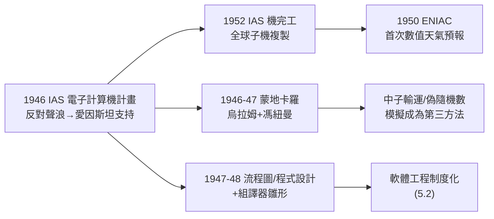

# 3.3 IAS 機與蒙地卡羅法、ULTRA 氣象（1946–1952）

1946–1952 年，馮紐曼在普林斯頓高等研究院（IAS）主持**電子計算機計畫**，造出了以數理邏輯機（Mathematical and Numerical Integrator and Computer）聞名的 **IAS 機**——它被全世界十餘個實驗室「照圖複製」，是第一代電腦的直系祖先。同時，他與烏拉姆（Stanislaw Ulam）發明**蒙地卡羅法**，並把一台機器推向一個當時瘋狂的目標：**用數值方法算出天氣**——1950 年的第一次數值天氣預報，是科學計算作為一門學科的誕生儀式。

## IAS 機：從草案到銅鐵

- **1946 年**：馮紐曼、Goldstine（3.2 隨行者）、與計畫主管艾科特（不是 ENIAC 那位；工程師 Julian Bigelow 任首席工程師）啟動計畫。IAS 董事會內部為「純數學聖地造機器」激烈反對——愛因斯坦投下有分量的支持票，計畫通過；
- **設計哲學**：盡量簡單、開放、可複製。1948 年完成邏輯設計，1952 年機器完工：平行加法器、威廉管記憶（後改 CRT 儲存）、1024 字元記憶體；
- **「複製大軍」**：蘭德公司的 JOHNNIAC（以馮紐曼命名）、阿貢的 ORACLE、伊利諾的 ILLIAC、英國的 ILLIAC 表親、澳大利亞的 CSIRAC、以色列的 WEIZAC、蘇聯的仿製品……**一台母機，全球子機**。這種「母機—子機」傳播模式，正是 3.2「公開、不專利」策略的兌現；
- **軟體同源**：Goldstine 與馮紐曼在 1947–48 年發表《程式設計與流程圖》（Flowcharting），把**流程圖**制度化——這是程式設計作為一門工藝的第一份教科書；1951 年左右他們還做出了最早的**組譯器與組合語言**雛形（見 5.2）；
- **人才搖籃**：年輕工程師與數學家在此進出，其學術孫輩遍布 MIT、貝爾實驗室與 IBM——其中包括與**香農**（→ 詳見《香農傳記》第 4 章）在貝爾實驗室的後續合作者們。

## 蒙地卡羅法：把物理問題變成賭場

- **1946 年**，烏拉姆在洛斯阿拉莫斯養病玩接龍時想到「用統計抽樣代替解析求解」，興奮地與馮紐曼討論；馮紐曼**當場**設計出完整的計算方案，次日交出一套可執行的演算法（人稱「Monte Carlo」之名出自 Metropolis 的賭城玩笑）；
- **本質**：對高維積分或複雜隨機過程，不做解析解，而是**用偽隨機數大量抽樣、以頻率逼近機率**：
$$\int f(x)\,dx \;\approx\; \frac{1}{N}\sum_{i=1}^{N} f(X_i),\quad X_i\sim p;$$
- 首批應用全是**中子輸運**（核武與反應堆設計）——中子在物質中撞擊散射的路徑正是天然隨機過程；化學工程出身（1.2）的馮紐曼對「微觀無序→宏觀確定」的統計圖像駕輕就熟；
- **偽隨機數的難點**：機器裡沒有真正的骰子。馮紐曼發明**平方取中法**（middle-square method）——世界第一個系統化的偽隨機數產生器，並留下一句自嘲名言：「任何妄想用算術方法產生隨機數的人，當然是活在罪惡的狀態裡。」
- **蒙地卡羅的世界性後果**：它把「模擬」變成第三種科學方法（理論、實驗之外）；日後的金融定價、分子動力學、路徑積分（費曼）、貝氏推斷（MCMC）、以及所有遊戲引擎的物理，全是它的子孫。

## ULTRA 氣象：第一次數值天氣預報

- **動機**：馮紐曼戰前就關注大氣動力學；他主張「只要算力夠，氣象就是一個（可預報的）流體力學邊值問題」——一個冷戰色彩的遠景是：**控制天氣**（他認真討論過給北極撒炭黑融冰的「氣候工程」）；
- **1948–50 年**：他與氣象學家 Charney、Norwegian 學派的 Rossby、以及計畫同事組隊，把正壓渦度方程簡化到 IAS 機能算的程度；
- **1950 年 4 月**：人類歷史第一次**數值天氣預報**在 ENIAC 上完成（借調賓州機器），24 小時預報算出來了——雖然粗糙（精度差、且原始模式偏移大），但**原則被證明**；
- **1952 年後**：IAS 機接手，聯合數值天氣預報單位（後為 NMC/ECMWF 的前身）成立——今日你手機上的天氣預報，是這條線的直接後代；
- **軍事暗面**：同一套模式也被用於核爆後放射性塵埃擴散的計算——「ULTRA 氣象」之名即暗含軍事最高優先級的味道。

## 與香農、圖靈的三方共振

1940 年代末，三人在紐澤西與賓州構成三角：

- **香農**（→ 詳見《香農傳記》第 3–4 章）1948 年發表《通訊的數學理論》：**資訊＝熵＝位元**；馮紐曼曾建議他叫它「entropy」，理由是「沒有人知道熵是什麼，你在辯論中永遠占上風」——這句玩笑成為科學史名段；
- **圖靈**（→ 詳見《圖靈傳記》第 6 章）在曼徹斯特造 Mark I，並寫下第一篇**機器智能**宣言（1950）；馮紐曼讀到並支持其「模仿遊戲」的立場；
- **馮紐曼**供給**架構**與**計算實踐**：IAS 機同時是「跑賽局的機器」「跑氣象的機器」「跑蒙地卡羅的機器」——**計算作為科學方法**的第一次全方位示範。

## IAS 內部的緊張與馮紐曼的雙重身分

計畫十年間，IAS 這座「純數學聖殿」與機器的關係始終緊張：

- **純粹派**的反對從未停止——數學家們抱怨真空管、冷氣與工程師打亂了「無用之大用」的環境；1950 年代中期，院方甚至一度考慮把機器搬到別處；
- 馮紐曼的應對是**兩邊同時論證**：對數學家，他說「機器將做純數學做不到的實驗」（數論的蒙地卡羅驗證、偏微分方程的數值實驗）；對董事會，他說「機器將保衛國家」（氣象、核計算）——兩種說法都是真話，這正是他的本色；
- **1956 年他離職赴 AEC**（4.3）後，計畫失去引擎；1957 年 IAS 院方一度解散計算部門，機器移往普林斯頓大學——「聖殿與機器」的婚姻，在他生前靠他一人維繫；
- 這段歷史成為日後所有「研究所該不該建大型計算設施」爭論的原型案例：答案是**該，但需要一個馮紐曼**。

### 「數值實驗」的方法論宣言

馮紐曼在 1940 年代末的一系列講稿中反覆陳述一個新命題：

- 傳統科學方法二分：**理論**（演繹）與**實驗**（歸納）；
- 計算機開啟第三種：**數值實驗**——用機器跑出解析法無法觸及的解，再從中「看出」規律；
- 他預言：「這將使數學物理的研究方式發生比望遠鏡之於天文學更大的改變。」
- 七十年後回看：氣候模式、分子動力學、宇宙學模擬、LLM 的訓練本身，全是這個宣言的註腳。

### 氣象與戰爭的另一層：對蘇計算

不能忽略 1950 年代初氣象計算的軍事動機的另一面：

- **核戰情境**：一旦開戰，氣象數據是轟炸路線、放射性塵埃與「先發打擊時窗」的關鍵輸入——數值預報的原始客戶之一是戰略空軍司令部（SAC）；
- 馮紐曼在內部會議上直白地說過：能精確算風的人，就能精確算「塵埃落在誰頭上」——他把這個能力同時獻給了科學與戰爭，如同內爆之於 EDVAC（3.1→3.2）的因果結構重演；
- 同期他還推動了用 IAS 機做的**最早的大規模數論實驗**（篩法、素數分佈的統計檢驗）——「用機器做數學實驗」自此成為數論的新傳統（日後的黎曼零點計算、有限單群的搜索皆其後代）。

## 事件關聯與前因後果

| 年份 | 事件 | 後續影響 |
|------|------|----------|
| 1946 | IAS 電子計算機計畫啟動 | 「母機—子機」全球傳播 |
| 1946–47 | 蒙地卡羅法發明 | 模擬成為科學第三方法 |
| 1947 | 平方取中法偽隨機數 | 計算隨機性研究的起點 |
| 1947–48 | 流程圖與程式設計方法論 | 軟體工程前史（5.2） |
| 1948 | 香農資訊論問世；「熵」命名軼事 | 資訊與計算的理論合流 |
| 1950 | ENIAC 首次數值天氣預報 | 科學計算的誕生儀式 |
| 1952 | IAS 機完工；JOHNNIAC 等子機 | 第一代電腦工業成形 |

**因果**：本章的前因是 3.2 的公開藍圖＋洛斯阿拉莫斯的計算飢渴；後果則向四方放射——**往科學**：氣象、流體、核物理獲得新方法論；**往工程**：流程圖、組譯器、以及 IAS 培養的人才網（其中一支直接成為 1940 年代末貝爾實驗室與 MIT 的計算骨幹，與香農的資訊論陣營合流）；**往理論**：蒙地卡羅逼出的隨機性問題，把香農的熵從通訊帶進一切模擬；**往戰爭**：氣象控制與塵埃計算預示了冷戰的「科學—軍事復合體」（4.3）。與圖靈的曼徹斯特機、香農的資訊論並置，可以說：**1945–1952 這七年，三個人合力把「計算」從一項工程升格為一個文明基礎設施**。

## 小結

- IAS 機＝第一張藍圖（3.2）的物理兌現＋全球複製：馮紐曼架構就此成為世界標準；
- 蒙地卡羅法＝統計思維（1.2、2.1）× 機器算力的首度合體，「模擬」自此與理論、實驗三足鼎立；
- 1950 年 ENIAC 數值天氣預報，是「用機器代替思考的解析天才」的宣言——馮紐曼自己就是最後一代解析天才，卻親手為數值時代接生；
- 流程圖與組譯器是軟體工程（5.2）的種子；
- 機器跑起來了，接下來的問題更深：**機器能不能思考？能不能自我複製？**（見 4.1）
