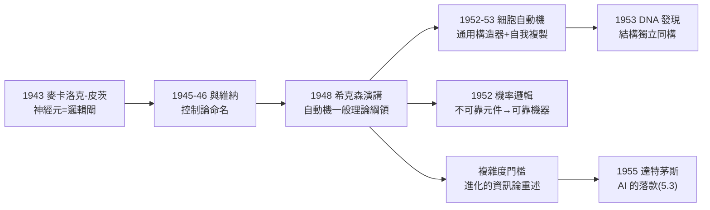

# 4.1 自動機理論與細胞自動機、自我複製（1948–1956）

1948 年 9 月，希克森（Hixon）研討會上，馮紐曼發表演講〈自動機的一般邏輯理論〉，正式提出一個宏大的綱領：**把「機器」像「數」一樣公理化，建立一部「自動機的一般理論」**。這個綱領孕育了三項改變世界的主題：**細胞自動機、自我複製機器、可靠性的機率邏輯**。它們在馮紐曼生前只完成一半，卻成為日後複雜性科學、人工生命與分散式計算的思想源頭。

## 前因：從「造機器」到「問機器是什麼」

1946–48 年間（3.3），馮紐曼在 IAS 造真機，同時被幾個問題燒著：

- **可靠性**：真空管幾小時壞一支，機器越大越不可靠——腦有 $10^{10}$ 個「元件」，為何能日復一日無錯運轉？（此問通往 4.2 的《計算機與大腦》）；
- **自我複製**：製造機器的勞力成本是瓶頸——**機器能不能造機器**？這既是工程夢想，也是生物學的根本問題；
- **理論真空**：圖靈機刻畫「計算」，但**沒有刻畫「構造」**——沒有一部「構造性的計算幾何」告訴你機器如何長出機器。

1948 年前後，他與**麥卡洛克、皮茨**（McCulloch–Pitts 神經元模型，1943）通信密切——那個「神經元＝邏輯閘」的模型（→ 詳見《圖靈傳記》第 7 章背景）正是他自動機理論的原子；1945–46 年他與**維納**（Norbert Wiener）頻繁合作，**控制論**（cybernetics）一詞正是在這對搭檔的通信中定名的。兩人後因優先權問題冷淡，但維納的「反饋」思想已深植於馮紐曼的自動機觀。

## 細胞自動機：把空間離散化的機器

要讓「機器造機器」可分析，馮紐曼需要一個**連續幾何與工程圖紙都被離散化**的世界：

- **1952–53 年**，在數學家烏拉姆的建議下，他採用「**細胞空間**」：一個巨大的方格，每格是一個有限狀態的細胞，按局部規則同步更新——**細胞自動機**（cellular automaton）由此誕生；
- 他在這個宇宙裡做出驚人的構造（1952–53 年手稿，後由 Burks 於 1966 年輯成《自我複製自動機理論》出版）：
  1. **通用構造器**（universal constructor）：一個「工廠機器」$A$，讀取一卷描述帶 $\phi(X)$，就能在格子上**一步一步造出任意機器** $X$；
  2. **自我複製的邏輯解**：直接讓 $A$ 複製自己會遭遇「描述無限遞歸」（要造 $A$ 需要描述 $A$……）。馮紐曼的解法優雅至極——**三段式**：
     - $A$ 讀 $\phi(A)$ 造出 $B=A$；
     - **複製器** $C$：把帶子原樣複製一份；
     - 把複製的帶子 $\phi(A)$ 附到新 $A$ 身上，開機；
  - 結果：$A+B$ 造出 $A+\phi(A)$——**機器＋其描述＝自我複製單元**，遞迴終止；
- **與 DNA 的震撼巧合**：1953 年華生與克里克發現 DNA 雙螺旋——**DNA 是描述帶，核糖體是構造器，聚合酶是複製器**。馮紐曼的邏輯結構與分子生物學**在幾年前獨立同構**，且他預言了 DNA 之外還必須有一個「複製酶」的角色（1953 年後被逆轉錄酶與複製機制證實）。這使他成為**人工生命**（Artificial Life）被追認的創始人；
- **百年後的直系子孫**：康威的「生命遊戲」（1970，圖靈完備）、沃爾夫勒姆（Wolfram）的初等細胞自動機分類（1980s）、以及 GPU 上跑的一切模擬——全是 1953 年那卷手稿的後代。

## 自動機的機率邏輯：不可靠元件造可靠機器

1952 年，他在加州理工講座**《自動機的機率邏輯》**（Probabilistic Logics and the Synthesis of Reliable Organisms from Unreliable Components）：

- 問題：元件失效率 $\epsilon$ 不可忽略時，如何讓複合系統可靠？
- 方案：**多路冗餘＋多數表決**（multiplexing），用冗餘度 $c\log(1/\epsilon)$ 級的元件換取任意低的整體錯誤率——與香農的無噪通道編碼定理（→ 詳見《香農傳記》第 4 章）在思想上同構：**可靠是可被編碼出來的**；
- 影響：容錯計算、RAID、太空梭的三冗餘系統、乃至今日神經網路的 dropout 正則化，都能在此找到思想祖先。

## 「複雜度的門檻」：自動機理論的哲學頂點

馮紐曼的自動機理論還包含一個驚人的哲學命題——**複雜度門檻**（complexity threshold）：

- 存在某個複雜度水準 $\theta$，機器低於它時，自動化合成的機器只會更簡單、更退化（衰變）；高於它時，**機器能造出比自己更複雜的機器**——進化在此開始；
- 這是對達爾文主義的資訊論重述，比「演化程式」的遺傳算法（其學生 Friedberg 1958 年的嘗試即出自馮紐曼建議）早了十年；
- 麥卡錫（→ 詳見《麥卡錫傳記》第 2 章）回憶，1955 年達特茅斯計畫書裡的「自動機理論」一項，指的正是馮紐曼這套——**AI 的出生證明上，有馮紐曼的落款**。

## 與維納的決裂：控制論的岔路

這條線的陰影面同樣重要。1945–46 年，馮紐曼與維納曾是親密無間的戰友：

- 兩人通信中**共同討論了「cybernetics」這個詞的定名**；1946 年普林斯頓的首次控制論會議，雙方各派主力出席；
- 但 1948 年維納《控制論》出版，將反饋、資訊與自動機的思想悉數冠以己名，並在信中暗示馮紐曼「搶走」了理念；馮紐曼則認為維納把工程問題哲學化、回避了嚴格證明；
- 兩人自此絕交。歷史的判決是分工式的：**維納得到「控制論」的名字與哲學光環，馮紐曼得到自動機的數學與其工程子孫**——前者在 1960 年代式微，後者長成 AI 與複雜性科學；
- 皮茨在這場決裂中是犧牲品：他先後追隨維納（MIT）與麥卡洛克，與馮紐曼保持通信——1950 年代他黯然離開科學界，自動機理論失去了最有力的年輕執行者。

### 自動機理論的「未完成清單」

馮紐曼 1955 年前後在講稿中列出自動機理論尚缺的四大件，這份清單幾乎是往後六十年複雜性科學的目錄：

1. **機率的動力學**：自我複製＋突變的機率模型（→ 1958 年後由演化計算補上）；
2. **學習的自動機**：如何從經驗改寫描述帶（→ 强化學習與連接主義，→ 詳見《Hinton傳記》第 2–3 章）；
3. **能量的角色**：熱力學約束下的計算（→ Landauer 原理 1961）；
4. **通用性與複雜度門檻的定量理論**（→ 1990 年代的複雜適應系統，聖塔菲）。

## 事件關聯與前因後果

| 年份 | 事件 | 後續影響 |
|------|------|----------|
| 1948 | 希克森演講，自動機綱領 | 「機器的數學」成為學科 |
| 1948–50 | 與維納決裂；控制論分岔 | 自動機 vs. 反饋兩條路線 |
| 1952–53 | 細胞自動機與通用構造器 | 人工生命、複雜性科學源頭 |
| 1953 | DNA 雙螺旋發現 | 馮紐曼構造被生物學「驗證」 |
| 1952 | 機率邏輯講座 | 容錯計算的理論基礎 |
| 1955 | 達特茅斯提案引用自動機理論 | AI 學科的邏輯祖先（5.3） |
| 1966 | Burks 輯遺稿出版 | 理論遺產的公共化 |

**因果**：本章的前因是三股：造 IAS 機的工程焦慮（3.3）、麥卡洛克—皮茨的神經元抽象、維納的反饋觀。後果有三條主幹：**往生物學**——自我複製的三段邏輯先於分子生物學，成為理論生物學與人工生命的母體；**往計算**——細胞自動機與容錯設計滲入從 RAID 到 GPU 的整個工程譜系；**往 AI**——「複雜度門檻」與自動機理論進入 1955–56 年達特茅斯會議的議程（→ 詳見《香農傳記》第 5 章，香農與麥卡錫正是那次會議的召集人；→ 詳見《麥卡錫傳記》第 2 章）。馮紐曼沒有親自與會——他當時已被診出骨癌（4.2、5.1）——但 AI 的首份提案書，幾乎是他的自動機理論的展開。

## 小結

- 1948–1953，馮紐曼把「機器」公理化，建立了自動機的一般理論——繼數（1.3）、物理（2.1）、社會（2.3）之後的第四座公理化大廈；
- 細胞自動機中的通用構造器＋描述帶，解決了自我複製的邏輯悖論，並與 DNA 機制獨立同構；
- 機率邏輯證明「可靠可以從不可靠中合成」，與香農編碼定理思想同構；
- 「複雜度門檻」是對演化與 AI 最深的一次預言；
- 同時，他的身體正在崩壞——自動機理論的最後一個應用對象，是他自己的大腦（見 4.2）。
