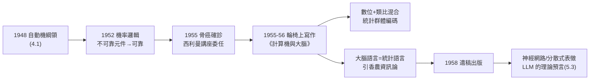

# 4.2 錯誤的可靠腦與《計算機與大腦》（1955–1957）

1955 年，馮紐曼被診斷骨癌（見 5.1）；同年他應耶魯之邀，接受**西利曼講座**（Silliman Lectures）的委任。他一邊與絕症賽跑、一邊坐在輪椅上寫出《計算機與大腦》（The Computer and the Brain，1958 年遺稿出版）——這是他對**大腦作為一種計算裝置**的數學解剖，也是自動機理論（4.1）的最後一章。書中的核心判斷之一——語言的統計性——日後在大型語言模型中被驚人地兌現。

## 前因：自動機理論的終極測試

「計算機與大腦」的比較，在馮紐曼那裡不是比喻，而是一場**兩個平行工程的互相檢驗**：

- 一邊是**工程腦**：馮紐曼架構——串列、精確、二進位、可靠性由工程保證（3.2、3.3）；
- 一邊是**生物腦**：$10^{10}$ 神經元、每個都慢（毫秒級 vs. 微秒級）、每個都不可靠、但整體極其可靠且極其省電；
- 4.1 的問題「不可靠元件如何合成可靠系統」在此升級為：**演化造出的這台機器，用什麼架構與語言？**

## 書中的核心論點

《計算機與大腦》篇幅不大，卻埋著十幾個未來學科的種子：

### 1. 數位 vs. 類比：大腦是混合機器

- 神經元的「全有全無」放電像數位位元；但突觸強度、放電率的**調變**明顯是類比的；
- 他的結論：大腦是**數位＋類比的混合計算系統**——這一判斷在今日神經形態晶體（neuromorphic computing）中才被工程化兌現；
- 他推算大腦的算力約 $10^{20}$ 位元/秒級、記憶體約 $10^{20}$ 位元——以 1955 年的技術，這是天文數字；以 2020 年代的算力曲線看，正是**AI 與腦算力交會的預言**。

### 2. 錯誤的可靠腦

- 神經元失效率遠高於真空管，但腦幾乎不出系統性錯誤；
- 他的答案呼應 4.1：**大規模冗餘＋統計式表徵**——資訊不在單一神經元，而在神經元**群體**的統計分佈裡；
- 這是今日**分散式表徵**（distributed representation）與神經網路的先聲：麥卡洛克—皮茨的單一邏輯閘模型被他自己修正為「**統計群體編碼**」。

### 3. 語言的統計性：遠超時代的判斷

《計算機與大腦》最後一段是本書最驚人的部分。他寫道：大腦使用的「語言」**不是我們數學的語言**——數學是後天發明的、極端特殊的外語；大腦的母語是**統計性的、組合性的、不滿足任何已知形式邏輯的語言**。他接著說：

> 「當我們的語言已經有這樣的性質時，我們就應該可以從統計的角度去描述它。」
> ——而他引用的正是 **C. E. Shannon 的資訊論**（→ 詳見《香農傳記》第 3 章）。

七十年後，這一段被反覆引用：**大型語言模型（LLM）正是「用統計結構逼近大腦語言」的實作**。香農的熵、馮紐曼的群體編碼、圖靈的通用機（5.2）——1955 年的這卷小書幾乎給出了一份 AI 的時間表（5.3）。

### 4. 未完成的部分

- 講座因病情惡化**沒有講成**：書只有兩講的草稿——「計算機」與「大腦」，第三講「兩者的比較」只留下筆記；
- 手稿由妻子克拉拉整理，耶魯大學出版社 1958 年出版；這本 150 頁的小書，成為馮紐曼**唯一面向大眾的科學遺囑**。

## 同期：原子能委員會與最後的公職

1955–1956 年，他同時在華盛頓擔任**原子能委員會**（AEC）委員（詳見 4.3）——白天在華府主持核政策文件，晚上回醫院寫大腦。這種「一人兩個終極戰場」的狀態，是他一生的縮影：**最深邃的理論與最直接的權力，同時握在同一隻手上**。

## 病榻上的演算法：最後的思考實驗

除了西利曼手稿，1956 年的馮紐曼還留下幾段病榻對話，日後成為 AI 史的注腳：

- **對哥德爾**：他反覆與探望者討論「哥德爾論證能否證明人腦勝過圖靈機」——他當時的結論是「不能，因為人腦自己也受不完備性的轄制」；這個判斷在 1961 年被哲學家 Lucas 撿起、1989 年被 Penrose 發揚，成為「心勝於機」論戰的正方彈藥——而馮紐曼本人持反方；
- **對烏拉姆**：他估算神經元的能量效率，得出「腦的每次『計算』耗能僅為真空管的百萬分之一」——這個觀察在 2010 年代被重新撿起，成為**神經形態晶片**（neuromorphic chips）的研發動機；
- **對護士的玩笑**：他說自己是「一台正在執行自我診斷程式的機器，而程式已經找到太多 bug」——黑色幽默一如既往。

### 與圖靈 1950 的雙源頭結構

把兩篇文本並置，AI 的地圖立刻清晰：

| | 圖靈《計算機器與智能》(1950) | 馮紐曼《計算機與大腦》(1955–58) |
|---|---|---|
| 核心問題 | 機器能否思考？ | 大腦如何計算？ |
| 方法 | 行為判準（模仿遊戲） | 結構比較（算力、元件、語言） |
| 對符號邏輯的態度 | 承認其能力，主張以行為論超越 | 指出大腦語言非形式邏輯 |
| 直系後代 | 符號 AI、哲學圖靈測試 | 連接主義、神經網路、LLM |
| 遺產命運 | 「測試」成為大眾文化 | 「統計語言」成為工程藍圖 |

兩份文本都沒有活著的作者去見證兌現：圖靈死於 1954（→ 詳見《圖靈傳記》第 8 章），馮紐曼死於 1957——**AI 的兩份出生證明，都由死者簽發**。

## 事件關聯與前因後果

| 年份 | 事件 | 後續影響 |
|------|------|----------|
| 1955 | 骨癌確診；接受西利曼講座 | 以餘生換最後理論 |
| 1955–56 | 撰寫《計算機與大腦》草稿 | 遺稿於 1958 出版 |
| 1956 | 費米獎（AEC 年代，見 4.3）；雙作戰 | 政策與理論同時推進 |
| 1957.2 | 去世 | 遺稿由克拉拉交耶魯出版 |
| 1958 | 《計算機與大腦》出版 | 神經網路、認知科學的奠基文本 |
| 1980s– | 分散式表徵、連接主義興起 | 群體編碼被工程化 |
| 2020s | LLM 時代 | 「統計語言」預言全面兌現 |

**因果**：這一章的前因是完整的馮紐曼鏈條：公理化習慣（1.3）× 機率邏輯（4.1）× 香農資訊論（3.3）× 對圖靈機器智能論文的呼應（2.2；→ 詳見《圖靈傳記》第 7 章）。後果則偏向 AI：羅森布拉特的感知機（1958）、後來的連接主義（→ 詳見《Hinton 傳記》相關章節）所用的「分散式表徵、統計學習、群體編碼」，在概念上都是《計算機與大腦》的直系子孫——而 GOFAI（符號主義）那一支，繼承的反而是馮紐曼架構＋圖靈機的「精確邏輯」傳統（→ 詳見《麥卡錫傳記》第 3 章）。**馮紐曼一人，同時是 AI 兩大學派的思想祖先**——因為他在書中正好指出了兩者的分界：數學語言（符號）與大腦語言（統計）。

## 小結

- 《計算機與大腦》＝自動機理論的遺囑：數位×類比混合、群體統計編碼、以及「大腦的語言是統計的」這一斷言；
- 「錯誤的可靠腦」把 4.1 的工程問題推向極限，答案（冗餘＋統計）成為神經網路的哲學基礎；
- 他引用香農來描述大腦語言，是資訊論與 AI 合流的最早正式文獻之一；
- 這本小書與圖靈的《計算機器與智能》（1950）構成 AI 的「雙源頭」：圖靈問「機器能否思考」，馮紐曼問「大腦如何計算」——兩問在 2020 年代於 LLM 中會師（5.3）；
- 寫作此書時，他正在華府處理核武政策——下一節看他的冷戰角色（見 4.3）。
