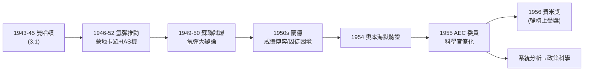

# 4.3 原子能委員會與冷戰角色（1954–1956）

1955 年 3 月，馮紐曼宣誓就任美國**原子能委員會**（Atomic Energy Commission, AEC）委員，辭去 IAS 教職，遷居華盛頓——一位匈牙利移民，成為掌握美國全部核武庫與核政策的五人之一。這是他自 1943 年曼哈頓計畫（3.1）以來「科學—權力」路線的頂點，也是冷戰史上「鷹派科學家」最極端的樣本。

## 前因：十年冷戰科學的履歷

1955 年之前的馮紐曼，已是核問題的第一線人物：

- **1943–45**：曼哈頓計畫、內爆設計、目標委員會（3.1）；
- **1946 年起**：洛斯阿拉莫斯顧問，與泰勒（特勒，1.1 老鄉）推動**氫彈**；1946 年的「4 月會議」上，他的數值計算支持了泰勒—烏拉姆構想的雛形；1952 年伊維·麥克（Ivy Mike）氫彈試爆成功——特勒被稱為「氫彈之父」，而**算出它可行的人**正是馮紐曼（蒙地卡羅＋IAS 機，3.3 的直接軍事應用）；
- **1949 年**：蘇聯試爆原子彈，華府震動；馮紐曼是主張「美國必須率先擁有氫彈」的最強音之一；1950 年的氫彈大辯論中，他與奧本海默（反對者）公開立場相左；
- **1950 年代**：蘭德公司（RAND）戰略研究的數學後台——**核威懾**的博弈模型（2.3 的極小極大＋**囚徒困境**，1950 年由蘭德的 Flood 與 Dresher 提出、塔克正式命名）大量借助他的框架；「相互保證毀滅」（MAD）的邏輯，本質是一場無限重複的極小極大賽局；
- **1953–54 年**：**奧本海默安全聽證會**——馮紐曼被傳喚作證。他誠實而殘酷：他說奧本海默不是間諜，但也說「我不希望他主持任何計畫」。這場聽證是科學界冷戰創傷的頂點，馮紐曼的證詞至今是史家爭論的焦點。

## AEC 委員：科學家的官僚生涯

就任 AEC 後，這位永遠的教授變成每天清晨五點開會的官員：

- **職權**：核武庫的研發與生產、核能電廠、放射性防護、國際核談判的技術幕後；
- **風格**：他把**蒙地卡羅與系統分析**帶進官僚系統——AEC 的內部報告開始出現模型、模擬與「成本—效益」的量化語言；這套方法日後被國防部長麥納馬拉發揚為「淨評估」，史家稱之為**蘭德式理性**；
- **政治立場**：他是**預防性戰爭**議題上最直率的鷹派——1950 年就公開主張「現在就打，趁我們還有壟斷」；在 AEC 任內他轉向「威懾＋技術優勢」的持續壓制路線；
- **為什麼如此**：史家的共識指向 1.1 的布達佩斯創傷——1919 年的動亂、霍爾蒂的反猶、以及 1945 年後「自由世界只有一個」的判斷，使他把蘇聯視為「下一個希特勒」；他自承「對人類有悲觀的估計，但對美國例外」；
- **與同儕的反差**：愛因斯坦（2.2 同院）呼籲世界政府、西拉德（1.1 老鄉）後來成為和平運動者、奧本海默墜入政治深淵——同代科學家的光譜上，馮紐曼站到了最右端，且**至死不悔**。

## 飛機上的禮物：費米獎

1956 年 2 月，艾森豪總統在白宮授予馮紐曼**費米獎**（Enrico Fermi Award，附 5 萬美元）——表彰他對核科學與國家的貢獻。此時他已因癌症骨瘦如柴、坐輪椅領獎。同年他還獲得：

- **愛因斯坦紀念獎**、**恩里科·費米獎**、美國國家科學院與各國院士頭銜的收尾；
- 總統科技顧問委員會、國防部的各種顧問職——直到 1956 年夏他已無法工作。

## 冷戰科學的雙面遺產

馮紐曼的冷戰角色留下兩份矛盾遺產：

| 遺產 | 內容 | 後果 |
|------|------|------|
| 硬件 | 氫彈可行性、核武庫量化管理、系統分析 | 冷戰軍備的數理化管理；「理性威懾」框架 |
| 副產品 | 蒙地卡羅、數值氣象、計算機工業（3.3） | 科學計算與和平的計算革命 |
| 制度 | AEC 的科學官僚化；蘭德式決策科學 | 政策科學（operations research）時代 |
| 爭議 | 預防性戰爭言論、奧本海默聽證證詞 | 科學家對權力責任的永恆爭論 |

## 「天才的官僚」：AEC 任內的日常

馮紐曼在華府的公職生活，是傳記作家們最難想像的一章：

- **作息**：每天 7 點前到辦公室，午餐時與幕僚下棋或講笑話，晚上回飯店繼續算數學——他自嘲「我終於明白官僚系統是最複雜的自動機」；
- **方法輸出**：他把 AEC 的武器報告全面「模型化」——每個計畫附成本、機率與對手反應的估計；幕僚回憶，他能當場心算出某型彈頭生產線的良率對威懾力的邊際影響；
- **國際線**：他參與了 1955 年日內瓦高峰會的技術幕後（「原子用於和平」倡議的 AEC 端），主張以核能輸出換取監督框架——鷹派中的務實面；
- **健康的崩壞**：1955 年末確診（5.1）後，他拒絕辭職，堅持「國家在戰時不能換參謀」——坐輪椅開會直到 1956 年夏；
- **對年輕科學家的提攜**：在華府任內他持續面試與推薦年輕數學家進入政府與蘭德系統——這批人後來成為 1960 年代「國防知識分子」的中堅（麥納馬拉時代的 systems analysis 團隊）。

### 為什麼馮紐曼不怕核戰爭（而同代人怕）

他有一套完整而自洽的論證，散見於 1950 年代的訪談：

- **前提一**：極權的威脅是確定的，核戰爭的風險是機率性的——拿確定的奴役去換機率的毀滅，期望值上不划算（典型的 vNM 效用運算，2.3）；
- **前提二**：技術壟斷窗口短暫，「先發優勢」若不用即失效——這是極小極大邏輯（1.3）的直接應用；
- **結論**：唯一理性的策略是**保持壓倒性優勢＋可信威懾**，等待對手體制內生變化；
- 歷史的回聲：1980 年代雷根的「以實力謀和平」與星戰計畫，被他的傳記作家稱為「馮紐曼學說」的遲到兌現；而 1991 年蘇聯解體，使他在預測上比絕大多數同代人更接近事實——儘管代價的倫理爭議至死未解。

## 事件關聯與前因後果

| 年份 | 事件 | 後續影響 |
|------|------|----------|
| 1946–52 | 氫彈推動與試爆成功 | 冷戰核天平傾斜 |
| 1949–50 | 蘇聯試爆；氫彈辯論 | 鷹派立場公開化 |
| 1950 | 囚徒困境誕生於蘭德 | 威懾理論的博弈基礎（2.3） |
| 1954 | 奧本海默聽證作證 | 科學共同體的裂痕 |
| 1955 | 就任 AEC 委員 | 科學家進入權力核心的範本 |
| 1956 | 費米獎 | 國家對「武器科學家」的最高承認 |
| 1957 | 去世（見 5.1） | 鷹派科學家神話的定格 |

**因果**：這條線的前因，可以一路追回 1.1 的布達佩斯——「帝國崩塌中的猶太少年」成長為「把文明安全寄託於威懾的數學家」。中段的技術因果尤其清楚：**沒有蒙地卡羅與 IAS 機（3.3），就沒有氫彈的可行性計算；沒有氫彈，就沒有 1955 年的 AEC 席位**。後果同樣兩面：軍事上，他把「理性選擇＋超大算力」變成冷戰的治理技術；和平面上，同一套技術催生了科學計算與政策分析。與香農對照（→ 詳見《香農傳記》第 5 章），兩人晚年分別成為「權力的數學家」與「隱士的數學家」——同一代的兩種科學家命運，在冷戰的天平上各據一端。而馮紐曼的天平，很快將被另一種力量壓倒：疾病（見 5.1）。

## 小結

- 1955–1956 的 AEC 歲月，是馮紐曼「科學—權力」路線的頂點：從內爆設計到氫彈，從蘭德博弈到核政策，他全程是數學的提供者與使用者；
- 他把系統分析與蒙地卡羅帶進政府，預示了政策科學與「量化治理」的時代；
- 他的鷹派立場根植於流亡者的歷史創傷，也與愛因斯坦、西拉德的和平主義形成同代人的悲劇對照；
- 奧本海默聽證的證詞，是他一生最被詬病的一頁；
- 同時，癌症已擴散：權力的頂點與生命的終點，重合在 1956 年（見 5.1）。
