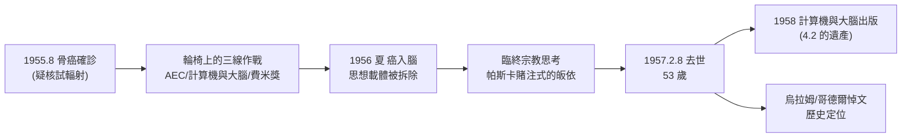

# 5.1 骨癌與去世（1955–1957）

1955 年 8 月，馮紐曼在 AEC 委員任上被診斷出**骨癌**（史家多認為源於 1940 年代末在比基尼環礁核試現場的輻射暴露——他曾在雲下數英里處觀察）。1956 年病情轉劇，癌細胞擴散至腦；1957 年 2 月 8 日，他在華盛頓沃爾特·里德陸軍醫院去世，享年 53 歲。這最後十八個月，是二十世紀最敏銳的大腦之一，被迫面對自身解體的全程直播。

## 確診與崩壞的時間線

- **1955.8**：左肩疼痛，檢查確診骨癌（多發性骨髓瘤／骨轉移）；
- **1955 冬–1956**：脊椎、髖部受侵，手術與固定術接連而來；他仍坐輪椅出席 AEC 會議、寫《計算機與大腦》（4.2）、赴白宮領費米獎（4.3）；
- **1956 夏**：癌細胞侵入腦——這對他而言是最殘忍的打擊：**自己畢生研究的對象（思維的載體）正在被疾病拆除**；
- **1957.2.8**：去世。遺體葬於普林斯頓公墓。

他的最後一批訪客中，有科學史家常記錄的一對：**帕斯誇爾·約旦**（即哥廷根老同事）不在場，但在場的有**克萊尼、哥德爾**與數學界故舊；IAS 的同事回憶，最後幾週他仍要求在病床上聽數學討論。

## 臨終的宗教思考：與神父的對話

最令人動容，也最富爭議的，是他臨終的宗教轉向：

- **背景**：馮紐曼一生是**不可知論者**（他說過「我信『信』的社會效用」式的帕斯卡式機巧話語），但並非無神論的旗手；
- **臨終**：他召來天主教**安斯利神父**（Father Michael AnSelm Mittermaier，本篤會），接受教理講授與臨終皈依；死前寫下著名的臨終禱文（致瑪麗亞的禱詞），以**帕斯卡的賭注**式語言自白：「只要還有一絲可能上帝存在、靈魂不朽，就值得押上全部」；
- **與帕斯卡的呼應**：他一生研究**賽局與期望值**（2.3），臨終做的正是把「賭注」邏輯用在靈魂上——期望值最大化的最後一局；
- **爭議**：無神論者（如後來的羅素派批評者）視之為恐懼下的投機；神學家視之為誠實的靈魂清算。他的好友斯坦尼斯拉夫·烏拉姆在《馮紐曼傳》中試圖折衷：那是「一個以極端理性聞名的人，對極端不確定性的最後管理」。

### 病床上的哲學對話

據烏拉姆與家人記錄，臨終的馮紐曼被幾個問題纏繞：

- **「人腦如何超越圖靈機？」**——他反覆思考哥德爾式論證能否證明心勝於機（這正是日後 Lucas–Penrose 論戰的主題，5.3）；
- **「我的自動機理論錯在哪裡？」**——他不滿意細胞自動機的進化動力學只做了邏輯、沒做機率；
- **「人類能否在核戰前學會節制？」**——他對 AEC 任內見過的武器計畫，留下「我們的技術跑贏了我們的社會科學」的悲觀結語。

## 身後與悼詞

- 妻子克拉拉（3.2 的同行者、IAS 機的首批程式設計師之一）整理遺稿，1958 年出版《計算機與大腦》（4.2）；她本人於 1963 年不幸因直升機事故（前往聖地牙哥從事海洋研究）身亡；
- **哥德爾**在悼文中寫下那句被引用最廣的評價（雖常被誤掛在別人名下）：馮紐曼「以驚人的速度跨越了數學中最廣闊的疆域」；
- 普林斯頓的追思會上，奧本海默致辭：「這個人身上有一種近似童話的能力——他永遠比任何人快一步看到下一步該做什麼。」

## 同代人眼中的最後一年

| 訪客／見證者 | 記錄的細節 |
|--------------|------------|
| 烏拉姆 | 頻繁的病榻對話：自動機的遺憾、哥德爾論證、對戰後世界的判斷——後來寫進《馮紐曼傳》 |
| 哥德爾 | 絕交多年後仍來探望；兩人最後談的仍是形式系統與心靈 |
| 克拉拉 | 全程照護並整理遺稿；1958 年交耶魯出版《計算機與大腦》 |
| AEC 同僚 | 他堅持坐輪椅出席會議直到 1956 年夏，官員們回憶「他的思路比所有人快，只是身體慢了下來」 |
| 天主教神父 | 臨終講授教理；記錄下那句「只要有一絲可能，就值得押上全部」的帕斯卡式自白 |

### 「科學家的死法」的三重對照

1950 年代中期，計算革命的巨人們以三種方式離開：

- **圖靈**（1954）：被國家的道德迫害所殺——化學閹割之後的氰化物（→ 詳見《圖靈傳記》第 8 章）；
- **馮紐曼**（1957）：被自己參與釋放的核時代的輻射所殺；
- **香農**（2001）：安享晚年，在 Alzheimer 的迷霧中平靜離場（→ 詳見《香農傳記》第 6 章）。

三種死法映照三種與權力的關係：被迫害者、掌權者、隱逸者。馮紐曼屬於第二種——他握有權力、使用權力、最後也被權力的副產品（核試輻射）奪去生命。史家說：**他是唯一一個死於自己決定的科學家**。

## 遺體與遺物的數學

以馮紐曼的方式收束他的終局，可以數得清：

- **著作**：約 150 篇論文、6 本專著（含遺稿兩部：《計算機與大腦》《自我複製自動機理論》手稿）；
- **學生**：他幾乎沒有傳統意義的博士學生——他太快、太多線並行；他的「學生」是**機器、機構與合作者**：IAS 機、蘭德、AEC、以及每一個與他合寫過論文的人（哥德爾辯、烏拉姆、摩根斯坦、Goldstine、Charney……）；
- **一句被引用最多的話**：「在數學中你不必理解事物，你只需要**習慣它們**（you get used to them）。」——這句話成為所有數學教育討論的常客，也是他一生面對量子力學、核武器與死亡時的態度寫照；
- **葬禮**：普林斯頓公墓，墓碑無方程式——按照他的遺願，樸素如任何一位教授。

## 事件關聯與前因後果

| 年份 | 事件 | 後續影響 |
|------|------|----------|
| 1946–48 | 比基尼核試現場觀察 | 疑似輻射致癌的遠因 |
| 1955.8 | 骨癌確診 | 雙戰場（AEC＋寫作）的終局 |
| 1956.2 | 輪椅上領費米獎 | 國家承認的絕筆畫面 |
| 1956 夏 | 癌細胞侵入腦 | 臨終哲學對話 |
| 1957.2.8 | 去世 | 「最快大腦」時代的句點 |
| 1958 | 《計算機與大腦》出版 | 理論遺產的公共化（4.2、5.3） |

**因果**：他的死亡有清晰的時代烙印——**被自己參與創造的原子時代（3.1、4.3）的輻射所殺**，這個諷刺性的事實成為後世討論「科學家責任」的永恆案例。而臨終皈依與帕斯卡賭注，則與他的一生形成完美閉環：一個把**理性最大化**推到極致的人，最後用理性管理死亡——無論你讚美或拒斥，那都是「馮紐曼式」的。同代人中，圖靈 1954 年因化學閹割與迫害而逝（→ 詳見《圖靈傳記》第 8 章），香農則安享晚年（→ 詳見《香農傳記》第 6 章）——**計算革命三巨頭的三種死亡，映照著三種與時代的關係**。

## 小結

- 1955–1957，馮紐曼在輪椅上同時完成：公職（AEC）、遺稿（《計算機與大腦》）、與靈魂的清算是他生命的第三份奇蹟；
- 臨終與天主教神父的對話、帕斯卡式的皈依，是「賽局論者面對終極不確定」的最後一局；
- 他死於疑似自己參與開啟的核時代的輻射——科學家與其造物關係的最殘酷註腳；
- 53 歲的句點，留下的是尚未完成的自動機理論與大腦理論——這兩捲未竟的手稿，成為下兩節的主題（見 5.2、5.3）。
