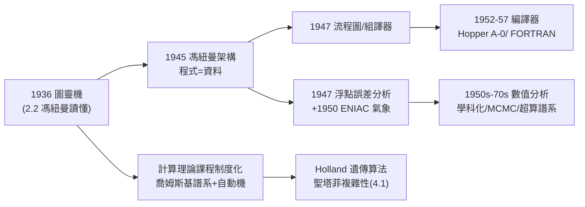

# 5.2 對圖靈機與編譯器、數值分析的制度化影響（1950–1980）

馮紐曼死後三十年，他埋下的三顆種子長成了整片森林：**可計算性與機器的理論傳統**（圖靈機的制度化）、**編譯器與程式語言的工程傳統**（從組合語言到高階語言）、以及**數值分析與科學計算的學科化**。這一章回顧 1950–1980 年間，這三條線如何從他的工作直接生長出來。

## 一、圖靈機傳統：從紙上機器到學科

馮紐曼是最早把圖靈機「當真」的人（2.2、3.2），他的傳播工作在死後繼續結果：

- **自動機理論課程**：1950 年代末，普林斯頓、密西根與 MIT 的「自動機與形式語言」課程，教材直接以他的希克森講義＋圖靈機＋喬姆斯基譜系拼成；喬姆斯基 1956 年的形式語言譜系（→ 詳見《香農傳記》第 5 章，香農正是喬姆斯基文章的評審人）與馮紐曼細胞自動機在 1960 年代合流為**計算理論**（theory of computation）標準課；
- **「馮紐曼連接」的崇拜者**：賓州大學的 Burks（4.1 的遺稿編者）在密西根建起自動機學派；Holland（Burks 的學生）1959 年的遺傳算法博士論文、日後的**複雜適應系統**（聖塔菲研究所，1980s），全是「馮紐曼→Burks→Holland」一脈；
- **哥德爾獎與圖靈獎**：1970 年代，ACM 以**圖靈**命名其最高獎（圖靈獎，1966 首屆），而馮紐曼的名字則以**馮紐曼講座**（SIAM）與**馮紐曼獎章**（IEEE）繼續存在於計算與數值的兩個世界——理論與工程各以其名立碑，正是他雙重身分的象徵；
- 進化計算與人工生命的正名者們（Holland、Langton）都自認馮紐曼的學術孫（4.1）。

## 二、編譯器與程式設計：從流程圖到 FORTRAN

馮紐曼 1947–48 年與 Goldstine 的**流程圖**方法（3.3）與 1951 年前後的**組合語言／組譯器**雛形，是「軟體作為獨立工藝」的第一份方法論：

- **1952 年前後**，IAS 機上出現了最早的**符号組譯與子程式庫**——Grace Hopper 在哈佛 Mark I/UNIVAC 上的 A-0 編譯器（1952）、以及 Backus 的 FORTRAN（1957），都是在馮紐曼「把程式當資料處理」的架構（3.2）上長出的語言層；
- 有趣的反諷：馮紐曼本人**反對**高階語言——當 Backus 1954 年向 IBM 提議 FORTRAN 時，馮紐曼的反應是「何必用英語寫數學」；他相信優秀的數學家就該直接寫組合碼。這是這位先知少數的保守時刻：**架構的發明人低估了架構之上的抽象塔**；
- 但他的「程式＝資料」原則，恰恰是編譯器、直譯器乃至作業系統的邏輯基礎——FORTRAN、LISP（1958，麥卡錫，→ 詳見《麥卡錫傳記》第 3 章）的一切高階抽象，都是在「程式可被機器當作資料讀寫」這個 1945 年的決定上建造的；
- **數值軟體的制度化**：他與 Goldstine 的「數值求逆矩陣的誤差分析」（1947）是**浮點誤差分析**的開山作；1948 年他們用 IAS 機前身的 ENIAC 做的氣象計算（3.3）催生了 Wilkinson 等人在英國的數值線性代數學派（NPL 的 ACE 團隊，正是圖靈的舊部，→ 詳見《圖靈傳記》第 6 章）——數值分析自此成為有期刊（1959 年起）、有課程、有工業（IBM 704 的浮點硬體）的正規學科。

## 三、數值分析與科學計算：從蒙地卡羅到超級電腦

- **蒙地卡羅的制度化**（3.3）：1950 年代，Los Alamos、蘭德、貝爾實驗室皆設「蒙地卡羅小組」；Metropolis 等人的 Metropolis 演算法（1953，MCMC 的源頭）直接出自馮紐曼圈子；1970 年代 Hastings、Gelfand–Smith 的推廣使 MCMC 成為統計學的支柱——貝葉斯革命的算力引擎；
- **數值天氣預報**（3.3）：1955 年 JNWPU（美國聯合數值天氣預報單位）成立；Charney–Phillips–Smagorinsky 一代把 1950 年的實驗變成 1960 年代的業務系統；Smagorinsky 的 GFDL 建成全球第一座**氣候模擬**機構——今日 IPCC 的模式譜系，源頭仍是 1950 年 IAS/ENIAC 的那次 24 小時預報；
- **超級電腦譜系**：IAS 機（3.3）→ IBM 701（1952，Foote 領導，直接參考 IAS 設計）→ CDC 6600（1964，Cray）→ Cray-1（1976）——**「馮紐曼瓶頸」的繞行史**（多記憶體埠、向量機、快取階層）貫穿了 1950–1980 的整個超算史；每代機器都在與那個 1945 年的串列架構角力，而角力的武器（流水線、平行、預取）也都在馮紐曼自己的論文裡有原型；
- **賽局與規劃**：丹齊格的單純形法（1947，2.3 的對偶會談）在 1950–60 年代成為石油、航空、物流的標準工具——**運籌學**（operations research）作為行業誕生；蘭德的系統分析（4.3）擴散為政府與企業的決策科學。

## 三個傳統的制度化對照

| 傳統 | 馮紐曼的原點 | 制度化載體 | 1970 年代的成熟形態 |
|------|--------------|------------|----------------------|
| 計算理論 | 讀懂圖靈機（2.2） | 大學課程、喬姆斯基譜系、Holland 學派 | NP 完全性時代的前夜 |
| 軟體工程 | 流程圖＋組譯器（3.3） | FORTRAN、LISP、ACM | 軟體危機與結構化程式設計 |
| 數值分析 | 誤差分析＋蒙地卡羅（3.3） | SIAM、氣象業務系統、超算工業 | Wilkinson 的代數特徵值學派 |

三條線有一個共同的形式特徵：**都是從「一個人的工作」變成「一套可傳授的制度」**——教科書、期刊、課程、工業標準。馮紐曼生前最擅長的正是這種「把私人的洞見公共化」：EDVAC 草案公開散發（3.2）、IAS 機圖紙開放複製（3.3）、賽局論寫成六百頁教科書（2.3）。他死後，別人替他把同樣的手法套用在他的遺稿上。

### 與圖靈傳統的英國線交會

- 圖靈戰後在 NPL 提出 ACE 設計（→ 詳見《圖靈傳記》第 6 章），其工程進度落後於美國的 IAS 系機器；但 ACE 團隊出的 Wilkinson，成為數值線性代數的泰斗（Wilkinson 獲 1970 年首屆圖靈獎之一）；
- 也就是說：**數值分析的英美雙源頭——誤差分析的美國版（馮紐曼–Goldstine 1947）與英國版（Wilkinson）——分別來自兩位架構發明人**；
- 1970 年代的「數值軟體庫」（LINPACK 前身、NAG）把這兩支匯成標準工具，科學計算自此有了可呼叫的公眾財——這正是 1950 年代「母機—子機」模式的軟體版重演。

### 為什麼馮紐曼反對高階語言（再探）

這個著名的保守案例值得再解剖一層：

- 他的隱含假設是「**程式設計師＝數學家**」——而數學家應當能直接掌控每一個位元；
- 這個假設在 1950 年代成立，在 1960 年代崩塌：程式設計師人口爆炸，大多數不是數學家；
- 教訓的制度史意義：**抽象層次的經濟學**（每上一層抽象，開發者人口擴大一個數量級）終究戰勝了精英主義——但每一層抽象的「編譯器」，本質上仍是他 1945 年「程式＝資料」原則的實作。他反對的形式，服務於他奠定的原則——這是遺產史最耐人尋味的一章。

### 制度遺產的三個「以他命名」

1950–1980 年間，馮紐曼的名字被制度化的速度超過幾乎所有數學家：

- **馮紐曼架構**：進入每一本計算機組織教科書的第一章——人類史上被最多工程學生背誦的名字之一；
- **馮紐曼獎章**（IEEE, 1992 設）與**馮紐曼講座**（SIAM, 1959 設）：分別代表工程與應用數學的最高榮譽之一；
- **馮紐曼代數、馮紐曼熵、馮紐曼鏈、馮紐曼探測器**：純數學、量子物理、邏輯、航天四個互不相干的領域，共用同一個定語——這種跨域命名密度，在科學史上只有牛頓（力、流數、環）與高斯可堪比擬；
- 反諷的是他生前從不用自己名字命名任何東西——所有這些名詞都是同行與後人安放的。**他一生都在「把別人的東西變成可用的」，別人則把他的名字變成永久的**。

## 事件關聯與前因後果

| 年份 | 事件 | 後續影響 |
|------|------|----------|
| 1945–47 | 架構＋流程圖＋誤差分析 | 三傳統的共同起點 |
| 1952 | IAS 機複製潮；IBM 701 | 電腦工業起跑（3.3） |
| 1953 | Metropolis 演算法 | MCMC 譜系 |
| 1956 | 喬姆斯基譜系發表 | 自動機理論課程定型 |
| 1957 | FORTRAN 問世 | 高階語言時代（馮紐曼生前反對） |
| 1958 | LISP 問世（麥卡錫） | 程式=資料的最高表達 |
| 1964 | CDC 6600 超級電腦 | 瓶頸繞行競賽開始 |
| 1966 | Burks 輯《自我複製自動機理論》 | 自動機遺產公共化（4.1） |
| 1976 | Cray-1；聖塔菲前身醞釀 | 超算與複雜性科學匯流 |

**因果**：這一章展示的是馮紐曼的**制度化效應**——他真正改變歷史的方式，不是某個定理，而是**把三種實踐變成制度**：把「可計算」變成課程（圖靈機傳統），把「程式」變成產業（編譯器傳統），把「模擬」變成科學（數值傳統）。與香農的平行軌跡對照（→ 詳見《香農傳記》第 5–6 章）：香農給了**度量**（位元），馮紐曼給了**居所**（架構）；兩者在 1950 年代的資訊論熱潮中一度合流（3.3），又在 1970 年代的 AI 早期分岔為「統計派」與「符號派」（5.3）。值得銘記的反諷是：**架構的發明人反對高階語言、理論的讀懂人低估了理論的社會學**——制度化永遠超出制度設計者的想像。

## 小結

- 1950–1980，馮紐曼的三份遺產各自制度化：計算理論（圖靈機＋自動機課程）、軟體工程（流程圖→編譯器→LISP）、數值分析（誤差分析→MCMC→超算）；
- 他反對 FORTRAN 的保守時刻提醒我們：先知也會低估自己的後代；
- 「程式＝資料」是他最長壽的單一決定——LISP、作業系統、乃至今日的 AI 編譯器都在其上；
- 他的瓶頸成為超算史的主旋律，他的氣象實驗成為 IPCC 的祖先；
- 1980 年之後，另一份遺產——自動機理論與「大腦的統計語言」——迎來了它的兌現時刻：AI（見 5.3）。
