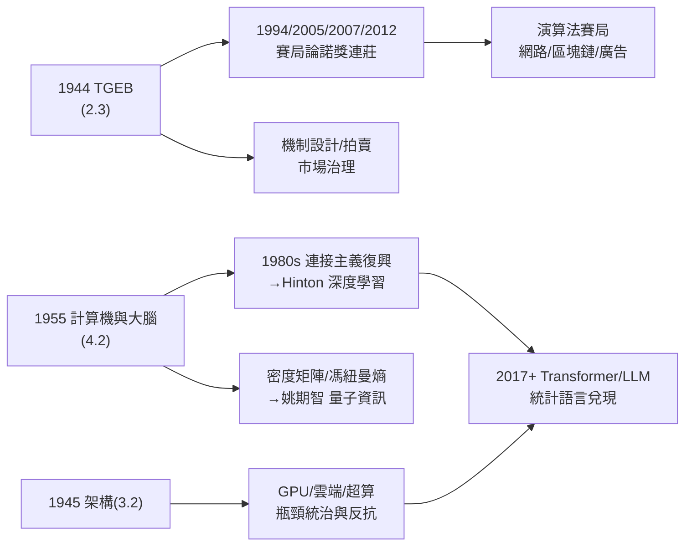

# 5.3 賽局論、AI 與現代運算架構的遺產（1980–2026）

1980 年之後，馮紐曼的三份遺產迎來各自的兌現期：**賽局論**登頂經濟學與冷戰終局，**AI** 在他「大腦的統計語言」預言（4.2）與符號傳統的雙軌上長成巨樹，**現代運算架構**則在雲端、GPU 與 LLM 時代被重新檢驗。到 2026 年的今天，每一部手機、每一場核談判、每一個聊天機器人的底層，都還運行著這位 1957 年去世的數學家的決定。

## 一、賽局論的登頂（1980–2026）

- **諾獎的接連加冕**：1994 年（納什、海薩尼、澤爾騰）、2005 年（奧曼、謝林——**核威懾**理論，4.3 的直接學術化）、2007 年（機制設計，赫維奇、馬斯金、邁爾森）、2012 年（羅斯與沙普利的**市場設計**）——賽局論從 TGEB（2.3）出發，成為經濟學、政治學、生物學與電腦科學的通用語言；
- **拍賣與機制設計**：1990 年代起的電信頻譜拍賣（Milgrom–Wilson，2020 諾獎）把 vNM 效用與極小極大邏輯變成數千億美元的市場機制——**馮紐曼的數學直接治理市場**；
- **演算法賽局**（algorithmic game theory）：網路路由、廣告競價（Google 的拍賣系統）、區塊鏈的共識機制，皆以納什均衡與機制設計為基礎——賽局論在 2000 年代成為**電腦科學**的內建子學科（Nisan 等人的教科書即以馮紐曼開篇）；
- **冷戰終局的印證**：謝林的「焦點」與威懾理論（2005 諾獎）證明：1950 年蘭德的囚徒困境（4.3）與 1944 年的 TGEB，確實是**核和平的數學**。馮紐曼的鷹派立場與其理論的和平效果，構成歷史最弔詭的組合。

## 二、AI：雙源頭的會師（1980–2026）

馮紐曼給 AI 留下了兩條血脈（4.2 的分岔），它們在 2020 年代會師：

### 符號派（馮紐曼架構＋圖靈機的邏輯傳統）

- 1956 達特茅斯（4.1 的落款）→ 麥卡錫的 LISP 與常識表示（→ 詳見《麥卡錫傳記》第 3–4 章）→ 專家系統 → 符號主義的五十年主導；
- 自動機理論、知識表示與「理性代理人」框架，全是馮紐曼式公理化傳統的延伸。

### 統計派（「大腦的統計語言」的路線）

- 麥卡洛克—皮茨神經元（4.1）→ 羅森布拉特感知機（1958）→ **連接主義**的低潮與復興（→ 詳見《Hinton 傳記》全書：反向傳播、深度信念網、2012 年 ImageNet、2018 圖靈獎）；
- Hinton 一派的「分散式表徵」，正是《計算機與大腦》（4.2）「群體統計編碼」的工程兌現——Hinton 明確承認馮紐曼此書是深度學習的理論遠祖之一；
- **LLM 時代**（2017–2026）：Transformer 的核心是「以統計結構預測序列」——馮紐曼 1955 年寫下的「大腦的語言是統計的、不滿足形式邏輯的」（4.2）幾乎是逐字兌現；GPT 的訓練目標（最大化序列機率）是**資訊論（香農）× 統計群體編碼（馮紐曼）× 通用計算（圖靈）**的三重合奏；
- **姚期智**及其學派的**量子計算與計算理論**工作（→ 詳見《姚期智傳記》），則把馮紐曼的另一份遺產——密度矩陣與馮紐曼熵（2.1）——變成量子資訊科學的日常語言：量子通訊的複雜度理論、量子霸權的證明，理論工具箱半數刻著馮紐曼的名字。

### 終極問題的回聲

- 圖靈 1950 年問「機器能否思考」，馮紐曼 1955 年問「大腦如何計算」——LLM 時代把兩問合成一問：**「統計語言的機器，是否已在計算意義上『理解』？」**；
- 他臨終思考的「哥德爾論證能否證明心勝於機」（5.1），在 Lucas（1961）與 Penrose（1989）手中成為著名論戰——至今未決，而 LLM 的崛起使這場論戰從哲學議題變成工程議題。

## 三、現代運算架構：瓶頸的統治與反抗（1980–2026）

- **馮紐曼瓶頸的長期統治**：單核 CPU 時代（1970s–2000s），一切性能工程都是對串列架構的補丁——快取、流水線、亂序執行；
- **反抗的三波浪潮**：多核（2005 前後）、GPU 平行計算（2007 年起的 CUDA 革命）、以及神經形態與**細胞自動機式**的分散式架構——諷刺的是，GPU 的 SIMT 模型在思想上更接近 1952 年細胞自動機（4.1）的「大量簡單單元同步更新」，而非 1945 年的串列機；
- **AI 的算力基礎設施**：訓練 GPT 級模型需要數萬張 GPU 的**馮紐曼架構**機器——架構的發明人，其瓶頸正在被自己預言的統計大腦所消耗；Hinton 們的演算法進步與 Cray 們的硬體進步（5.2），在同一批資料中心裡會師；
- **馮紐曼探測器與命名遺產**：1970 年代起 NASA 的月球軌道器系列以「Lunar Orbiter」之名拍出人類第一批數位影像；**小行星 22824 馮紐曼**、月球隕石坑「馮紐曼」、各國的馮紐曼講座——命名如星圖般散布。

### 2026 年的算力地圖：三巨頭在同一座資料中心

2020 年代訓練一個旗艦級 LLM，所需的每一層技術都對應著一位先驅：

| 層次 | 技術 | 先驅 |
|------|------|------|
| 理論 | 可計算性、通用機 | 圖靈（1936；→ 詳見《圖靈傳記》第 3 章） |
| 理論 | 交叉熵損失＝最小化編碼長度 | 香農（1948；→ 詳見《香農傳記》第 4 章） |
| 理論 | 群體編碼、統計語言假說 | 馮紐曼（1955） |
| 系統 | 儲存程式架構、GPU 上的馮紐曼機 | 馮紐曼（1945） |
| 演算法 | 反向傳播、分散式表徵 | 連接主義（→ 詳見《Hinton傳記》） |
| 硬體 | 並行計算、高速互連 | 馮紐曼瓶頸的反抗史 |

馮紐曼在其中占據了**獨一無二的雙位**——他既是「理論中的腦」的預言者，又是「硬體中的機」的建造者。Hinton 曾說，深度學習的哲學基礎「在馮紐曼 1955 年那本小書裡就已經寫好了」；而訓練那些模型的每一塊 GPU，邏輯上仍是 1945 年草案（3.2）的直系子孫。

### 未竟之問：馮紐曼探測器的隱喻

他 1955 年曾設想一種**能自我複製的星際探測器**（「馮紐曼探測器」，由 1970 年代的科幻傳播命名）——用通用構造器（4.1）實現太空的自我擴張。2020 年代，這個概念在兩個方向上同時復活：

- **工程方向**：太空製造與月面自動化建設的研究，直接引用他的三段式自我複製邏輯；
- **警惕方向**：AI 安全研究者用「馮紐曼探測器」命名失控的自我擴張風險——通用構造器＋無約束目標，正是 4.1 那個「複雜度門檻」的反面教材；
- 他若看到自己的自動機理論成為 AI 安全的核心概念，想必會說：**「我早就告訴過你們，複雜度門檻的兩邊都通著。」**

## 事件關聯與前因後果

| 年份 | 事件 | 後續影響 |
|------|------|----------|
| 1944/1950 | TGEB；囚徒困境 | 冷戰威懾＋經濟學革命（2.3、4.3） |
| 1955 | 《計算機與大腦》「統計語言」預言 | 深度學習的理論遠祖（4.2） |
| 1980s | 連接主義復興；聖塔菲研究所 | 人工生命＋複雜性科學（4.1） |
| 1994–2012 | 賽局論諾獎連莊 | 市場設計與拍賣治理 |
| 2007– | GPU/CUDA 平行革命 | 架構反抗的第一波勝利 |
| 2012 | Hinton 的 ImageNet 時刻 | 深度學習時代開啟 |
| 2017– | Transformer 與 LLM | 「統計語言」全面兌現 |
| 2020s | 量子計算工程化 | 馮紐曼熵成為標準工具 |
| 2026 | AI 與腦算力交會點逼近 | 4.2 的算力預言進入決賽圈 |

**因果**：回望這一百年，馮紐曼遺產的獨特之處在於**閉環**：他把希爾伯特的形式化（1.3）經由圖靈（2.2）變成機器（3.2），把機器用於賽局（2.3）與原子（3.1），把原子時代的創傷轉為冷戰的數學（4.3），又在生命盡頭把機器的鏡子轉向大腦（4.2）——而大腦的統計語言，恰是 2020 年代 AI 的藍圖（5.3）。與同代三巨頭的遺產對照：**圖靈**留給我們「計算的定義」（→ 詳見《圖靈傳記》第 8–9 章），**香農**留給我們「資訊的度量」（→ 詳見《香農傳記》第 6 章），**馮紐曼**留給我們「計算的**文明形態**」——機器如何組織、科學如何模擬、社會如何決策、乃至大腦可能如何工作。三人合力，就是數位時代的全部地基；而其中那個把所有地基澆鑄成一體的人，來自 1903 年布達佩斯的一間銀行家的客廳（1.1）。

## 小結

- 賽局論從 TGEB 走到拍賣與機制設計，成為治理市場與威懾戰爭的通用語言；
- AI 的兩大學派——符號與統計——都是馮紐曼的思想後代；LLM 是《計算機與大腦》七十年後的工程兌現；
- 馮紐曼瓶頸統治了七十年，正在被 GPU 與神經形態架構繞行——但他預言的統計群體編碼恰是繞行者 themselves；
- 量子資訊科學用著他的熵與密度矩陣；人工生命用著他的細胞自動機；
- 1903–1957 只活了 53 歲，卻在數學、物理、經濟、計算、生物與政治六個大陸各留下首都——**馮紐曼傳記至此收束：他不是某個領域的天才，而是「天才」這個概念的公理化**。
