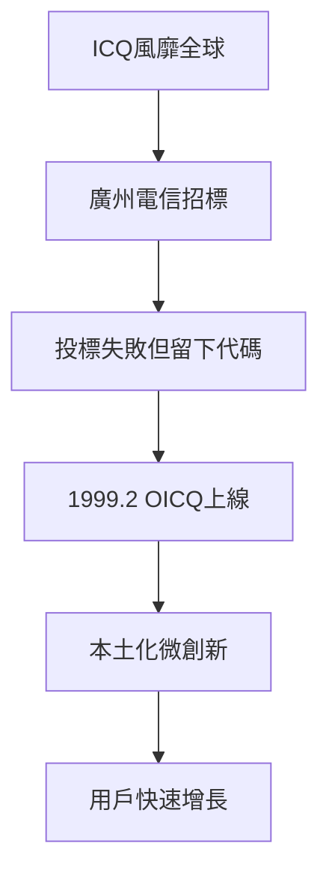

# 1.2 五人創業與OICQ誕生

1998年11月11日，馬化騰與張志東註冊成立深圳市騰訊計算機系統有限公司，隨後許晨曄、陳一丹、曾李青相繼加入，形成著名的「五虎」架構：馬化騰任CEO把握方向，張志東任CTO掌技術，曾李青任COO負責市場，許晨曄管行政與信息，陳一丹管法務與財務。股權設計上，馬化騰僅持股47.5%左右，刻意不過半，避免一言堂。公司初期主業是幫電信局做尋呼系統集成與項目外包，這是五人最熟悉的生意。

1996年以色列人開發的ICQ被美國在線收購後風靡全球，廣州電信的招標項目要求開發一個類ICQ系統，騰訊投標未中，但代碼留了下來。1999年2月，騰訊推出OICQ（後因侵權爭議改名QQ），它針對中國市場做了關鍵本土化改進：用戶資料存儲在服務器端而非本地（可隨處登錄）、離線消息、小型化安裝包適配當時的撥號上網環境。這些微創新使其迅速超越模仿對象。

**因果分析**：招標失敗是意外之喜——若中標，OICQ就只是電信局的一個內部系統而非對外產品；正是落標迫使騰訊把系統自立門戶推向公眾市場。而尋呼行業的經驗（離線消息設計正源於此）使OICQ在體驗上勝出，用戶暴增由此成為必然，但也埋下了下一節「燒錢危機」的伏筆。
