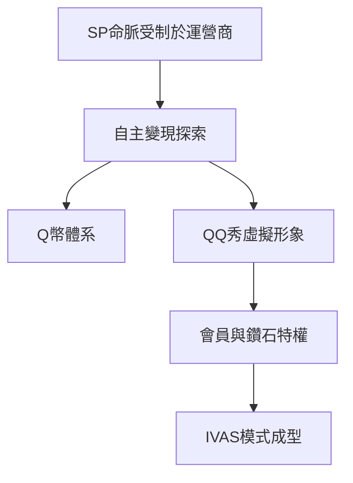

# 2.2 QQ會員與虛擬道具的商業模式

單靠SP分成終究受制於人，騰訊開始探索直接向用戶收費。2000年推出Q幣，2002年推出QQ秀——用戶付費為虛擬形象購買服裝、髮型等裝飾。這是中國互聯網史上里程碑式的產品：它證明了中國用戶不願為軟件付費，卻願意為虛榮心、個性表達與社交身份付費。2002年上線的QQ會員以每月10元提供等級加速、紅名等特權，QQ空間的黃鑽、遊戲的藍鑽紫鑽等「鑽石帝國」相繼成型，形成「免費基礎服務+付費增值」的互聯網增值業務（IVAS）模式。

$$
\text{總收入} = \text{活躍用戶數} \times \text{付費滲透率} \times \text{ARPU}
$$

到2004年上市前，互聯網增值服務已與移動及電信增值服務分庭抗禮，收入結構從單一SP轉向多元化。這種以虛擬商品驅動的變現邏輯，後來被無縫移植到遊戲，成為騰訊遊戲帝國的方法論基石。

**因果分析**：QQ秀的成功本質是把社交比較心理貨幣化——QQ龐大且真實的社交關係鏈讓虛擬裝扮具有「被看見」的價值，離開社交網絡，虛擬道具一文不值。這確認了一條根本因果鏈：社交關係鏈是騰訊一切商業變現的底座，也解釋了日後騰訊為何對社交陣地寸土不讓、最終必須親手做出微信。
