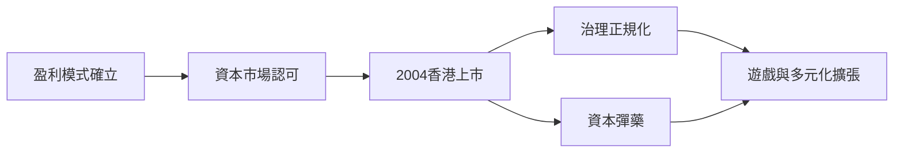

# 2.3 2004香港上市

2004年6月16日，騰訊在香港聯交所主板掛牌，發行價3.7港元，以當時16億美元左右的市值成為首家在中國內地以外的交易所上市的即時通訊服務商。上市前，IDG資本與盈科數碼早已在2001年以數千萬美元的回報將大部分股權轉讓給南非MIH（後為Prosus/Naspers），MIH與創始團隊各持約50%，形成穩定的雙方股東結構。上市募資主要用於擴容服務器、收購與新業務布局。

上市意義遠超融資本身：其一，獲得國際資本市場的資本彈藥與公司治理約束，為之後遊戲與門戶擴張鋪路；其二，股權稀釋與信息透明倒逼管理體系正規化；其三，「小企鵝」從此與資本市場綁定，市值成為騰訊後續每一次戰略抉擇的度量衡。上市當年騰訊市值僅約為60億港元量級，多年後增長數百倍，成為香港股市史上最著名的長期複利案例之一。

$$
V_{2004} \approx 62\text{億港元} \quad \Rightarrow \quad V_{2021} \approx 90000\text{億港元}
$$

**因果分析**：上市是前面三章成果的收割——用戶規模、IVAS變現、盈利記錄三要素齊備，資本市場才肯給門票；而上市又反過來成為下一階段的引擎：沒有上市後的資本與治理，就不可能支撐2004年後進軍遊戲、門戶、搜索的全線戰爭，也就無從談起與MSN的正面對決。
