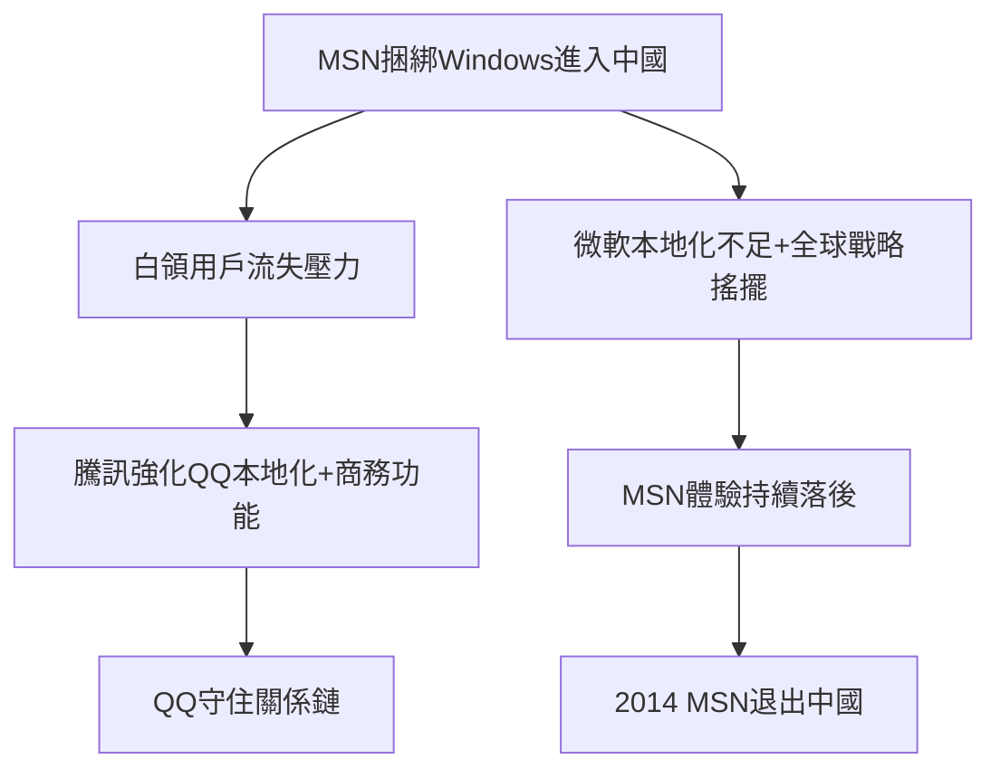

# 3.1 與MSN之戰

2005年，微軟MSN Messenger正式進入中國，憑借Windows捆綁與Office生態，迅速搶占商務人士市場，高峰期用戶超過3000萬，一度被認為將顛覆「低端、學生氣」的QQ。MSN的威脅是實質性的：它切走了騰訊最想要的高價值白領用戶與廣告市場。騰訊的應對是雙線作戰——正面提升QQ體驗並推出TM等商務版本，側翼則強化QQ群的辦公場景滲透。與此同時，MSN在中國的致命傷逐漸暴露：服務器在海外、本地化遲緩、不支持離線消息傳輸的穩定性、又缺少QQ秀式的本地化增值服務；2006年起微軟全球戰略動搖，Windows Live體系整合混亂，中國團隊缺乏授權與資源。加上微軟2005年收購的QQ競品Skype戰略擺置，MSN逐步失血。2009年前後MSN中國被賣給上海聯和投資合資運營，2014年正式退出中國。

**因果分析**：這場戰爭的勝負根在「關係鏈的沉沒成本」——用戶的好友都QQ上，遷移成本極高；MSN縱有捆綁優勢，也無法搬走整條社交網絡。騰訊由此獲得一條被反覆驗證的鐵律：守住關係鏈即守住一切。這條鐵律在移動互聯網時代面臨真正的考驗，因為智能手機換機潮會重置所有關係鏈的載體，這正是微信誕生的遠因。
