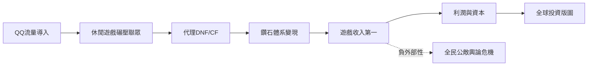

# 3.2 遊戲帝國與全民公敵

2003年騰訊試水休閒遊戲（QQ遊戲大廳），直接模仿聯眾並憑QQ導量在兩年內將其擊垮，這是騰訊「模仿+流量碾壓」模式的第一次大型展示。2004年成立遊戲事業部，2008年代理DNF與穿越火線（CF）兩款韓國遊戲大獲成功，配合Q幣與鑽石會員體系，收入飆升；2010年後《英雄聯盟》通過拳頭公司持股與代理雙軌運作，奠定PC遊戲霸主地位。2008年騰訊超越盛大成為中國營收第一的遊戲公司，此後長期居全球前列。遊戲不僅貢獻利潤，更提供了資本反哺：它讓騰訊有錢投資拳頭、Supercell、Epic，構建全球遊戲版圖。

但商業成功的另一面是形象危機。騰訊以模仿起家、以流量封殺對手的做法積怨已深，聯眾、新浪UC、泡泡、淘寶旺旺等「被騰訊模仿」的產品無一倖免。2010年《計算機世界》封面文章《「狗日的」騰訊》引爆輿論，周鴻禕稱其為「全民公敵」，全行業「反騰訊聯盟」情緒高漲。

**因果分析**：遊戲成功與形象崩塌是同一因果鏈的兩面——社交流量壟斷使任何細分市場的模仿者都能以極低成本碾壓原創者，這種結構性壓迫必然積累行業公憤。公憤最終在3Q大戰中找到爆發出口，而那場大戰又反過來迫使騰訊在勝利後進行痛苦的戰略反思。
