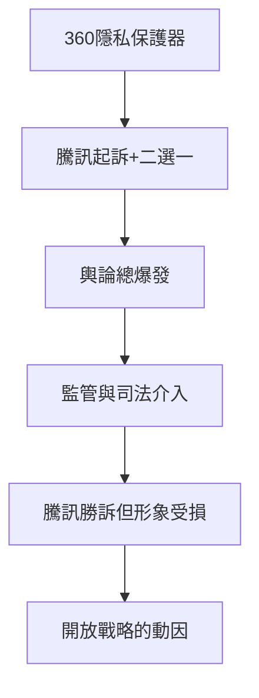

# 3.3 3Q大戰與平台封閉的代價

2010年，奇虎360推出「隱私保護器」，指控QQ偷窺用戶硬盤文件；騰訊隨即起訴並反擊。同年11月3日，騰訊發布著名的「艱難的決定」：在裝有360軟件的電腦上停止QQ運行，強迫數億用戶二選一。輿論譁然，用戶恐慌，政府部門介入後雙方才各自收回。司法層面，騰訊訴360「扣扣保鏢」不正當競爭勝訴並獲賠500萬元；360訴騰訊濫用市場支配地位的壟斷案則一路打到最高人民法院，2014年終審騰訊勝訴，成為中國互聯網反壟斷的標誌性判例。

對騰訊而言，勝訴的榮光掩不住真實的代價。強迫二選一暴露了平台封閉策略的極限：QQ護城河雖深，但騰訊以「模仿+封殺」對待整個行業的方式已招致公憤總爆發，監管風險與品牌損耗同時見頂。馬化騰事後承認這是「最艱難的決定」，也是轉折點——大戰期間恰逢移動互聯網浪潮襲來，若騰訊繼續內鬥錯失移動船票，一切優勢歸零。

**因果分析**：3Q大戰是騰訊十年封閉策略的清算日。「強迫二選一」在法律上獲勝，在民心與行業關係上慘敗，這種反差使馬化騰與總裁劉熾平認定：移動時代不能再以封閉平台對抗生態，必須開放、結盟、投資。這一判斷直接催生了2011年騰訊開放平台與合夥人制度調整，也是下一章「自我革命」的制度前提。
