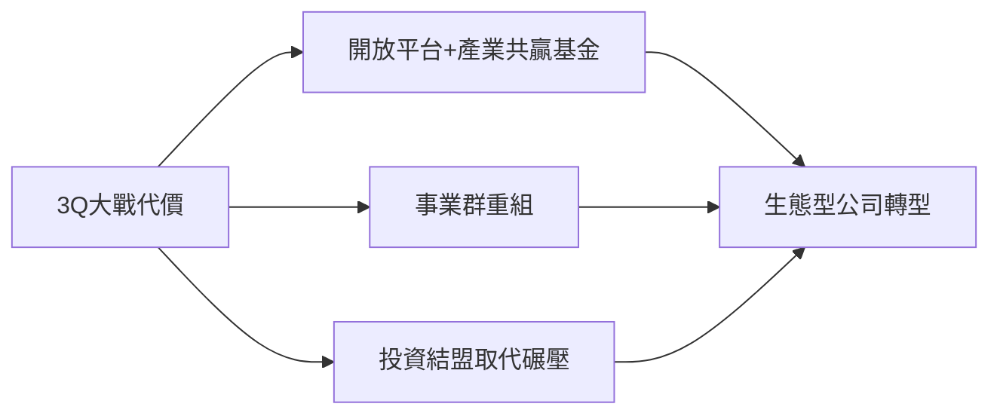

# 4.1 開放戰略與自我革命

3Q大戰的傷痛尚未愈合，移動互聯網的浪潮已至：2010年智能手機滲透率飆升，App取代PC成為用戶入口。馬化騰意識到，QQ的成功反而可能成為移動時代的枷鷀。2011年起，騰訊戰略急轉：一是在開放平台大會上宣布「開放半年計劃」，把QQ、Qzone等流量開放給第三方應用，成立50億元產業共贏基金；二是進行內部組織變革，2012年將事業部制重組為六大事業群（BG），鼓勵內部賽馬與小團隊創新；三是調整對外關係，從「模仿碾壓」轉向「投資結盟」，先後投資京東、大眾點評、58同城，把電商與生活服務的戰場交給夥伴。

**因果分析**：開放戰略絕非道德覺醒，而是嚴酷的理性選擇——3Q大戰證明封閉對抗的成本（輿論、監管、用戶信任）已超過收益；移動互聯網又使戰場碎片化，騰訊不可能事事親為。內部賽馬制則是為了避免「成功者的路徑依賴」：允許張小龍的廣州團隊與QQ總部團隊各自研發移動IM，結果是自我革命成功，這為微信誕生提供了組織土壤。
