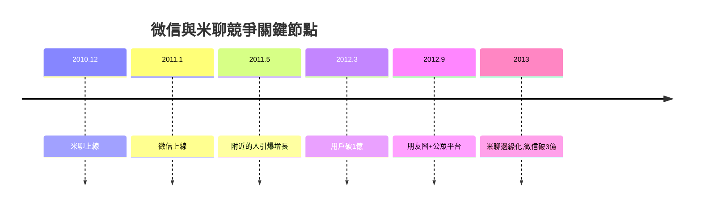

# 4.2 微信誕生與米聊競爭

2010年12月，小米推出基於手機通訊錄的即時通訊應用米聊，直接威脅QQ在移動時代的地位。騰訊內部反應極快：總裁辦決策讓多個團隊賽馬，最終廣州研發院張小龍團隊的產品勝出。張小龍以Foxmail創始人的資歷與對產品的極致敏感，帶領小團隊於2011年1月21日上線微信。初期微信功能與米聊相近，勝負手在於騰訊的底層技術與體系化能力：借鑒搜狐微博經驗引入「查看附近的人」引爆增長，隨後「搖一搖」「漂流瓶」等輕玩法持續拉新，語音對講與消息送達可靠性也優於米聊。米聊因服務器能力與研發資源不足逐漸掉隊，微信在一年半內用戶破兩億，2013年破三億，完成移動互聯網時代最關鍵的「船票」爭奪。

**因果分析**：微信的成功是三重因素疊加：賽馬機制確保優勝產品出線；騰訊十年積累的IM技術底座（消息可靠性、海量並發）決定了體驗上限；社交關係鏈導入使冷啟動幾乎零成本。米聊的失敗則反向驗證了IM是「系統能力戰」而非「點子戰」。微信拿到船票後，騰訊徹底穩固了移動時代的統治地位，並為下一節的支付突襲提供了載體。
