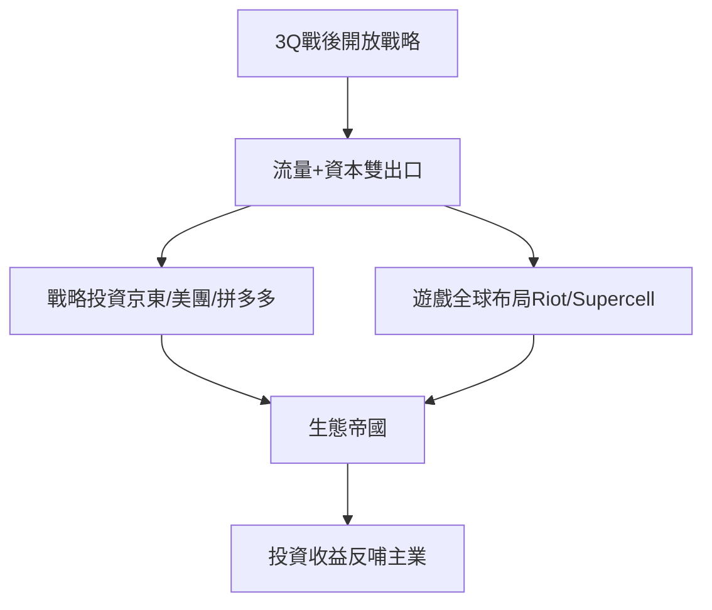

# 5.1 投資版圖與連接戰略

與阿里自營為主的模式不同，騰訊自3Q大戰後確立「半條命交給夥伴」的連接戰略：凡是騰訊不擅長或非核心的領域，用投資代替自營。2011年後相繼入股京東（電商）、大眾點評（本地生活）、58同城（生活服務）、美團、滴滴、拼多多、Sea、EPIC Games，並全資或控股拳頭公司（Riot）、Supercell、Funcom等海外遊戲資產。到2020年前後，騰訊投資組合市值數千億美元，成為事實上的「中國互聯網伯克希爾」。投資不僅分散風險，更構建了以微信支付與小程序為基礎的帝國外圍生態——被投公司獲得流量入口，騰訊獲得數據與場景。

**因果分析**：連接戰略的成功依賴於兩個前提：一是微信與QQ提供了不可替代的流量入口，使騰訊在談判中擁有「流量換股權」的獨特籌碼；二是遊戲業務貢獻了充足現金流，支撐大規模長周期投資。兩者缺一不可，皆為前面章節成果的延伸。但這一模式也埋下隱患：龐大的帝國版圖使騰訊被視為壟斷巨頭，為2020年後的監管風暴埋下伏筆，並推動其向產業互聯網尋找第二曲線。
