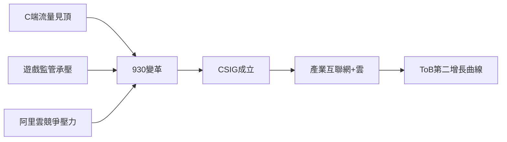

# 5.2 930變革與產業互聯網

2018年9月30日，騰訊宣布史上第三次組織架構調整（930變革）：撤銷MIG、OMG等舊事業群，新設雲與智慧產業事業群（CSIG）與平台與內容事業群（PCG），明確提出從消費互聯網轉向「消費互聯網+產業互聯網」雙輪驅動。動因有三：一是C端流量紅利見頂，QQ與微信用戶增長趨緩，需要新增長引擎；二是遊戲與娛樂業務在2018年遭遇版號停發與輿論壓力，收入承壓；三是阿里雲一路領先，騰訊雲再不發力將失去ToB賽道。騰訊雲憑借微信生態、遊戲技術棧與金融級基礎設施，逐步做到中國市場第二，並深耕政務、金融、製造等行業解決方案。

**因果分析**：930變革是騰訊對「增長數學題」的回應——當消費互聯網的用戶數逼近天花板，繼續依賴C端廣告與遊戲必然使增長率下滑；產業互聯網將過去積累的計算能力、支付能力、小程序生態重新組合，向企業與政府出售，等於把存量能力二次貨幣化。這一轉型成敗尚未終局，但它說明騰訊每一次組織變革都是外部環境壓力的內部映射，而非主動的戰略浪漫。
