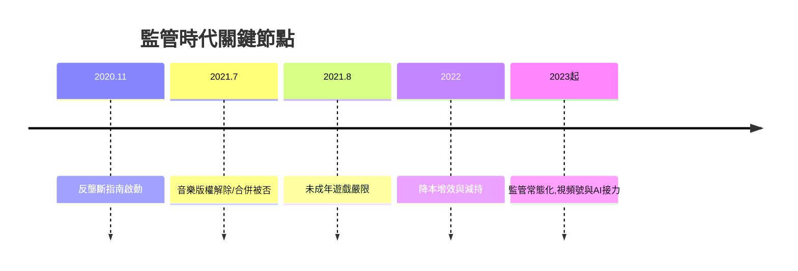

# 5.3 監管時代與未來挑戰

2020年11月《平台經濟領域反壟斷指南》徵求意見，螞蟻IPO暫停隨後互聯網監管風暴全面展開。騰訊首當其衝：2021年7月，音樂獨家版權被責令解除；虎牙與斗魚合併被否；未依法申報的投資併購遭罰款；遊戲業被稱為「精神鴉片」，未成年人遊戲時長被嚴格限制，直接影響遊戲收入增速。2021-2022年騰訊市值自高點縮水過半，公司轉向「降本增效」，縮減非核心業務，大規模減持京東、美團股份向股東返還價值。2023年後監管常態化，遊戲版號恢復常態發放，騰訊藉助視頻號、小程序、企業微信的「微信生態三件套」重啟廣告與交易增長；同時全面投入AI大模型混元，並在遊戲出海（PUBG Mobile、Supercell）與雲業務國際化上尋找新空間。

**因果分析**：監管風暴的根源是騰訊自身成功的結構性結果——連接戰略打造的帝國版圖與數十億用戶的數據集中，使它在政治與社會層面必然被重新定價。與3Q大戰類似，這是一次外部壓力驅動的戰略校準：從「連接一切」的擴張邏輯，轉向「科技向善」的收斂邏輯。未來的勝負手在於：AI能否再造微信級別的交互革命，以及產業互聯網能否真正接棒消費互聯網成為第二增長曲線。騰訊的歷史證明，它的每次重生都源於把外部危機轉化為內部變革的能力。
