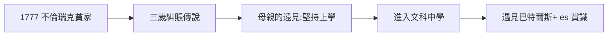

# 1.1 貧寒神童

1777 年 4 月 30 日，約翰·卡爾·弗里德里希·高斯（Johann Carl Friedrich Gauss）出生於不倫瑞克（Braunschweig）一個貧苦家庭：父親是泥水匠、園丁，母親幾乎不識字。按他自己的說法：「我學會說話之前，就已經會算數了。」

## 三歲糾正父親的賬

傳說三歲時，他在一旁聽父親計算工人工資，突然說：「爸爸，你算錯了，應該是……」父親重算，果然是孩子對。這個故事真偽難考，但母親多蘿西婭晚年（她活到 97 歲）反覆向人講述，細節一致。

## 窮孩子的出路

18 世紀德國底層子弟的上升通道只有兩條：教會與貴族資助。高斯的母親雖不識字，卻有驚人的遠見——她堅持不讓兒子去當學徒學手藝，「我的孩子屬於更大的世界」。父親起初反對（家裡需要勞動力），母子聯手才爭取到上學的機會。

**因果**：一個不識字的母親，是高斯傳記中最不該被忽視的人物。沒有她的堅持，天才會在泥水匠作坊裡磨滅。下一節，貴族資助將接過母親的棒。
