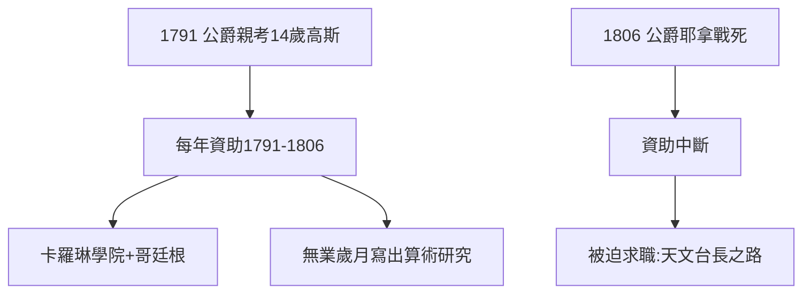

# 1.2 費迪南公爵的資助

## 被發現的天才

在文科中學（Gymnasium），高斯的拉丁文與數學同樣出色。14 歲時，他被引薦給不倫瑞克公爵卡爾·威廉·費迪南（Karl Wilhelm Ferdinand）——開明的君主、科學贊助人。公爵親自考了他，當場決定：**每年資助，送他讀完中學和大學**。

## 十四年的供養

從 1791 年到 1806 年公爵戰死（耶拿戰役），資助持續了整整十四年，涵蓋：

- 卡羅琳學院（Collegium Carolinum，1792–95）；
- 哥廷根大學（1795–98）；
- 博士畢業後的無業歲月（1798–1807 年他沒有固定職位，全靠公爵津貼和零星稿費生活——《算術研究》就是這段時期寫的）。

## 贊助制的意義

在現代科研體制誕生前，貴族贊助是基礎科學唯一的氧氣。高斯對公爵感恩終身：公爵死後，他仍為公爵家族做事，並把《算術研究》題獻給公爵。

**因果**：十四年的資助買下了高斯最自由的青年時代——《算術研究》與正十七邊形都產於「無業」期間。公爵的死（1806）則迫使他走向天文台長的職位，開啟了下一章的天文時代。
