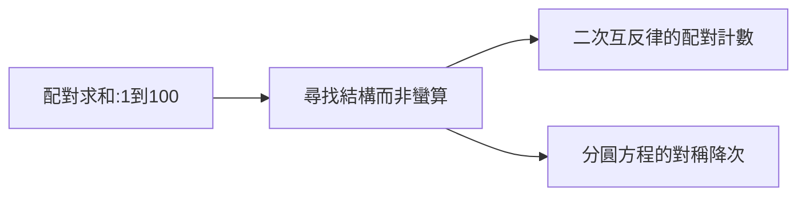

# 1.3 從 1 加到 100 的傳說

## 最著名的數學軼事

小學老師為了讓學生安靜，出題： $1+2+\cdots+100 = ?$ 。不到一分鐘，小高斯交卷：5050。方法：首尾配對——

$$1+100 = 2+99 = \cdots = 50+51 = 101$$

共 50 對，故 $50 \times 101 = 5050$ 。一般形式即等差數列求和：

$$S_n = \frac{n(a_1+a_n)}{2}$$

## 傳說的考證

史學家指出：老師出的題目可能是更難的版本（ we'd 從 81297 之類的大數開始），且「一分鐘交卷」的細節有多種版本。但核心情節——**用對稱配對代替逐項相加**——符合高斯一生的思維特徵：尋找結構，而非蠻算。

## 思維的預演

- 配對思想 → 日後二次互反律證明中的「配對計數」；
- 求對稱性 → 正十七邊形作圖中的分圓方程降次；
- 不滿足於答案、追求方法的優雅 → 「數學是科學的皇后」背後的審美。

**因果**：一個小學課堂的機智，預演了整個數論革命的方法論。下一章，這種「找結構」的天賦將在哥廷根結出正十七邊形的果實——並讓 19 歲的他決定獻身數學。
