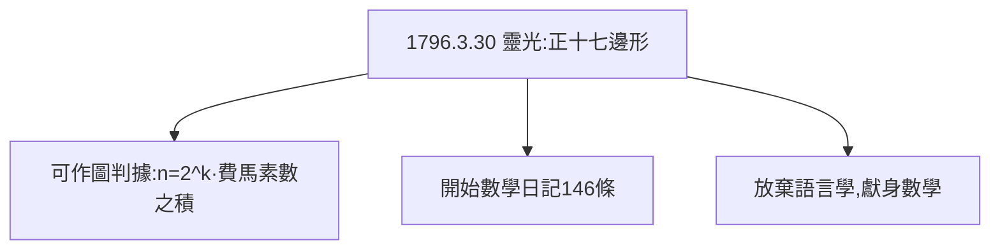

# 2.1 正十七邊形

## 1796 年 3 月 30 日：改變人生的早晨

19 歲的高斯在哥廷根的宿舍裡醒來，腦中靈光一閃：正十七邊形可以用尺規作圖！困擾古希臘兩千年的問題——哪些正多邊形可尺規作圖——被他一舉解決：**正 $n$ 邊形可作圖，當且僅當 $n = 2^k \cdot p_1 p_2 \cdots$，其中 $p_i$ 是互不相同的費馬素數**（如 3, 5, 17, 257, 65537）。

## 數學日記的開篇

從這一天起，他開始寫《數學日記》（Notizenjournal），第一條就是：「正十七邊形的作圖原理被發現。」日記共 146 條，最後一條止於 1814 年——許多 19 世紀的重大發現（如橢圓函數的雙週期性）都能在裡面找到早了數十年的記錄。

##  philology 與 mathematics 的抉擇

此前高斯在語言學（philology）與數學之間猶豫——他的拉丁文足以當古典學者。正十七邊形的發現讓他下定決心：**獻身數學**。他在日記裡寫道，這一天是他人生的分水嶺。

**因果**：一個早晨的靈感決定了職業，也開啟了用日記「存證優先權」的習慣——這個習慣在非歐幾何優先權之爭（5.2）中將成為關鍵證據。而分圓方程的理論，正在通往《算術研究》。
