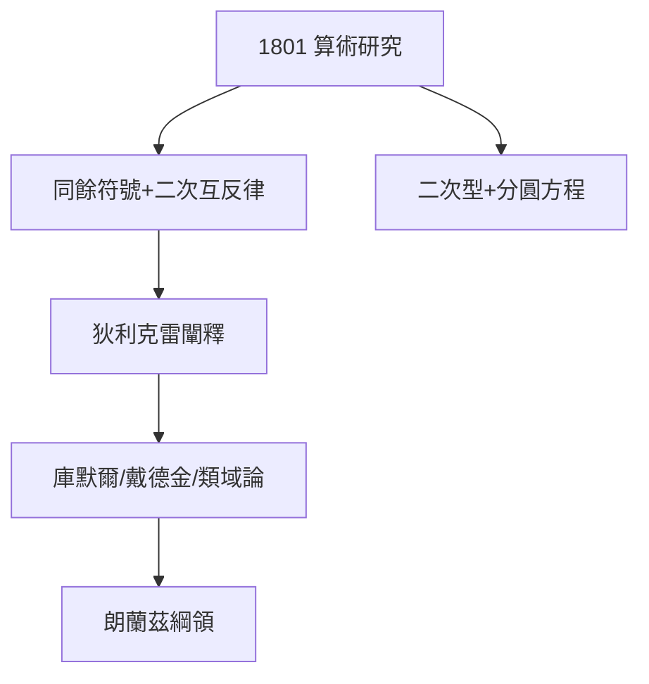

# 2.2 算術研究

## 24 歲的豐碑

1801 年，高斯自費出版拉丁文鉅著《算術研究》（Disquisitiones Arithmeticae）。全書七章，系統奠定了**現代數論**：

1. 同餘理論（ $\equiv$ 符號是他發明的）；
2. 二次互反律的第一個完整證明——「黃金定理」：$$\left(\frac{p}{q}\right)\left(\frac{q}{p}\right) = (-1)^{\frac{p-1}{2}\cdot\frac{q-1}{2}}$$
3. 二次型理論與類數；
4. 分圓方程與正多邊形作圖判據。

## 「少些，但要成熟」

高斯的座右銘是 *Pauca sed matura*（少些，但要成熟）。《算術研究》刪去了所有中間探索，只留最優雅的證明——後人讀它像讀密碼本，狄利克雷據說一生反覆研讀，終於寫出第一本闡釋它的教科書。

## 代價：讀者寥寥

書出版時只賣出幾百冊，連公爵的資助都差點覆蓋不了印刷費。但它的影響是地質級的：從狄利克雷、庫默爾、戴德金，到 20 世紀的類域論與朗蘭茲綱領，都是它的直系後裔。

**因果**：無業青年用公爵津貼印出的書，定義了數論的未來兩百年。而書中「分圓」一章的計算工具（最小平方法的雛形也在醞釀），即將在穀神星事件中大顯身手。
