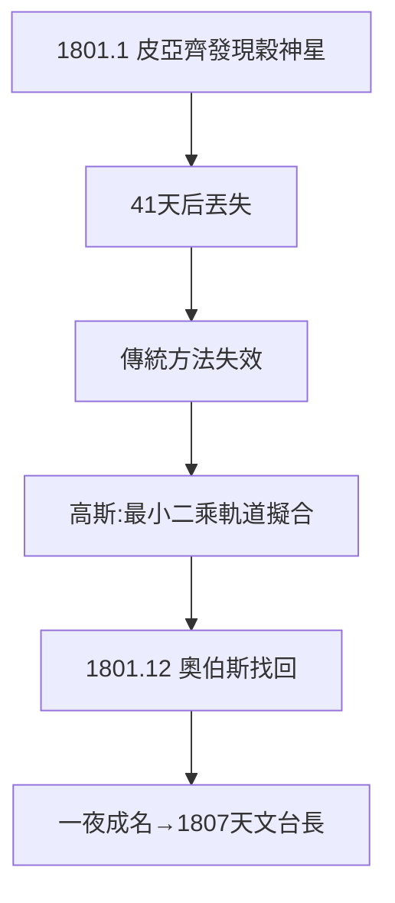

# 2.3 穀神星定位

## 1801 年元旦的發現與丟失

1801 年 1 月 1 日，皮亞齊（Piazzi）在西西里發現一顆新「行星」（穀神星 Ceres），但只跟蹤了 41 天、9 度弧段，它就消失在太陽的光輝裡。全歐洲天文學家束手：弧段太短，傳統軌道計算失效。

## 高斯的逆襲

24 歲的高斯聽說此事，用全新的**最小二乘軌道擬合**方法，從稀疏數據算出軌道根數，預言穀神星將在何時何處重現。1801 年 12 月 31 日——整整一年後——奧伯斯（Olbers）在高斯預言的位置附近找回了穀神星，誤差不到半度。

## 一夜成名

- 從「數論怪人」變成歐洲名人；
- 各國科學院爭相頒獎、邀請；
- 最直接的後果：1807 年他被任命為**哥廷根天文台台長兼大學教授**——一個終身職位，解決了公爵死後的生計問題。

**因果**：純數學家的工具（最小平方法）在天文學中一戰封神，而名聲換來的台長職位，又把他綁在天文與測量上四十年——下一章全是這份職位的產物：小行星、大地測量，與深夜裡的非歐幾何。
