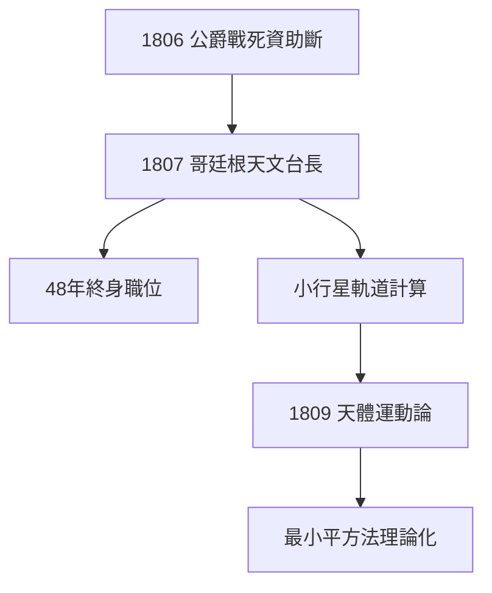

# 3.1 哥廷根天文台長

## 1807：終身職位

公爵 1806 年戰死、資助中斷，高斯一度考慮去聖彼得堡科學院。哥廷根大學及時 At 抛出橄欖枝：天文台台長兼教授。他接受了——從此 48 年未離開哥廷根，直到 1855 年去世。

## 台長的日常

- 每晚觀測、計算小行星軌道（婚神星、灶神星、智神星的軌道都有他的計算）；
- 發展天文計算方法：《天體運動論》（1809）系統闡述最小二乘法；
- 培養學生：雖然他教學不熱心（名言：「我的講課是給已經懂的人聽的」），但狄利克雷、莫比烏斯都受過他的指導。

## 行政即研究

天文台的工作看似瑣碎，卻給了他穩定的俸祿與觀測數據。更重要的是：**天文觀測的誤差處理需求，逼他把最小平方法從技巧升華為理論**（見 3.2、4.3）。

**因果**：失去贊助人反而換來終身職位——高斯的「被迫轉行」天文，成為他中年最高產的領域之一。而天文台的經緯儀，很快將指向漢諾威的群山（大地測量）。
