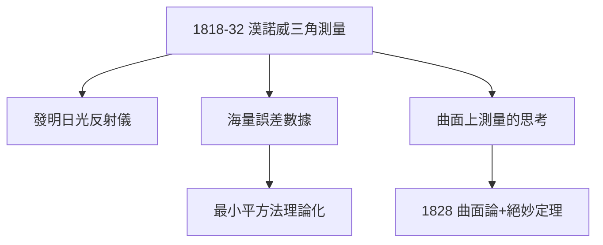

# 3.2 最小平方法與大地測量

## 漢諾威測量（1818–1832）

漢諾威王國委託高斯進行全國三角測量。十四年間，他跋山涉水、親自觀測，把測量精度推到當時的極限。為此他發明了**日光反射儀**（heliotrope）——用鏡子反射陽光作覘標，測程達上百公里。

## 最小平方法的成熟

海量測量數據都有誤差，如何得到「最佳值」？高斯在《天體運動論》（1809）與後續論文中完整建立**最小二乘法**：

$$\min_{\beta}\sum_{i=1}^{n}(y_i - x_i^T\beta)^2$$

並證明在正態誤差假設下，最小二乘估計是最優的（高斯-馬爾可夫定理的雛形）。勒讓德 1805 年也發表過同法，優先權有爭議，但高斯的理論深度無人能及。

## 副產品：曲面論

長期在地球曲面上做測量，讓他思考：**曲面的彎曲能否只用曲面上的測量來決定？**——這個問題直接催生了《曲面的一般研究》（1828）與絕妙定理（見 4.1）。

**因果**：一份政府測繪合同，同時生出統計學的基石（最小二乘）與微分幾何的基石（內蘊曲率）。高斯的「副產品」比別人的主業還大——這是他中年創造力的常態。
