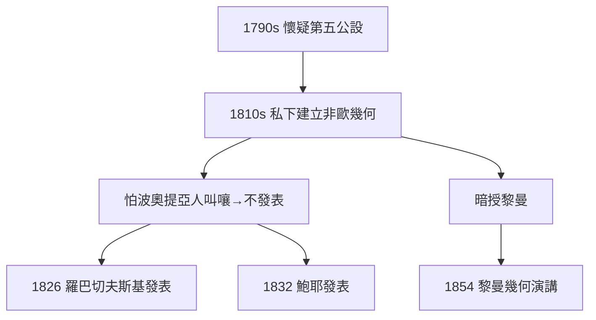

# 3.3 非歐幾何的私下構想

## 深夜的異端

早在 1790 年代，高斯就懷疑歐幾里得第五公設（平行公設）不可證明。1810–20 年代，他在書信與筆記中發展出一套「非歐幾何」：三角形內角和小於 180°、相似而不全等的圖形不存在。他在給朋友陶里努斯（Taurinus）的信中寫道，已經「完全掌握」了這套理論。

## 為什麼不發表

他在給貝塞爾的信中坦言：怕「波奧提亞人（喻指愚鈍的世人）的叫嚷」（das Geschrei der Böotier）。康德的歐幾里得空間觀仍是哲學正統，公開挑戰等於自找麻煩——他選擇沉默。

## 沉默的代價與收穫

- 代價：1826 年羅巴切夫斯基、1832 年鮑耶分別獨立發表非歐幾何，優先權不再屬於高斯；
- 收穫：他的筆記與書信（死後整理）證明他最早看透一切，學界仍尊他為「非歐幾何的先知」；
- 深遠影響：他把這份未發表的洞見傳給了學生**黎曼**——1854 年的就職演講（見 5.1 與黎曼傳 3.2）正是這條暗線的開花。

**因果**：高斯的沉默讓出了一項發明權，卻為黎曼留下了路標。這是科學史上「不發表」的最大代價，也是最富遠見的傳承——下一章的曲面論，正是非歐幾何的數學軀體。
