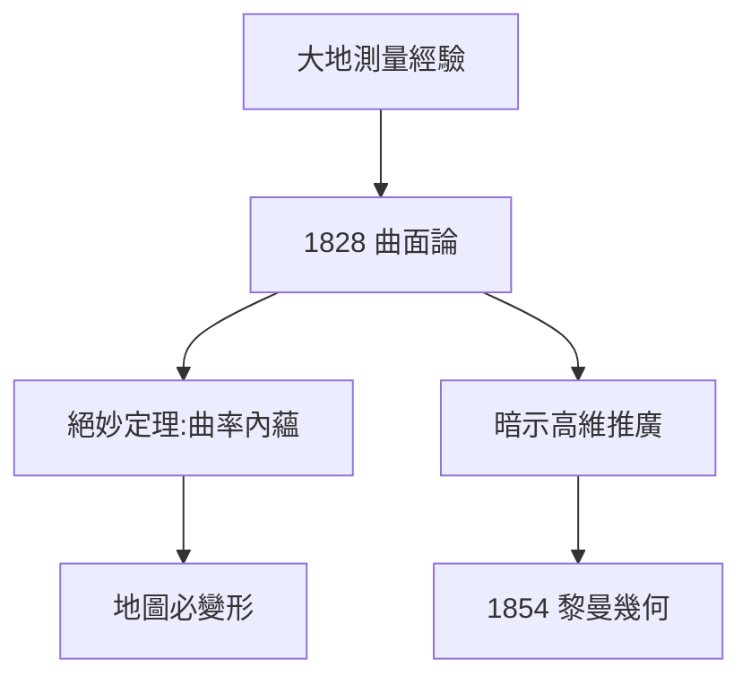

# 4.1 曲面內蘊幾何

## 《曲面的一般研究》（1828）

大地測量的思考結晶為 1828 年的論文，核心是**高斯曲率** $K = \kappa_1\kappa_2$（兩主曲率之積）與**絕妙定理**（Theorema Egregium）：曲率是曲面的**內蘊**量——生活在曲面上的二維生物，無需跳出曲面，就能測出自己世界的彎曲。

## 為什麼「絕妙」

- 之前人們以為彎曲是相對外部空間而言的；
- 高斯證明：只用量曲面上的距離，就能算出曲率；
- 推論：球面的一部分無法無變形地展平成平面（地圖必有變形）——製圖學的數學判決書。

## 通向黎曼

論文結尾，高斯暗示可把理論推廣到「更高維」。這句話被黎曼讀到，成為 1854 年演講的直接起點：$n$ 維流形上的度量

$$ds^2 = \sum g_{ij}\,dx^i dx^j$$

**因果**：從漢諾威群山的三角測量，到「二維生物測彎曲」的思想實驗，再到黎曼的 $n$ 維流形——這是本書最漂亮的一條因果鏈：政府合同 → 幾何革命 → 廣義相對論的數學舞台。
