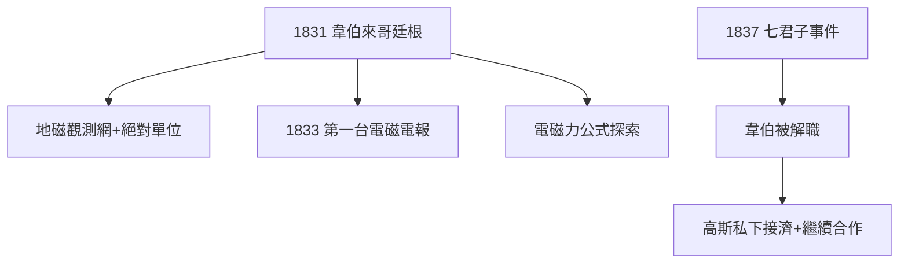

# 4.2 與韋伯的地磁與電報

## 物理學家高斯

1831 年，物理學家威廉·韋伯（Wilhelm Weber）來到哥廷根，兩人一拍即合，合作十年：

1. **地磁學**：建立地磁觀測網，繪製地磁圖，提出地磁單位的絕對測量（「高斯」至今仍是磁感應強度的CGS單位）；
2. **電磁電報**（1833）：在天文台與物理實驗室之間架起 1 公里導線，用電流偏轉磁針傳遞編碼信息——**世界上第一台電磁電報**，比莫爾斯早數年（只是沒商業化）；
3. **電磁力定律**：高斯-韋伯試圖建立與距離、速度相關的電磁作用公式，雖被麥克斯韋取代，卻啟發了後來的電動力學。

## 政治風波

1837 年，漢諾威國王廢除憲法，韋伯等「哥廷根七君子」抗議被解職。高斯沒有公開站出來（他厭惡政治），但私下接濟韋伯，並保持通信合作——友誼經受住了政治考驗。

**因果**：天文台長的「副業」開創了地磁學，還順手發明了電報。更重要的是，這段合作讓高斯晚年保持了對物理的敏感——當黎曼 1854 年談論「物理空間的幾何」時，高斯是全場唯一真正聽懂的人。
