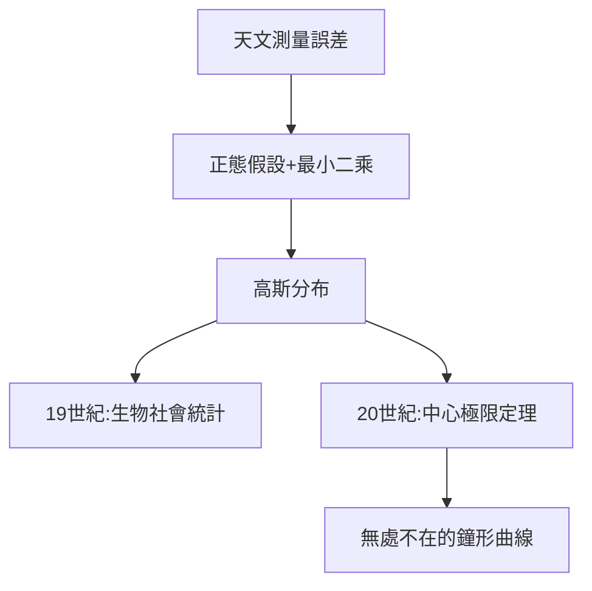

# 4.3 誤差理論與正態分布

## 高斯分布的誕生

在處理天文與測量誤差時，高斯假設誤差服從

$$f(x) = \frac{1}{\sigma\sqrt{2\pi}}e^{-\frac{(x-\mu)^2}{2\sigma^2}}$$

並證明：在此假設下，算術平均是最優估計、最小二乘是最優擬合。這條鐘形曲線從此以他的名字命名——**高斯分布**（正態分布）。

## 從天文到眾生

- 棣莫弗、拉普拉斯早有相關工作，但高斯把它變成實用的數據處理理論；
- 19 世紀末，高爾頓、皮爾遜把它引入生物與社會統計；
- 20 世紀：中心極限定理解釋了它的普適性——它是「大數平均」的宿命形狀；
- 今天：從考試分數到量子漲落，無處不在。

## 方法論的遺產

高斯的誤差哲學是：**承認誤差、量化誤差、馴服誤差**。這與他「 Pauca sed matura」的座右銘一體兩面——不追求無誤差的神話，追求誤差可控的嚴謹。

**因果**：為找回穀神星而發明的數學（2.3），在測量大地時成熟（3.2），最終變成人類處理一切不確定性的通用語言。一個天文學家的工具箱，成了現代統計學的地基。
